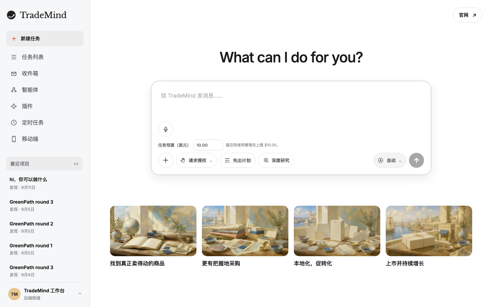
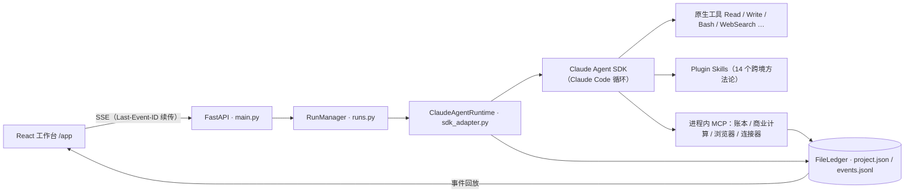

# TradeMind（代码名 OPHIRA）

**跨境电商版的 Codex，对标阿里的 Accio Work。**

给刚起步的出海卖家一个会干活的 Agent：说出想法，它去搜、读、算、写；每个结论挂上来源，
做任何有副作用的事之前先问你。



## 它是什么

- **一个主 Agent，没有固定流程。** 由 Claude Agent SDK 驱动，选品、找供应商、算落地成本、
  写询盘草稿，都由它自己决定用什么工具、什么时候停；没有状态机，默认不限轮数。
- **证据账本。** 网页、浏览器、平台连接器取回的内容由后端签发来源凭证（source receipt），
  `record_evidence` 必须引用凭证，不能自己填 URL；决策回链证据，证据失效联动决策。
- **副作用要人批。** 写账本、对外发送、登录态浏览器操作按风险分级；审批可持久化、
  可跨进程恢复原 Run。
- **可评测。** 4 个基准任务、61 个离线快照门禁、一份从真实轨迹归纳的失败模式分类法；
  judge 未经 gold 校准不进发布门禁。

## 三个关键设计决定

1. **单 Agent、不限轮数、不写状态机。** 按《Agent Harness 教材》三条不变量（一台电脑、
   一个循环、一个窗口）执行，成本保险丝只留预算上限。见
   [`docs/design-decisions-2026-08-23.md`](docs/design-decisions-2026-08-23.md)。
2. **来源凭证由服务器签发，不由模型自填。** 可审计不能靠模型自觉；外部证据没有服务器
   凭证就写不进账本。见 [`docs/project-events.md`](docs/project-events.md)。
3. **4 个确定性计算 MCP 保留。** 落地成本、单位经济性这类要进决策的数字必须走可复现口径；
   评测里抓到过 Agent 心算派生数字的失败模式（FM-06）。见
   [`evals/failure-modes.md`](evals/failure-modes.md)。

## 架构



一次运行的数据流和权限双层防御（`can_use_tool` + `PreToolUse` hook）在
[`AGENTS.md`](AGENTS.md) 的「架构大图」一节。

## 现状，实话

- 真端点验证：DeepSeek Green Path 连续 3 轮通过（2026-09-05），Provider 合约矩阵 9 例通过
  （2026-09-04）；L2 基准 4 个任务各跑过一轮（2026-08-21）。
- 还没有真实卖家、真实店铺账号跑过任务；平台连接器（TikTok Shop、Shopify、Gmail、Outlook）
  只有离线契约验证。
- judge 未校准，gold 未标注。全部要求的交付/未交付状态见
  [`docs/prd-delivery-inventory.md`](docs/prd-delivery-inventory.md)。

## 从这里开始读

- 评测体系与失败模式：[`evals/README.md`](evals/README.md)、[`evals/failure-modes.md`](evals/failure-modes.md)
- 产品与架构规格：[`docs/OPHIRA-PRD-and-Technical-Architecture-v2.3.md`](docs/OPHIRA-PRD-and-Technical-Architecture-v2.3.md)
- 工程规则与红线：[`AGENTS.md`](AGENTS.md)

---

## 功能清单（按界面入口）

The repository now contains two connected React surfaces:

- `/` — the TradeMind marketing site and product story.
- `/app` — the interactive AI global commerce workspace.

The product rail also opens Agents (`/app/agents`), a Plugins hub (`/app/plugins`)
with Skills and Connectors sections, Scheduled tasks (`/app/schedules`), and Mobile
trusted-device pairing (`/app/mobile`). Companion access is disabled until a
same-origin HTTPS deployment is configured; optional Web Push additionally requires
operator VAPID configuration and explicit browser subscription.
See [`docs/mobile-companion.md`](docs/mobile-companion.md).

Choose **Plan first** in the workspace to run SDK native plan mode. The Agent can
inspect project files and public sources, then presents steps, tools, external
actions and a cost estimate for review. Planning exposes no MCP server or shell/file
write tool. **Approve and execute** or **Request revised plan** continues the exact
reviewed SDK session; normal business-action approvals still apply during execution.
Live Provider and browser acceptance remain open in the PRD delivery inventory.

Human approvals now persist through native SDK deferral and resume the original
Run across control-plane workers; see [`docs/durable-approvals.md`](docs/durable-approvals.md).
The workspace also shows SDK-measured context occupancy and can request native
same-session `/compact`; see [`docs/context-compaction.md`](docs/context-compaction.md).
Scheduled runs can retain scoped, traceable task experience without changing user
policy or global memory; see [`docs/task-experience.md`](docs/task-experience.md).
Manual and automatic schedule triggers now share cross-process overlap checks;
see [`docs/schedule-overlap.md`](docs/schedule-overlap.md).
Project event triggers can start budgeted Runs from signed webhooks, direct
Mailgun inquiries, normalized email events, and Shopify orders; see
[`docs/event-triggers.md`](docs/event-triggers.md).
Run-bound evidence and decisions now emit recoverable ledger observations; the
workspace drains the complete Run event tail before closing its stream.
See [`docs/project-events.md`](docs/project-events.md).

Manual project changes, schedule outcomes and Provider preflights now have
independent durable event streams, including authorized replay and recovery.
See [`docs/scoped-events.md`](docs/scoped-events.md). Native streaming and resumed
SDK cost accounting are exercised in [`docs/sdk-accounting.md`](docs/sdk-accounting.md).

Shared projects now include member management and durable discussions with replies,
source/version anchors, edit history, and conflict checks. See
[`docs/project-collaboration.md`](docs/project-collaboration.md) for role boundaries
and local versus organization sign-in behavior.

Open **Project templates** to save a reviewed project brief and fixed reference-file
versions, inspect history, and create a separate project with customized settings.
Interrupted creations retain reviewable recovery records. See
[`docs/project-templates.md`](docs/project-templates.md) for ownership, copied material
and cold-backup boundaries.

Tenant Skills keep immutable, content-addressed package history with per-run snapshots,
version inspection, reviewed rollback, bounded storage, and active-session-safe runtime
leases. Workspace results can also render typed evidence, decision, and artifact cards
whose factual fields are joined from the server ledger rather than authored by the model.

**Skills → Private repository** adds administrator ZIP import review, frozen file
inspection, disabled publication with durable receipts, and separately confirmed
enablement or version restoration. Organization members can inspect and download
published packages. See [private Skill repository](docs/private-skill-repository.md)
for API changes, single-deployment scope and recovery limits.

**Plugins → Import a plugin package** accepts Claude plugin ZIPs with Skills and
remote MCP declarations. Skills enter the private review flow one by one; MCP
addresses require separate project review; subagent definitions are reported and
ignored. See [plugin imports](docs/plugin-imports.md).

All 13 built-in Skills include evidence guides and editable artifact templates that
travel with the immutable package snapshot; see [`docs/skill-resources.md`](docs/skill-resources.md).
The local [Skill backup and restore exercise](docs/skill-backup-exercise.md) verifies
independent copies, historical pins, disabled versions, and rejected corrupt restores.
The operator [application cold backup](docs/application-backup.md) captures the complete
data directory with its Plugin, verifies project/Run/proposal/receipt links, and restores
into a new directory with reviewed publication recovery. Stop the application before
backup; restoration does not start jobs or model sessions.
The commerce MCP also calculates cash balances and peak funding gaps from explicit
settlement schedules, distinguishing daily closing balances from a conservative
intraday bound; see [`docs/cashflow.md`](docs/cashflow.md).

**Plugins → Connectors** now includes official onboarding links for SHEIN, Temu,
TikTok Shop, AliExpress, Shopee and Shopify. TikTok Shop has a seller-authorized shop and
product reader with pagination, scoped credentials and revoke/reconnect controls.
Shopify reads one store in the app's Dev Dashboard organization through the client
credentials grant (24-hour tokens kept in memory): shop details, products and recent
orders without customer identity, guided by the `shopify-store-review` Plugin Skill.
Project administrators can grant one shop for a fixed duration; the main Agent
can then read that shop and cite server-issued source receipts when recording evidence.
The other four adapters and live seller certification remain open; see
[`docs/marketplace-connectors.md`](docs/marketplace-connectors.md).

**Plugins → Connectors** also has a project-scoped remote MCP directory and an
advanced HTTPS address form. A live tool-list review is required before use;
each discovered tool can be allowed, asked every time, or denied. Custom hosts
require organization approval. The advanced form also supports browser OAuth
with an explicitly approved issuer and server-side token refresh. Reviewed
remote tools run through a pinned MCP
gateway; live endpoint/Provider acceptance is still pending. See
[`docs/user-mcp.md`](docs/user-mcp.md).
The directory includes a HubSpot CRM OAuth entry. It requires a HubSpot-created
MCP connector and only registers known read tools after consent and live review;
real HubSpot account acceptance remains open.

**Plugins → Connectors → WeChat** supports official QR pairing and explicitly
enabled, project-bound direct text messages from the scanning user. Results use
the same main Agent and durable reply obligations. Tokens stay private, changing
the binding invalidates old replies, and uncertain sends are not retried.
Real-account and group @ acceptance remain open; see
[`docs/weixin-channel.md`](docs/weixin-channel.md).

Open **Project run metrics** in a saved workspace to inspect recent execution,
latency, observed cost estimates, and Provider/Skill/tool groups. Missing data stays
explicit; see [`docs/project-metrics.md`](docs/project-metrics.md).

Deep Research runs also show frozen budget/deadline limits, native research-unit
activity and reported task usage. See [`docs/deep-research-resources.md`](docs/deep-research-resources.md)
for the source-merge contract and the distinction between SDK estimates and billing.

Open **Project knowledge** in a saved workspace to search registered text files and
OCR Markdown, inspect source lines and version provenance, and download a freshly
hash-checked source. Coverage gaps stay visible; matches are reference material and
do not automatically become verified evidence. See
[`docs/project-knowledge.md`](docs/project-knowledge.md).

Open **Project files** to download exact saved versions, inspect their history,
and preview/edit text with conflict checks. New registrations preserve immutable
bytes; user edits retain the prior version and become searchable project files.
See [`docs/artifact-versions.md`](docs/artifact-versions.md) for supported formats,
interrupted-edit recovery and the availability boundary for legacy versions.

Open **Workspace recovery** to review and restore a complete supported file tree
saved before a Run, including files changed by Bash. Recovery preserves the current
workspace as another recovery point and retains project truth and version history.
See [`docs/workspace-recovery.md`](docs/workspace-recovery.md) for the review flow,
interrupted directory swaps, concurrent-run protection and capacity limits.

Open **Project export** to review and download a project ZIP with saved files,
visible conversations, provenance and project records. Downloads recheck the reviewed
fingerprint and current owner/admin authority. Credentials and browser login profiles
are excluded; this is a portable record archive, not runtime restoration. See
[`docs/project-export.md`](docs/project-export.md) for contents, limits and verification.

PDF/image uploads produce bounded Markdown companions with honest extraction
diagnostics; optional local PaddleOCR-VL setup and remaining quality checks are in
[`docs/ocr-ingestion.md`](docs/ocr-ingestion.md). Result/evidence feedback now has
exact ledger anchors, human review and explicit unlabeled evaluation-candidate
export; see [`docs/feedback-loop.md`](docs/feedback-loop.md).

### Run locally

Start the backend from the repository root:

```bash
python3.11 -m venv .venv
.venv/bin/pip install -e './backend[dev]'
cp backend/.env.example backend/.env
.venv/bin/uvicorn ophira_backend.main:app --app-dir backend/src --reload
```

To enable the Playwright browser ladder, install its optional dependency and
managed Chromium binary once:

```bash
.venv/bin/pip install -e './backend[dev,browser]'
.venv/bin/playwright install chromium
```

Set an Anthropic API key in `backend/.env`, or pair `ANTHROPIC_BASE_URL` with the
provider credential and model for an Anthropic-compatible gateway. DeepSeek, Kimi,
GLM, and Qwen examples are documented in [`docs/model-providers.md`](docs/model-providers.md).
The backend passes this configuration directly to Claude Code; it does not translate
requests through an OpenAI-compatible API. Then start the frontend in a second terminal:

```bash
cd frontend
npm install
npm run dev
```

Open `http://localhost:5173/app`. Vite proxies `/api` and the SSE stream to `http://127.0.0.1:8000`. For separate deployments, copy `frontend/.env.example` and set `VITE_OPHIRA_API_URL` to the backend origin.

### Verify

```bash
# backend（若刚移动/重命名过仓库，先 python3.11 -m venv .venv --clear 重建 venv）
.venv/bin/ruff check backend/src backend/tests
PYTHONPATH=backend/src .venv/bin/pytest backend/tests

# frontend
cd frontend
npm run test:run
npm run lint
npm run build
```

### Current verification boundary

The full PRD delivery inventory, including unimplemented and externally unverified
requirements, is tracked in [`docs/prd-delivery-inventory.md`](docs/prd-delivery-inventory.md).

Settings → **Memory review** supports JSON export, expiry and renewal, disabling,
and confirmed permanent deletion. Cross-process transactions keep concurrent updates
and deletion recovery consistent. See [memory governance](docs/memory-governance.md)
for the live-store and backup boundaries.

Saved projects also provide **Project shops**: configure a shop identity and optional
platform Connector, open its independent login browser, confirm the signed-in shop,
then let the main Agent collect source-linked page captures and reports. The window
runs on the backend computer. See [setup, grants and verification](docs/shop-browsers.md).

- The native durable-approval path passed three consecutive real DeepSeek Green Path
  rounds on 2026-09-05 (local time), archived at
  `evals/reports/greenpath-20260906T044246Z/`. This includes same-Run deferred tools,
  denial followed by continuation, exact SSE replay, and conversation resume.

- The current nine-case DeepSeek Provider contract matrix was rerun against the real endpoint on
  2026-09-04 with Claude Agent SDK 0.2.143: text streaming, served-model identity,
  file tools, Bash, MCP, Plugin Skill discovery, and native WebSearch passed. Vision
  remains unavailable and invalid credentials still rely on the bounded preflight
  timeout instead of an SDK fast failure.
- The archived real-endpoint bundle `evals/reports/greenpath-20260904T082202Z/`
  passed three consecutive DeepSeek Green Path rounds with actual Plugin Skill invocation,
  Read/Web/MCP/Bash/Write/Edit coverage, same-run source-receipt Evidence, permission
  deny-then-continue, SSE replay, and session resume. It does not prove a real commercial
  connector side effect or production multi-tenancy.
- Real Chromium L1 and Chrome-CDP L2 smoke acceptance passed on 2026-09-03; the
  archived reports are `evals/reports/browser-l1-20260903T093547Z.json` and
  `evals/reports/browser-l2-20260903T093647Z.json`. They prove browser capture and
  screenshot/Evidence/Artifact/source-receipt persistence, not model quality or GUI L3.
- The autonomous standing-intent watcher, Feishu Run/reply delivery with durable
  channel identity binding, trusted-gateway principal/project authorization,
  governed memory lifetime/export/deletion, and the reviewed commercial
  `send_message` adapter are implemented and covered locally.
- No real Feishu tenant or authorized commercial test account has completed those
  external E2Es. The trusted gateway is a single-deployment-tenant principal boundary,
  not production multi-tenancy; `/api/auth/status` remains `multi_tenant: false`.
- The executable offline Snapshot gate currently contains 61 cases. It does not replace
  the still-required real commercial-connector Opportunity-to-Action E2E.

真端点验收（花钱，环境变量门控）：Green Path 3 连过与 Provider 合约测试见
[`backend/README.md`](backend/README.md)；评测体系与报告见 [`evals/README.md`](evals/README.md)。

The workspace keeps illustrative examples as an empty-state, then switches to the durable backend project ledger as soon as a live analysis starts. Commercial conclusions still require verified sources and user review.
