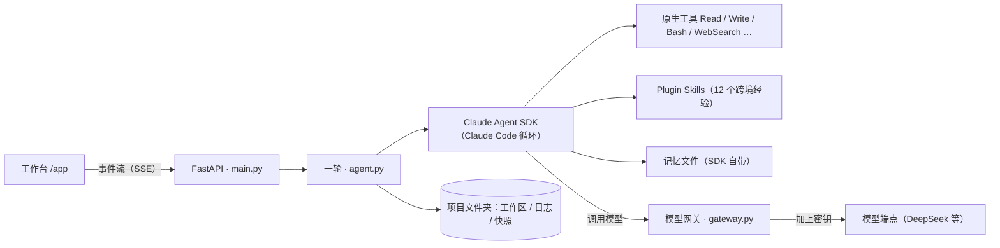

# TradeMind

**跨境电商版的 Codex，对标阿里的 Accio Work。**

给刚起步的出海卖家一个会干活的 Agent：说出想法，它去搜、读、算、写；每个结论挂上来源，
删文件、对外发送之前先问你。

## 它是什么

- **一台电脑。** 每个项目一个工作区。Agent 在里面读写文件、写 Python 算数做表、跑命令；
  命令在 Claude Agent SDK 的沙箱里执行。
- **一个循环。** Claude Agent SDK 驱动，没有状态机、不限轮数。用什么工具、什么时候停，
  由它自己决定。
- **一个窗口。** 一个项目就是一段连续的对话。值得以后记住的事，Agent 自己写进记忆文件
  （SDK 自带的记忆）。
- **人把关。** 删除文件、对外发送要你点头；拿不准的时候，它用选择题问你。每一轮开始和
  结束都会给工作区拍一次快照。

## 三个关键设计决定

1. **单 Agent、不限轮数、不写状态机。** 按一台电脑、一个循环、一个窗口执行，成本保险丝
   只留预算上限。
2. **代码只待在四个位置。** Agent 启动前的准备（工作区快照、PDF 转文字）、基础设施
   （模型网关、预算）、只管拦截的钩子（写不出项目、删除交给人）、人点头之前的等待。
   其余全部交给 Agent。
3. **Agent 拿不到模型密钥。** 它通过本机的模型网关调用模型，网关在出口才加上真实密钥；
   Agent 的环境里只有一个本机令牌。

## 架构



细节在 [`docs/ARCHITECTURE.md`](docs/ARCHITECTURE.md)。

## 现状，实话

- **2026-11-26 重建。** 后端从 173 个模块、75,816 行减到 6 个模块、约 1,100 行；前端只留
  首页和一个对话工作台。重建前的代码在 tag `archive/pre-rebuild-2026-11-26`。
- **怎么验证的。** 后端 49 个测试，其中一个用真实的 Claude Code CLI（SDK 0.2.143 自带）
  对着本机的脚本化模型跑完两轮：工具、钩子、审批、追问、记忆、会话续传，不花钱。前端
  14 个测试，并在 Chromium 里完整走过一遍。
- **还没有真实卖家跑过任务**；重建后也还没用真实模型端点跑过。各家端点以前的实测结果在
  [`docs/model-providers.md`](docs/model-providers.md)。
- **平台连接器不在这一版**（Shopify、Shopee、Temu 等），等有真实卖家账号再按需加回来。
- **图片**：DeepSeek 的端点会静默丢掉图片。上传的图片目前只作为文件交给 Agent。

## 本地运行

```bash
# 后端（Python 3.11）
python3.11 -m venv .venv && .venv/bin/pip install -e './backend[dev]'
cp backend/.env.example backend/.env   # 填模型端点和密钥，见 docs/model-providers.md
cd backend && ../.venv/bin/uvicorn ophira_backend.main:app --app-dir src --port 8000

# 前端
cd frontend && npm ci && npm run dev   # http://localhost:5173/app
```

## 从这里开始读

- 架构与接口：[`docs/ARCHITECTURE.md`](docs/ARCHITECTURE.md)
- 模型端点：[`docs/model-providers.md`](docs/model-providers.md)
- 工程规则：[`AGENTS.md`](AGENTS.md)
- 线上部署：[`deploy/shared-box/README.md`](deploy/shared-box/README.md)
