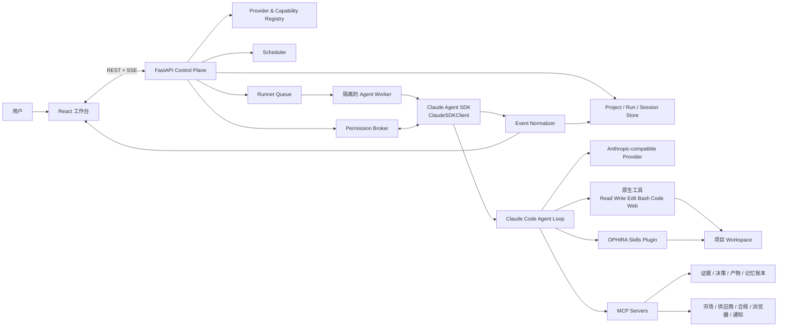

# OPHIRA AI PRD 与技术架构 v2.3

> 文档状态：Draft v2.3（2026-09-19）；上一版 v2.2 原样保留在 `OPHIRA-PRD-and-Technical-Architecture-v2.md`
> 研究基线：通用 Agent 品类 2026-09-19（v2.2 为 2026-08-20，v1.1 为 2026-08-05）；实现状态以 §3.8 为准（2026-09-04 增量复核，2026-09-19 按交付清单补充）
> 产品方向：跨境电商版的 Codex，面向出海小B（对标阿里的 Accio Work）
> 架构基线：Claude Agent SDK 单主 Agent，保留 Claude Code 原生能力
> 本文合并 PRD 与技术架构；产品需求、架构约束和验收标准共同构成范围基线。

## v2.2 → v2.3 主要修订（2026-09-19）

依据：`general-agent-benchmark-2026-09-19.md`（五家通用 Agent 逐项对比，各家官方文档 2026-09-19 核实）、`prd-review-2026-09-19.md`（审查清单与用户决定）、`prd-delivery-inventory.md`（交付清单）。v2.2 原文件保留，不删除。

| # | 修订 | 依据 |
|---|---|---|
| 1 | **品类基线重写**：§2.6 从四家扩到五家，补上 Claude Code；改成逐项能力对比，核实日期 2026-09-19；§9 参考资料同步 | 对比文档；v2.2 的基线停在 2026-08-20 |
| 2 | **差异化说法更正**：差异位从「可审计」改为「业务结论能追溯到证据」（§2.6）；「定时任务不依赖本机开机」改为云端形态的目标（§3.4、§3.9）；§3.4 注明差异化表只对 Accio 成立 | 五家里四家都能审计；五家都能在云端运行；当前部署本地优先 |
| 3 | **新增 FR-29～FR-41**：计划模式、任务进度清单、运行中插话纠偏、并行任务列表、用户接入 MCP 与连接器目录、上下文用量、会话检索、首次使用引导、事件触发、钉钉和企微、插件导入、语音输入、发布网页；FR-25 增补手机端实时进度和插话；§3.6、§3.7、§4.14、§5 同步 | 对标缺口；首次使用引导来自目标用户（出海小白） |
| 4 | **优先级统一**：FR-20 只保留 L1/L2（P1），L3 拆为 FR-42（P2）；FR-22 组织治理改为 P2；会话检索定为 P1 | 用户 2026-09-19 拍板 |
| 5 | **现状补齐**：09-04 之后交付的功能写进 FR 表现状（运行花费显示、工作区快照、产物版本、Skill 导入与提案、店铺只读连接器、授权模式、Deep Research 资源面板、Web Push）；新增已交付的 FR-43 项目协作与模板、FR-44 项目知识库；§3.7 P2 清单移走已完成项 | 交付清单 |
| 6 | **「明确不做」补四条理由**：Agent 团队、跨厂商自动切换、命令行和 IDE 入口、用户可配置 Hooks | 用户 2026-09-19 拍板 |
| 7 | **事实更正**：内置 Skill 从 4 个改为 14 个（§4.7）；MCP 为 11 个进程内 server、43 个领域工具，另有预检专用的 health server（§4.6）；自主 watcher 状态统一为已实现本地闭环（§3.7）；不再要求兼容旧版四维数据（§4.11、§7）；复核日期统一 | 代码核对：`constants.py`、`backend/ophira-capabilities/skills/` |

§2.1 是 2026-08-20 的历史检查点，其中的数字（4 个 Skill、21 个工具、32 种事件）保持原样。

## v2.1 → v2.2 主要修订（2026-08-23/24）

用户拍板：**《Agent Harness 教材》为最终权威，凡与教材冲突的条款一律按教材修正**（一个主 Agent 对结果负责；普通模式只允许极少量 SDK 原生、一次性、只读支线；不设轮数上限）。全量逐条审计见 `textbook-audit-2026-08-24.md`，决策论证见 `design-decisions-2026-08-23.md`。

| # | 修订 | 依据 |
|---|---|---|
| 1 | **不设轮数上限**：`max_turns` 默认 None，成本熔断 `max_budget_usd` 是唯一保险丝；Deep Research 子代理同步去掉 maxTurns（§4.4、§4.8、§4.10 包络原则） | 教材"一个循环"不变量：让模型自己决定何时结束 |
| 2 | **沙箱内 Bash 自动批准**：恢复 SDK 原生默认 `autoAllowBashIfSandboxed=True`，另加 `failIfUnavailable=True`；hook 只拦逃逸沙箱；人把关只留账本写入/对外发送的 MCP ask 层（§4.10、FR-13、§6.1） | 教材"一台电脑"+第 09 章判据（动作副作用被沙箱围住）；消除 FM-01/FM-02 打断来源 |
| 3 | **普通模式子代理终版口径**：始终由一个主 Agent 负责；只在上下文隔离确有价值时极少调用 SDK 原生一次性只读支线；不定义固定角色团队。代码级禁止支线写账本、提交自动化承诺或再派生（§4.4、§4.8、§6.1） | 2026-08-24 用户终版拍板"按原生能力来做"；教材第 04 章 |
| 4 | **Green Path deny 探针移层**：Bash 不再产生权限请求，deny→continue 探针改为 marker Write（§6.2） | 修订 2 的连带修正 |
| 5 | 每 run 变化的 project_id/trace_id 移至系统提示词末尾，保 prompt cache 前缀稳定 | 教材第 13 章 cache 判据 |
| 6 | 评测代码归属口径（判定逻辑住 `evals/`、驱动脚本住 `backend/scripts/`）；数据反馈闭环立项（`P2-feedback-loop-spec.md`） | 教材第 12/13 章 |

## v2.0 → v2.1 主要修订（2026-08-20，同日）

| # | 修订 | 依据 |
|---|---|---|
| 1 | **品类定位对齐**：Accio Work 官方定位＝"外贸人的 OpenClaw / 专为中小企业打造的跨境生意工作台"；新增常驻 Agent 平台品类基线（Claude Cowork / OpenClaw / Hermes Agent / Codex 四原型调研，§2.6） | 用户提供官方定位 + 四平台官方文档核实 |
| 2 | **单 Agent 红线细化（历史中间态）**：2026-08-20 曾暂缓普通模式只读支线；该表述已被 2026-08-24 终版取代：普通模式可极少调用 SDK 原生一次性只读支线，固定角色团队仍禁止（§1.1、FR-01、§4.8） | Cowork/Codex/Claude Code 均原生具备；上下文经济学需要 |
| 3 | **主动服务与渠道提级（用户拍板 IM 形态）**：IM 渠道按 Claude Tag 形态、心跳巡检、前瞻意图、通知收件箱、移动远程审批（FR-15/24/25/26、§4.16） | 品类五件套 table stakes；Accio Mobile Beta 实证 |
| 4 | **记忆蒸馏提案化**：后台蒸馏 + 人审闸门 + 结构化溯源分级 + 容量上限（FR-14、§4.16） | OpenClaw Dreaming / Codex Memories / Hermes 容量上限 / Cursor 记忆反转教训 |
| 5 | **GUI 三级能力阶梯与"截图即证据"**（FR-20；2026-08-21 拍板将三级全部纳入目标范围、运行时按任务选；当前实现状态见 §3.8） | 逆向实证：Claude Desktop 与 Codex 均三级全装（内嵌+接管+OS级），大厂无一"三选一" |
| 6 | **权限增补**：删除文件任何模式必须确认、Auto 自审档、once/session/persistent 粒度（§4.10） | Cowork 误删 11GB 事故铁律等品类实证 |
| 7 | **产物补洞**：图像/视频生成 MCP（FR-27） | Accio/Codex 均有；跨境 Listing 素材刚需 |
| 8 | **全量核对补丁**：办公格式产物（FR-16）、首批连接器矩阵（FR-21）、结构化追问表单（FR-28）、内容营销 Skill 族（§4.7） | 对 Accio Work 功能清单逐项核对后的残余项 |
| 9 | **自动化评测体系**（§3.11、§6.6）：三层评测金字塔 + 错误分析先行 + judge 必经 gold 校准（TPR/TNR）方进发布门禁 | 用户拍板；"可审计"承诺必须可度量 |

## v1.1 → v2.0 主要修订

| # | 修订 | 依据 |
|---|---|---|
| 1 | **差距分析全面重写**：v1.1 §4.14 所列问题大部分已在仓库工作树中修复（presets、Provider Registry、单 Agent 化、插件 Skills、5 个 MCP server），但**关键改动全部未提交**，且**从未在真实模型端点上跑通**（历史 12 次运行全部 401） | 本地仓库工作树 2026-08-20 实测（时为 `Ophira-ai`，当日更名为 `Open-Acciowork`） |
| 2 | **Provider 生态扩容与代际更新**：官方 Anthropic 兼容端点从 4 家扩展到 8+ 家（新增 MiniMax、百度千帆、腾讯混元、火山方舟）；模型全面换代（DeepSeek v4、Kimi k3、GLM 5.x、Qwen 3.5–3.8、MiniMax M3）；阿里/智谱 Coding Plan 禁止应用后端的条款已拿到原文 | 各厂商官方文档逐一 fetch 核实（§4.9、§9） |
| 3 | **SDK 能力刷新**：Python SDK 0.2.82 → 0.2.142；吸收 `sandbox`、`max_budget_usd`、`session_store`、`output_format`、`thinking/effort`、官方多租户隔离指引、OTel 可观测性；明确 `setting_sources=[]` 与 skills 发现的边界 | code.claude.com 官方文档 + PyPI/npm（§2.3、§4.4） |
| 4 | **竞品档案完整化**：Accio Work 2026-03-23 正式发布，>10M MAU、230K+ 企业部署；完整工具/权限/记忆/定价/更新日志档案；已知投诉（积分消耗、疑似跨账户数据泄漏）转化为 OPHIRA 差异化机会 | Accio 官方文档全文 + PRNewswire/Caixin/MIT TR 等（§2.2、§3.4） |
| 5 | **新增架构注意事项**：原生 WebSearch/WebFetch 属 Anthropic 服务端工具，在第三方端点上可能不可用（Kimi 已明确不支持 WebFetch），必须有 MCP 检索降级路径 | Kimi 官方文档 + 合约测试矩阵（§4.9） |

---

## 1. 结论先行

OPHIRA 的核心产品场景是：让跨境小商家从任何一个模糊的全球商业目标出发，启动一个能够持续推进工作的商业 Agent。目标既可以来自需求侧（"哪里正在需要某类商品"），也可以来自供给侧（"我能稳定供应这些产品，应该卖到哪里、找到谁"）。Agent 不只给一段泛泛建议，而是能自己搜索、阅读、计算、整理文件、调用商业数据工具、生成报告与表格、保留证据，并在需要产生真实副作用时请求用户授权。

产品定义不变：

> **OPHIRA 是跨境电商版的 Codex，面向出海小B，对标阿里的 Accio Work。一个主 Agent 从市场需求、现有供给或商业目标中的任意一点出发，按需调用原生工具、Skills 和 MCP，把分散信息转化为可追溯的判断、可编辑的交付物以及走向客户与成交的下一步行动。**

"一个 Agent"仍是产品和架构的共同原则：常规任务不拆成研究、供应、资金、销售等固定角色，也不实现固定节点工作流。四个维度作为 Agent 可按需调用的商业分析 Skill 和证据标签存在，而不是用户每次都必须穿过的流程。

截至 2026-09-04，单主 Agent、账本、可信网关 principal/项目权限和多数控制面已有本地代码/测试；DeepSeek 真端点 Provider 合约七项核心用例通过，随后固定 Green Path 连续 3 轮通过，实证同一主 Agent 的原生工具、Plugin Skill、MCP、权限、账本、SSE 与会话恢复链路；Browser L1/L2 也已分别通过真实 Chromium 与 Chrome-CDP smoke acceptance。仍未证明的是“真实 Provider + 真实商业 connector 副作用”的整条闭环、真实飞书租户、真实媒体生成商和 Office 可视质量；全局 store 尚未物理分租户，`multi_tenant=false`。Phase 0 的剩余工作是接通这些尚缺的真实依赖并证明，不能用单元测试数量替代。

### 1.1 不可妥协的架构红线（与 v1.1 一致）

| 红线 | 设计与验收口径 |
|---|---|
| 核心 Agent 只能使用 Claude Agent SDK | 所有业务会话均由 `ClaudeSDKClient`/`query()` 驱动 Claude Code agent loop；禁止另写模型循环 |
| 不允许直连模型替代 SDK | 业务代码不得用 OpenAI SDK、Anthropic Client SDK 或裸 `/v1/messages` 实现核心 Agent；不得以"兼容性"为由回退 |
| 不使用固定编排框架 | 不引入 LangGraph、LangChain、Dify 或自研状态机来决定下一步；由主 Agent 结合上下文自主选择工具和 Skill |
| 保留 Claude Code 原生能力 | 使用 `claude_code` tools preset，保留 Read、Write、Edit、Bash、代码执行、Glob、Grep、WebSearch、WebFetch、Skill 等能力；权限控制不等于删除能力 |
| 常规任务单主 Agent，禁角色型团队 | 一个主 Agent 对结果负全责；普通模式仅在上下文隔离确有价值时极少调用 SDK 原生一次性只读支线，且代码级禁止其写账本、提交自动化承诺或再派生；任何模式均无固定角色团队；Deep Research 是显式重模式 |
| 领域能力用官方扩展点 | 外部系统和确定性动作封装为 MCP；方法论封装为文件型 Skill；复杂处理由原生 Bash/代码执行或 Skill 附带脚本完成 |
| 国产模型只走 Anthropic 协议 | 通过每个厂商官方 Anthropic-compatible Base URL 和 Key 配置 Claude Agent SDK；项目内不实现 OpenAI 格式适配器 |
| 证据与副作用可治理 | 事实必须带来源、时间和置信度；写文件、执行命令、登录态浏览器、外发消息等按风险分级并可由用户授权 |

任何不满足以上红线的实现，即使功能表面可用，也不算 OPHIRA 目标架构。

---

## 2. 研究范围与事实基线

### 2.1 本地仓库历史基线（2026-08-20；已由 §3.8 的当前复核取代）

以下内容保留为 2026-08-20 的历史检查点，不代表当前实现状态；当前能力与缺口以 §3.8 的 2026-09-03 增量复核为准。权威仓库：`github.com/Janettbella69/Open-Acciowork`（2026-08-20 由 Ophira-ai 更名），本地克隆 `/Users/isabella/Open-Acciowork`。技术栈：FastAPI + React/Vite + Python 3.11。

**已实现（大部分在未提交的工作树中）：**

- `ClaudeAgentOptions` 已使用 `claude_code` tools preset 和 system prompt preset+append（`sdk_adapter.py`），并启用 `sandbox`（v2.2 起 `autoAllowBashIfSandboxed=True`〔SDK 原生默认，2026-08-24 拍板恢复〕、`allowUnsandboxedCommands=False`、`failIfUnavailable=True`）、`enable_file_checkpointing`、`thinking={"type":"adaptive","display":"summarized"}`、`max_budget_usd`、`include_partial_messages/include_hook_events`。
- 四专业 Agent（Opportunity Lead + 需求/供应/资金/销售）**已删除**；普通模式 `agents=None`、`disallowed_tools=[]`（v2.2：原生支线子代理开放，账本写入对子代理代码级拒绝）；Deep Research 模式另注入 3 个只读研究子代理（`source-mapper`/`multilingual-researcher`/`conflict-verifier`，各自禁 Write/Edit/Bash/Agent/Task）。
- 应用托管 Plugin `ophira-core` 已建成（4 个 Skill：`global-opportunity-execution`、`supplier-due-diligence`、`landed-cost-analysis`、`customer-path`，均有合法 frontmatter）。
- 6 个进程内 MCP server 共 21 个工具（`ophira_ledger`/`supplier`/`customer`/`commerce_math`/`web`/`automation`），`strict_mcp_config=True`，工具描述统一带"不代替商业判断"声明（v2.2 收敛至教材"20 个左右"口径：legacy 视图工具已删、market 域并入账本，见 §4.6）。
- Provider Registry + 文件密钥库（0600/0700 + 原子写）+ SDK 预检（真实 `query()` 路径，断言 Skill 发现与 MCP health 调用）+ 8 类错误码分类已实现（`providers.py`）。
- 凭据隔离：`ANTHROPIC_API_KEY`/`ANTHROPIC_AUTH_TOKEN`/`CLAUDE_CODE_OAUTH_TOKEN` 先置空再注入所选 Profile 唯一凭据；每 Profile 独立 `CLAUDE_CONFIG_DIR`（0700）；`CLAUDE_CODE_DISABLE_AUTO_MEMORY=1`、`CLAUDE_CODE_DISABLE_NONESSENTIAL_TRAFFIC=1`。
- 权限双层防御：`can_use_tool`（写入 workspace 包含检查 + 禁 unsandboxed Bash）+ `PreToolUse` hook（敏感路径黑名单 `.env`/`credentials`/`secrets` 等；**读写围栏分开（v2.2）：Read/Glob/Grep 围栏=项目目录（含账本原始 JSON，兜住 MCP 接口外的意料之外分析），Write/Edit 围栏=工作区**）；沙箱内 Bash 自动批准（v2.2，SDK 原生默认）、逃逸沙箱永久拒绝；权限超时自动 deny。
- 记忆提案—审批—回滚 + MEMORY.md 受控同步（注入上限 8 条/4000 字符）；Scheduler 后端完整（croniter + 时区 + missed-run 策略）；32 种 SSE 事件、单调 sequence、`Last-Event-ID` 续传、全量脱敏。
- `RunRecord` 固化 provider/skill/policy 快照，`extra="forbid"`；`Decision` 已通用化，四维降级为可选 `dimension` 标签（v1.1 目标达成）。

**仍缺 / 风险：**

| 项 | 现状 |
|---|---|
| ⚠️ **工程状态风险（最高优先）** | 25 个文件修改未提交；`providers.py`、`skills.py`、整个 `ophira-capabilities/` 插件目录 **untracked**——一次 `git clean` 即可丢失全部 Phase 0 成果。第一动作是提交 |
| ⚠️ **零运行时证据** | `data/` 中 12 次历史运行 100% 失败，错误一致：`401 OAuth access token has been revoked`（旧代码继承宿主已撤销 OAuth 所致——新 env 隔离代码正是修复，但从未验证）。没有任何一次运行到达过工具调用 |
| 定时任务前端 | 仍是 localStorage 本地草稿（UI 明示 "local draft only"）；后端 Scheduler 与 API client 函数齐备但是死代码 |
| 设置页 | localStorage-only，**完全没有 Provider/Key UI**；`listProviders/saveProvider/preflightProvider` 等 client 函数无人调用 |
| 测试缺口 | 无 E2E/Green Path 测试（run 生命周期测试全部用 FakeRuntime）；`providers.py`、`skills.py`、`preflight()` 零测试；无 Provider 合约测试套件 |
| SDK 版本 | 钉 0.2.82，最新 0.2.142（15 天 60 个版本，变更集未审）；升级必须走合约测试，不盲升。【2026-08-21 已升级钉 0.2.143，见 §2.3】 |
| API 偏差 | 权限落点为 `POST /api/runs/{run_id}/permissions/{request_id}`（非 v1.1 的 `/api/permissions/{id}/resolve`）；记忆为 `POST /api/memory/{id}/decision`；`GET .../evidence`、`POST /api/skills/{id}/test`、connectors 端点未实现；SSE 用 `Last-Event-ID` header 而非 `?after=` |

### 2.2 竞品事实基线：Accio 与 Accio Work

（除标注外均来自 Accio 官方文档 `accio.com/work/documents/en/*.html` 全文与官方 changelog；详见 §9。）

**主体与规模**：Accio 由阿里国际（AIDC）出品。基础 Accio 是 2024-11 发布的 AI B2B sourcing 引擎；**Accio Work 于 2026-03-23/24 发布**，桌面优先 + Web 双入口（2026-08-21 一手核实官网 accio.com/work 首屏：并列 "Download for macOS"（macOS 11+，Apple Silicon）与 **"Try in browser"** 两个按钮）。桌面端是 Electron；官方另强调 "all tool execution — file operations, terminal commands, browser actions — runs on your own device"，即**本机执行类能力绑定桌面端，Web 入口为功能缩减版**。注意与同名基础版 Accio 区分（2024-11 的 B2B sourcing 引擎，另有 iOS/Android），官方主标语 "Your AI Business Team That Turns Ideas Into Profits"。截至 2026-03 全球 **>1000 万 MAU**（约每 5 个 Alibaba.com 用户中 1 个）；截至 2026-04 **23 万+ 企业**部署了 Agent 团队。商业化未定论——阿里高管公开承认"还没有清晰的变现答案"（MIT Technology Review, 2026-04）。

**能力面（官方文档口径）**：

- 工具：文件检索/读写（PDF/DOCX/XLSX/PPTX）、终端命令、定时任务（本地执行，关机不跑）、Web 搜索/抓取、AI 图像与视频（Beta）、浏览器接管、多 Agent 消息与群管理、B2B 平台供应商搜索。
- 浏览器：接管用户**真实 Chrome 登录态**（扩展 "Accio Browser Relay" 或 CDP 直连 Beta），真实设备指纹与住宅 IP；本地 127.0.0.1 中继、受控标签页可视标识、默认审批、登录墙前强制停手。
- 权限：allow / ask / ask_once / deny 四态；规则维度=路径前缀/命令前缀/域名；授权粒度 once/session/persistent；决策审计 `permissions/audit.jsonl`；workspace 白名单 + realpath 防符号链接逃逸；支付与提交订单强制人工批准。
- 记忆：四层——本地向量索引（opt-in）、Diary、MEMORY.md、身份文件（SOUL.md/USER.md/IDENTITY.md 等按固定顺序拼入系统提示词）；`/dream` 蒸馏管线（手动/每日首条/定时 10:00 与 22:00）。
- Skills：**100+ 阿里预置认证 Skill**（SKILL.md 格式），三层优先级（Agent 私有>账号>内置）；用户可上传自定义包；Agent 会从重复工作流自动造 Skill（"SkillHarvest"）。
- 扩展：插件（连接器+Skills+指令的组合包）、MCP 自定义 Server 注入、OAuth 连接器（Gmail/GitHub/X/LinkedIn/Instagram/Alibaba.com 等）、IM 渠道（Telegram/Discord/钉钉/飞书/微信/企微）。
- 多 Agent：Agent Team（1 TL + 最多 10 成员群聊、@分派并行）；SubAgent 委派（explore/bash/browser/general 四型、最深 2 层）；Agent Hub 市场；7 个内置模板。
- 交付物：报告、多 sheet 表格、批量 Listing、询盘与谈判线程、AI 建站（画布可视编辑+一键发布）、图像/视频、TikTok 脚本分镜、Markdown/PDF/DOCX/PPT 导出、知识库（个人+团队）。
- 定价：免费 20 积分/天；Pro $19.9/月（4,000/月）；Elite $99/月（20,000/月）；Ultra $199/月（40,000/月）。**多厂商模型市场按倍率计积分**：Auto/MiniMax M2.5/Qwen 3 Max = 1x，Claude Sonnet 4.6/Gemini 3.1 Pro/GLM-5/Kimi K2.5 = 2–2.5x，Claude Opus 4.6/GPT-5.2/5.4 = 3–4x——并非 Qwen 独占。
- 典型营销场景：宠物玩具 600 件目标价 <$1 的自动寻源+7×24 多供应商谈判（人批成交）、名片背调、Instagram/Reddit 趋势选品+毛利测算、批量上架、SEO 全流程、竞品视频拆解产 TikTok 脚本、Gmail 报价汇总对比表、100+ 市场 VAT/退税/清关文档（发布会口径）。

**已知投诉与限制**（对 OPHIRA 是定位机会，见 §3.4）：Elite 档积分 24 小时内被简单 RFQ 任务耗尽；Trustpilot 上有**疑似跨账户数据泄漏**投诉（用户看到他人工作流/任务/团队；搜索快照来源，未能直接复核原帖）；缺少供应商报价聚合对比界面；定时任务依赖本机开机；高峰期 Error 555 限流；生态偏 Alibaba.com，弱于 Amazon-FBA/独立站场景。

**与 v1.1 的判断一致**：Accio Work 验证了"专业场景 + 通用 Agent 能力"的需求，其权限四态、记忆分层、SKILL.md 格式与本方案高度同构；但 OPHIRA 不复制其"多 Agent 团队"叙事（那是它的表演层卖点，也是其结果不可追溯的根源之一）。

### 2.3 Claude Agent SDK 事实基线（2026-08-20）

- 版本：**仓库钉 `claude-agent-sdk==0.2.143`**（2026-08-21 由 0.2.82 升级，L1 测试 139 过；区间内唯一破坏性变更 0.2.129 的 skill 名校验不触及本仓）。升级前必须跑 §4.9 合约测试。
  **两条 SDK 版本线不可直接比较**：Python 线 0.2.x（PyPI，145 版）、TypeScript 线 0.3.x（npm，272 版），二者 2025-09 同周首发、同日发布最新版，**捆绑的是同一个 Claude Code 引擎（实测均为 2.1.238）**——agent loop 在引擎里，SDK 只是语言绑定。号差与版本数差是发布颗粒度，不是能力差；真实差距仅在"绑定层暴露了多少参数"（Python changelog 有 15 条 "parity with the TypeScript SDK" 追平记录，均已交付）。**换栈的唯一正当理由**：某个必须用的参数只有 TS 绑定暴露——届时也应只把那一小块写成 MCP server 挂载，而非整体重写。
- `tools`/`system_prompt` 的 `{"type":"preset","preset":"claude_code"}` 写法不变；`system_prompt` 支持 `append` 与 `excludeDynamicSections`。
- **权限语义确认**：`allowed_tools` = 自动批准（不约束 `bypassPermissions` 模式）；`disallowed_tools` 裸名从上下文移除工具、带参数模式（如 `Bash(rm *)`）仅拒匹配调用；判定顺序 hooks → deny → ask → permission mode → allow → `can_use_tool`（前序已放行则回调不触发）。`permission_mode` 现有六值：`default/dontAsk/acceptEdits/bypassPermissions/plan/auto`。
- **Skills 发现边界（v1.1 未写清，易踩坑）**：文件系统 skills（`~/.claude/skills`、`./.claude/skills`）只在 `setting_sources` 含 `"user"`/`"project"` 时被发现；`setting_sources=[]` 时**只能**靠 `plugins`（`{"type":"local","path":...}`，Skill 命名空间 `plugin-name:skill-name`）装载——OPHIRA 恰好用的是后者，此路线正确且已被仓库 preflight 断言验证。SDK 场景下 SKILL.md 的 `allowed-tools` frontmatter **不强制执行**，权限必须在顶层 options/回调做（v1.1 已正确记载，维持）。
- 进程内 MCP：`@tool` + `create_sdk_mcp_server` 仍是现行 API；三种传输 sdk-inprocess / stdio / HTTP+SSE。
- 值得吸收的新能力：`max_budget_usd`（成本熔断，仓库已用；v2.2 拍板**不设 `max_turns` 轮数上限**——"一个循环"口径，预算是唯一保险丝）；`sandbox` 选项（仓库已用）；`session_store`/`session_store_flush`（会话转录外置到 S3/Redis/Postgres——云端 SaaS 阶段的官方答案）；`output_format`（JSON Schema 结构化输出，可用于 run 结果摘要）；`fallback_model`；`thinking`/`effort`；`betas`；`user`（审计标识）；`add_dirs`。
- **官方多租户隔离指引**（hosting 文档）与仓库实现一致：`setting_sources=[]` + `CLAUDE_CODE_DISABLE_AUTO_MEMORY=1` + 每租户 `CLAUDE_CONFIG_DIR` + 每租户 `cwd`；注意 `setting_sources=[]` **不**阻止 auto-memory 与 `~/.claude.json` 的加载，必须配合上述 env 才完整。
- 可观测性：OTel 导出官方支持（`CLAUDE_CODE_ENABLE_TELEMETRY=1` + `OTEL_*` 系列），可替代部分自建指标管道。

### 2.4 Provider 事实基线（摘要，详表见 §4.9）

- 官方 Anthropic 兼容端点已成为国产模型行业标配：DeepSeek、Kimi（开放平台）、GLM/Z.ai、Qwen 百炼、MiniMax、百度千帆、腾讯混元、火山方舟均有官方文档。
- **商用红线已拿到原文**：阿里云 Coding Plan 明文禁止"automated scripts, application backends, or other non-interactive scenarios"；智谱 Coding Plan 明文要求自建应用/网站/机器人/SaaS 走标准 API。OPHIRA 后端一律使用按量付费 API Key。
- 2026 年各家共同口径：接 Claude Code 需钉住**全部**模型档位变量（`ANTHROPIC_MODEL` + `ANTHROPIC_DEFAULT_OPUS/SONNET/HAIKU(/FABLE)_MODEL` + `CLAUDE_CODE_SUBAGENT_MODEL`），不再只设主模型。
- 能力差异显著且必须进合约测试：DeepSeek 不支持图片、未知模型名**静默映射**到 v4-flash；Kimi 端点当前不支持 WebFetch 工具；MiniMax M2.x 仅文本、thinking 不可关；Qwen 无 `/v1/models`、temperature 区间 [0,2)。

### 2.5 明确假设与待验证项（维持 v1.1，两条更新）

- 第一批高价值用户是拥有产品、供给、服务能力或跨境经营目标，但缺少完整专业团队的中国出海小B与精简团队。（Accio 的 10M MAU 与 230K 企业验证了赛道，但其用户构成偏 Alibaba.com 买家，不能直接推导 OPHIRA 的首批用户画像。）
- "发现需求、组织供给、判断可行性、寻找客户、准备成交"可能形成高频任务簇，但用户不会总从需求侧开始，也不会按同一顺序执行。
- 用户愿意提供 BYOK 模型 Key，或接受 OPHIRA 托管模型额度；两种商业模式由相同 Provider Profile 支撑。（Accio 用积分制托管多厂商模型的做法证明托管模式可行，其"积分消耗过快"投诉说明**成本透明**是可攻击的差异点。）
- 平台销量、关键词热度等"实时数据"必须来自授权 API、用户登录态页面或可引用的公开来源；没有数据许可时不得伪装成平台官方实时数据。

### 2.6 通用 Agent 品类基线（v2.3 重写，2026-09-19 核实）

Accio Work 官方对标口径为 "agentic platforms like Claude Cowork and OpenClaw"，市场定位为"外贸人的 OpenClaw / 专为中小企业打造的跨境生意工作台"。OPHIRA 的对标对象是五家通用 Agent：Claude Code、Claude Cowork、Codex、Hermes Agent、OpenClaw。这几家正在收敛成同一个品类；OPHIRA 等于这个通用形态加上跨境电商外壳。

下表按各家官方文档 2026-09-19 核实：✅ 有，◐ 部分有，未见＝查过文档没有，? ＝没查到（不代表没有）。完整的 11 类 53 项对比、每格依据和来源见 `general-agent-benchmark-2026-09-19.md`。

| 能力 | Claude Code | Cowork | Codex | Hermes | OpenClaw | OPHIRA 现状 |
|---|---|---|---|---|---|---|
| 云端运行（关机也能跑） | ✅ | ✅ | ✅ | ✅ | ✅ | ◐ 本地优先，本机后端开着才跑 |
| 计划模式 | ✅ | ? | ✅ | ◐ | 未见 | 未实现（FR-29） |
| 任务进度清单 | ✅ | ✅ | ✅ | ✅ | ✅ | 未实现（FR-30） |
| 运行中插话纠偏 | ✅ | ✅ | ✅ | ✅ | ✅ | 未实现（FR-31） |
| 并行任务列表 | ✅ | ◐ | ✅ | ✅ | ✅ | 部分实现（FR-32） |
| 操作整台电脑 | ✅ | ✅ | ✅ | ✅ | ✅ | 浏览器 L1/L2 已实现；L3 单窗口截图、AXPress、文本替换与有限按键本地实现，真实 OS 动作未验收（FR-42） |
| 用户接入 MCP | ✅ | ✅ | ✅ | ✅ | ✅ | 未实现（FR-33） |
| 插件 | ✅ | ✅ | ✅ | ✅ | ✅ | 部分实现：只有内置插件（FR-39） |
| Skill 自创建 | ◐ 用户发起 | ? | ◐ 演示后生成 | ✅ | ✅ | 已实现：Agent 提案，人审后发布（FR-12） |
| 记忆写入 | 自动 | 自动 | 自动 | 自动，可开人审 | 自动 | 强制人审（FR-14） |
| 会话检索 | ◐ | ✅ | ◐ | ✅ | ✅ | 未实现（FR-35） |
| 事件触发 | ✅ | ? | ✅ | ✅ | ✅ | 部分实现：飞书入站、项目级签名 webhook、规范化询盘和订单事件、Mailgun 收件路由验签、Shopify 订单原生验签与店铺级订阅管理、Gmail Inbox watch/Pub/Sub 增量触发、Outlook Graph Inbox 通知订阅、项目级分发及有界 delta 缺口补偿；旧登记与超界缺口人工核查、其他店铺原生订阅、真实服务验收待做（FR-37） |
| 条件巡检（有变化才通知） | ◐ | ? | ◐ | ✅ | ✅ | 已实现（FR-26） |
| 手机上看进度、插话 | ✅ | ✅ | ✅ | ◐ | ✅ | 部分实现：配对、审批、发起任务（FR-25） |
| 国内 IM | 未见 | 未见 | 未见 | ✅ | ◐ | 部分实现：飞书本地闭环（FR-24、FR-38） |
| 生成图片 | 未见 | 未见 | ✅ | ✅ | ✅ | 部分实现：没配真实生成商（FR-27） |
| 审计 | ✅ | ✅ | ✅ | ? | ✅ | 已实现（FR-13） |
| 多模型厂商 | ◐ | ◐ | ✅ | ✅ | ✅ | 部分实现：只认证了 DeepSeek（FR-05） |
| 证据账本、结论可追溯 | 未见 | 未见 | 未见 | 未见 | 未见 | 已实现（FR-09、FR-10） |
| 对外动作审核（带回执、幂等） | ◐ | ◐ | ◐ | ◐ | ◐ | 已实现（§4.6 `ophira_commercial_actions`） |

两个结论：

1. 常驻、渠道、记忆、主动、进化、审计这六件，五家对标产品大多已具备，是品类标配。OPHIRA 的差异位是**业务结论能追溯到证据**（证据账本 + 结论回链），五家都没有。另外几条对五家也成立的差异：对外动作「暂存 → 审核 → 执行」，带回执和幂等；Provider 预检和合约测试，能断言实际服务的模型；记忆强制人审（Hermes 有同类开关，但默认关闭）；跨境外壳（14 个跨境 Skill、TikTok Shop 和 Shopify 只读连接器、到岸成本等确定性计算）。
2. 各家治理机制几乎都是事故后补的：Cowork 误删用户 11GB 文件后定下「删除永远确认」，ClawHub 被审计出 1184 个恶意 Skill，Codex 出过分支名注入漏洞。OPHIRA 把治理做在第一版是后发优势。机制吸收明细见 §4.16；有意不做的能力见 §3.7「明确不做」。

---

## 3. 产品需求文档

### 3.1 目标用户

#### 核心用户

出海小B与精简商业团队：缺少完整的市场研究、供应链、财务、销售和内容团队，但需要持续判断"世界哪里有需求、我能组织什么供给、这件事是否成立、客户在哪里、怎样走向成交"。

典型特征：

- 信息分散在电商与贸易平台、搜索引擎、社交媒体、供应商/客户页面、聊天记录和本地文件中。
- 决策预算有限，希望先小成本验证，而不是购买复杂企业系统。
- 会提出模糊问题，无法一开始就写出规范的研究任务。
- 不只需要"答案"，还需要市场/客户清单、供给与成本表、询盘或触达材料、风险说明等可继续使用的产物。

#### 次级用户

- 跨境服务商和选品顾问，需要同时管理多个客户项目并保留证据链。
- 有固定品类的品牌/工贸一体团队，需要持续监控市场与供应变化。

#### 暂不优先

- 需要完整 ERP、订单履约和财务总账替换的大型企业。
- 只需要通用聊天、代码编程或个人效率助手的用户。

### 3.2 用户问题

1. **发现难**：不知道哪些信号可信，无法高效覆盖多个市场和来源。
2. **验证难**：存在需求不等于适合自己；供应、毛利、现金占用、合规和获客难度常被遗漏。
3. **执行断层**：研究结论与供应商清单、成本模型、Listing、询盘和测试计划相互割裂。（Accio 用户"缺少报价聚合对比界面"的抱怨正是此问题的实例。）
4. **过程不可追溯**：普通聊天里的结论很快过期，来源、时间、假设和修改记录难以复用。
5. **工具过度结构化**：固定表单和工作流要求用户先理解系统，而不是系统理解用户。
6. **Agent 不可信**：模型凭空给出销量、排名或供应商结论，或者在未经授权时执行外部动作；托管积分制下成本也不可预期。

### 3.3 Jobs to Be Done

当我只有一个模糊的跨境商业想法时，我希望 OPHIRA 能：

- 帮我发现值得研究的品类、产品或需求信号；
- 告诉我哪些是已观察事实、哪些是推断，证据来自哪里、何时获取；
- 结合我的市场、预算、渠道和能力判断是否值得试；
- 找到候选供应商并做可比较的规格、价格、MOQ、交付和可信度整理；
- 计算到岸成本、毛利、盈亏平衡与现金压力，并允许我调整假设；
- 生成可编辑的报告、CSV/表格、询盘、Listing 草稿、测试计划等交付物；
- 识别潜在客户、合作方或成交路径，并准备可审核的触达材料；
- 在我允许时操作登录态网页、发送消息或建立定时监控；
- 下次继续同一项目时记得经我确认的稳定偏好和事实。

这些是可组合能力，不是必须从上到下执行的固定漏斗。

### 3.4 产品定位与原则

#### 产品定位

**不是搜索框，也不是"AI 团队开会"的表演，而是拥有商业能力包、工具箱和持久工作区的一个执行 Agent。**

对位一句话（v2.1，对齐品类定位）：Accio Work 是"外贸人的 OpenClaw，货在阿里"；**OPHIRA 是"外贸人的常驻数字员工"——证据可审计、模型与数据主权在用户自己手里。**

#### 与 Accio Work 的差异化（v2.0 新增）

| 维度 | Accio Work | OPHIRA |
|---|---|---|
| Agent 结构 | 多 Agent 团队（1 TL + ≤10 成员）作为核心卖点 | 单主 Agent + 可追溯证据链；Deep Research 才有受限只读子代理 |
| 结果可信度 | 结论与来源关联弱，官方评测承认建议偏泛 | 证据账本一等公民：来源/时间/置信度/事实-推断分型，结论回链证据 |
| 模型 | 托管积分制、多厂商倍率计费，成本不透明（用户投诉积分消耗过快） | BYOK + Anthropic 协议 Provider Profile，成本=厂商牌价，`max_budget_usd` 逐运行熔断 |
| 数据主权 | 数据过阿里基础设施；有疑似跨账户泄漏投诉 | 本地优先工作区 + 每租户/每 Profile 隔离（`CLAUDE_CONFIG_DIR`、凭据白名单、路径防逃逸）——把隔离做成可验证的卖点 |
| 生态 | 深度绑定 Alibaba.com 供给侧 | 平台无关；渠道只是数据源与连接器参数 |
| 分发 | 桌面 App + IM 渠道 + Agent Hub + Mobile 遥控 PC | 本地 Web 工作台先行，**桌面壳随 GUI L3 落地**（2026-08-21 拍板；壳为宿主、Python 后端作本地 sidecar，不重写内核）；IM 渠道按 **Claude Tag 形态**进 P1（主 Agent 以成员身份进用户的飞书/微信群，v2.1 用户拍板）；移动端＝同一控制面的远程审批面。**云端形态的目标**：部署到云端后，无 GUI 的定时和巡检任务在服务端常驻，不依赖用户设备开机（FR-15）；当前本地优先形态下，后端跑在用户电脑上，关机就不执行。GUI L2/L3 任务需要本机浏览器或桌面，始终要求设备在线 |

上表只对 Accio 成立。对五家通用 Agent，BYOK、成本透明、本地优先和数据主权都不构成差异：Hermes、OpenClaw 同样 BYOK、显示花费，而且开源、可自托管；Claude Code 和 Codex CLI 也在本机运行。对五家成立的差异见 §2.6 结论 1。

Accio 同时也**抬高了 table stakes**：权限四态与审计日志、分层记忆、SKILL.md 能力包、定时任务、浏览器登录态操作，用户会默认期待。OPHIRA 的对应能力在 FR 表中均有落点，实现次序见 §5。

#### 产品原则（维持 v1.1）

1. **从自然语言开始**：允许一句模糊问题开局，只追问会显著改变结果的缺失条件。
2. **Agent 自主选路**：Agent 可以先搜索、先读文件、先计算或先生成草稿，不由预设图节点决定。
3. **专业默认，机制通用**：默认理解跨境商业，但底层保留文件、命令、代码、网页和 Skill 的通用能力。
4. **证据优先**：事实带来源和时间；推断显式标记；过期信息不包装成实时结论。
5. **产物优先**：重要结果落到项目工作区，成为可编辑、可下载、可继续处理的文件或结构化记录。
6. **人在风险回路中**：内部读取和分析尽量顺滑；外发、采购、登录态写操作和危险命令必须可控。
7. **一份项目真相**：主 Agent、定时任务写入同一项目证据与产物账本；Deep Research 子代理只返回只读研究摘要，由主 Agent 去重、判断并落账。

### 3.5 核心使用场景

#### 场景 A：从需求或供给出发推进全球商业机会

示例输入："我们可以稳定供应一批可持续家居用品，哪些海外市场和客户更值得优先做？帮我验证并推进。"用户也可以从需求、竞品、客户线索或一份现有商业材料开始。

期望体验：

1. 主 Agent 判断品类偏好、备货方式等是否会显著改变结果；必要时只问 1–3 个关键问题。
2. Agent 自行选择 WebSearch/WebFetch（或检索 MCP 降级）、市场情报 MCP、浏览器连接器、Skill 或代码计算，不展示固定"第一步/第二步"流程。
3. 页面持续显示正在访问的来源、工具状态和可取消的进度，但不暴露模型私有思维链。
4. 结果至少包含目标理解、需求与客户信号、供给匹配、商业可行性、主要风险、证据时间和下一步验证或执行动作；与当前目标无关的维度不强制出现。
5. 用户可以继续缩小市场、替换约束、比较路线、要求寻找供应/客户或生成成本表，Agent 在同一会话和工作区继续执行。

最低合格输出不是一段通用商业建议，而是一份**可追溯的机会判断 + 明确未知项 + 可执行的下一步 + 必要交付物**。

#### 场景 B：验证一个具体产品

用户上传供应商报价、竞品链接和已有销量表，问"这个便携榨汁杯值得做吗？"主 Agent 读取文件和网页，使用确定性计算工具建立成本/敏感性模型，引用外部信号，产出 Go / Test / No-go 建议及其条件。用户调整运费或退货率时，Agent 更新同一产物，而不是重新生成一份失联答案。

#### 场景 C：供应商研究与询盘

用户要求寻找满足认证、MOQ 和交付期的供应商。Agent 调用供应商 MCP、公开网页或授权浏览器，生成对比表与尽调缺口。任何真正发送询盘、提交表单或外发邮件的动作都先展示目标、内容和影响范围，由用户确认。（Accio 的"7×24 自动谈判、人批成交"证明了该场景的付费意愿；OPHIRA 的差异是谈判线程全程留痕入账本。）

#### 场景 D：寻找客户与准备成交

用户从目标市场、产品能力或理想客户画像出发，要求 Agent 找到潜在客户、渠道伙伴或采购方。Agent 使用公开来源和客户/CRM MCP 建立带来源的候选清单、识别联系路径、起草个性化触达材料并记录后续动作。任何真实发送、提交或修改 CRM 的操作都必须先预览并授权。

#### 场景 E：生成并修改商业交付物

用户可以要求"把结论做成 CSV""写一份英文 Listing""生成给老板的周报"。Agent 通过原生 Write/Edit/Bash 和代码执行在项目工作区创建、检查、修改文件，UI 显示产物和版本。

#### 场景 F：持续监控

用户说"每周一检查这 5 个竞品的价格和评论变化"。Agent 把自然语言意图转成可审阅的计划；用户确认后创建定时任务。目标体验是每次运行复用同一 Skill 和项目上下文，新增带时间的证据，只有达到阈值才通知。当前 Scheduler、standing intent 控制面与自主条件 watcher 已接通本地闭环；真实 Provider、数据源与渠道的连续运行质量仍需独立验收。

#### 场景 G：Deep Research 例外模式

当问题需要大范围、多语种、多来源并行研究时，用户显式选择 Deep Research，或主 Agent 提出建议并获得确认。该模式启动 3 个只读研究子 Agent，共享主 Run 预算、统一取消、受墙钟时限约束且不设轮数上限；只有主 Agent 汇总、去重、判断冲突并写入项目真相。普通选品、成本分析、写报告等任务不得为了"看起来高级"自动创建多个 Agent。

### 3.6 信息架构（v2.3 补充）

一个连续、对话优先的工作区：

- **项目与会话**：历史项目、会话续接、新任务入口；任务列表（FR-32）和会话检索（FR-35）；首次使用时，空状态给出示例任务并引导配置模型（FR-36）。
- **对话/执行流**：用户消息、Agent 结果、工具状态、权限卡片、可取消运行；计划审批卡片（FR-29）、任务进度清单（FR-30）、运行中插话（FR-31）、上下文用量提示（FR-34）。
- **证据抽屉**：来源、抓取时间、观察对象、引用位置、可信度和冲突。
- **产物区**：报告、表格、文本、脚本和导出文件；支持版本与下载。
- **项目记录**：目标、已确认约束、决策、开放问题和经批准的记忆。
- **Skills**：已安装能力、适用场景、来源、启停、测试、不可变版本历史与人工回滚；Run 使用内容哈希快照和只读运行时视图。
- **自动化**：已连接后端计划任务、standing intent、自主 watcher 和通知收件箱；真实 Provider/数据源条件评估与真实渠道投递仍待验收。
- **设置**：已有 Provider、Key、连接器与组织策略控制面；首个 `send_message` HTTPS JSON adapter 及项目范围移动设备配对已有本地实现，但真实 test-account/手机 HTTPS E2E、更多业务 adapter、原生移动推送和完整桌面动作桥仍缺；连接器目录与进阶的自定义 MCP（FR-33）是 v2.3 新增目标。

### 3.7 首发范围（v2.2 更名：抛弃 MVP/demo 概念，教材口径——做真产品，只是还没上线）

#### P0：必须交付

- Claude Agent SDK 单主 Agent 运行时、原生工具集、会话/SSE/取消/恢复、项目工作区及本地权限治理已有代码与自动化测试；2026-09-04 DeepSeek 真端点固定 Green Path 已连续 3 轮通过并归档。
- Provider Registry、密钥库、SDK 路径预检、设置界面和错误分类已实现本地闭环；DeepSeek 当前合约矩阵已实测，其他厂商兼容性仍须逐一验证。
- Skills、领域 MCP、证据/决策/Artifact 账本、Evidence Drawer、记忆提案与审批已有实现；Skill 历史包冻结、配额、运行时租约和版本回滚已有本地代码/测试。
- Scheduler、自动化 MCP、通知收件箱和前端管理面已有实现切片，自主条件 watcher 已接通本地闭环（FR-26）；真实渠道投递和凭据失效闭环尚未完成。
- 普通模式采用 2026-08-24 终版边界：一个主 Agent 负责，可极少调用 SDK 原生一次性只读支线，支线不得写账本或提交自动化承诺；Deep Research 为 3 个只读研究子代理，共享预算、统一取消、受墙钟时限约束且不设轮数上限。
- **Green Path 与 Provider 合约不能以单元测试替代**；当前 DeepSeek 证明只覆盖归档报告所列范围，§3.8 其余“已实现”仍仅指本地代码和自动化测试覆盖。

#### P1：紧随其后（v2.1 重排）

- 在真实飞书/Lark 租户验收已实现的回复与 durable identity mapping，再补微信渠道；验收移动控制面已有的配对/设备信任和可选 Web Push，补原生推送、手机端实时进度和插话（FR-24/25）。
- 用真实 Provider/数据源验证 standing intent 自主 watcher 的长时运行；补齐真实渠道投递（FR-26、§4.16）。
- 扩展 GUI L1/L2 的真实浏览器回归；L1/L2 smoke acceptance 已于 2026-09-03 通过，2026-09-24 又完成离线真实 Chromium/CDP 的禁止域脚本、私网/同源重定向及恢复子集；公网目标、Service Worker 攻击与更完整矩阵仍需验收（FR-20）。L3 见 P2（FR-42）。
- 为媒体 MCP 配置并认证真实图像/视频生成商；对现有 Runway 视频适配做真实任务、成品质量与长时故障验证（FR-27）。
- 更多市场与平台 Skills、合规数据源、物流与汇率工具。
- 供应商联系、Listing 发布等外部动作的预览—批准—执行闭环。
- 检索 MCP 降级路径（针对不支持原生 WebSearch/WebFetch 的 Provider）。
- 桌面桥，使本地文件与真实浏览器能力更自然；承载 L3 的桌面壳见 P2。
- 交互与扩展补齐（v2.3，对标 2026-09-19，见 §2.6）：计划模式（FR-29）、任务进度清单（FR-30）、运行中插话纠偏（FR-31）、并行任务列表（FR-32）、用户接入 MCP 与连接器目录（FR-33）、会话检索（FR-35）、首次使用引导（FR-36）、事件触发（FR-37）、钉钉和企微渠道（FR-38）。

#### P2：观察项

- **GUI L3 + 桌面版**（FR-42）：OS 级 computer use 与承载它的桌面壳；L1/L2 已完成真实 smoke acceptance，L3 现有单窗口截图、AXPress、辅助功能文本替换及有限按键开发版，真实输入动作与真机系统权限验收未完成。定为 P2：目标用户的工作基本都在浏览器里（1688、Shopify 后台、TikTok 卖家中心），L1/L2 已经够用；L3 需要桌面壳和系统权限，成本高。
- 组织策略（FR-22）：按个人使用场景定为 P2。团队协作、评论、项目模板、Skill 私有仓库、Skill 提案和知识库已交付，见 FR-12、FR-43、FR-44。
- 上下文用量显示与压缩（FR-34）、插件导入（FR-39）、语音输入（FR-40）、发布网页（FR-41）。

#### 明确不做

- 不把四个维度做成固定四 Agent 或必经工作流。
- 不用普通模型 API 或其他 Agent 框架实现降级路径。
- 不承诺没有授权数据源支撑的"官方实时销量""平台内部趋势"。
- 首发不自动下单、付款、群发询盘或未经确认修改线上店铺。
- 不用向量库自动写入所有对话来替代可审核的长期记忆。
- 不在一个共享宿主目录里让不同用户的 Agent 执行 Bash。
- 不做 Agent 团队和固定角色的子 Agent：这是红线，由一个主 Agent 对结果负责；唯一例外是 Deep Research 显式模式的 3 个只读研究子代理（FR-19）。五家对标产品都支持 Agent 团队，这是有意的取舍。
- 不做跨厂商自动切换：防止用户以为在用 A 模型，实际用的是 B（Hermes、OpenClaw 支持）。同厂商内的 `fallback_model` 仍按 §4.4 作为可选项。
- 不做命令行和 IDE 入口：目标用户是出海小白。
- 不开放用户可配置的 Hooks：面向开发者，小白用不上；hooks 只在内部做权限控制。

### 3.8 功能需求与实现状态审计（2026-09-04 增量复核，2026-09-19 补充）

> 审计口径：“已实现”表示本地代码路径和相应自动化测试存在；“部分实现”表示已有可执行切片，但仍缺需求中的关键闭环；“未实现”表示没有可执行切片。2026-09-03 已执行真实 Chromium L1 与 Chrome-CDP L2 smoke acceptance；2026-09-04 已执行 DeepSeek 真端点合约矩阵与固定 Green Path 3 连过。前者只覆盖浏览器捕获及截图/Evidence/Artifact/source receipt 持久化，后者只覆盖归档 bundle 所列 Agent/Provider 链路。本轮没有执行真实 Feishu/Lark 租户、真实商业 test account、真实媒体生成商或 LibreOffice 可视 E2E，因此不得把本表解释为生产可用证明。2026-09-19 补充：按 `prd-delivery-inventory.md` 把 09-04 之后交付的功能写进现状列，并新增 FR-29～FR-44；新增行的「未实现」「部分实现」经代码核对。

| ID | 优先级 | 需求 | 可验收标准 | 现状 |
|---|---:|---|---|---|
| FR-01 | P0 | 单主 Agent | 一个主 Agent 对结果负责；普通模式只可极少调用 SDK 原生一次性只读支线；无固定角色团队；代码级禁止支线写账本、提交自动化承诺或再派生 | **已实现**（本地代码/测试） |
| FR-02 | P0 | SDK 唯一模型运行时 | 业务运行由 `ClaudeSDKClient`/`query()` 发起；静态门禁禁止第二套模型循环 | **已实现并有当前真端点证明**：静态门禁覆盖；2026-09-04 DeepSeek Green Path 连续 3 轮由 SDK 主 Agent 完成 |
| FR-03 | P0 | 原生能力完整 | 同一主 Agent 可使用文件、命令、Web、Skill 与 MCP；风险由权限治理 | **已实现并有当前真端点证明**：3 轮均覆盖 Read/Web/Skill/MCP/Bash/Write/Edit、权限拒绝后继续，且无支线 Agent 事件 |
| FR-04 | P0 | 自由规划与工具选择 | 后端不维护固定业务步骤或角色状态机 | **已实现**（本地代码/测试） |
| FR-05 | P0 | Provider 配置 | 保存/测试 Anthropic-compatible Provider；Key 进密钥库；Run 固化配置快照 | **部分实现**：Registry、Vault、设置 UI、快照与预检已接通；DeepSeek 已完成当前真端点合约与 Green Path，其他厂商仍待逐一验证 |
| FR-06 | P0 | 鉴权预检 | 经 SDK 最小路径预检，并把认证、端点、模型、额度、协议、MCP、Skill 与运行时错误结构化 | **部分实现**：代码和模拟测试已覆盖；DeepSeek 真端点核心合约通过，vision 与无效凭据快速失败仍明确降级，其他厂商未验证 |
| FR-07 | P0 | 会话与运行 | 创建、流式接收、取消、恢复、回放；重复取消幂等 | **已实现**（本地代码/测试） |
| FR-08 | P0 | 项目工作区 | 项目隔离目录；拒绝路径越界、敏感路径和符号链接逃逸 | **已实现**（本地代码/测试） |
| FR-09 | P0 | 证据账本 | Evidence/Artifact 带来源、时间、类型、置信度与来源运行；UI 可审查 | **已实现**（本地代码/测试）：主 Agent Web/Browser 读取由 host 签发可回放 source receipt，外部 Evidence 的来源、时间、hash、版本和 Run/SDK session scope 由服务端补全并校验 |
| FR-10 | P0 | 结论可追溯 | Decision 回链证据；证据失效时联动标记受影响结论 | **已实现**（本地代码/测试） |
| FR-11 | P0 | MCP 领域工具 | 台账、供应商、客户、商业计算等工具返回结构化结果与明确错误 | **部分实现**：确定性工具与数据加工切片、TikTok Shop 项目店铺只读 MCP、ECB 参考汇率及现有 Web MCP 下有界的世界银行 WDI 国家级宏观指标均有来源凭证；供应商/客户、商品级市场等仍无真实业务数据适配器，不能宣称实时品类需求 |
| FR-12 | P0 | Skills | `SKILL.md` 可发现、启停、测试并由 Run 固化版本 | **已实现并有当前调用证明**：不可变内容寻址历史、存储配额、Run 快照、只读运行时物化、活跃会话租约与人工回滚均已接通；内置 Skill 14 个；组织私有 Skill 导入（人审）与 Agent 自创建提案（人审后发布、默认关闭）已实现；2026-09-04 DeepSeek Green Path 连续 3 轮实际调用 Plugin Skill，回滚后的真端点重跑仍待专项验收 |
| FR-13 | P0 | 权限 | 路径/工具/副作用策略、once/run/persistent 授权、删除强制确认、Auto 模式和审计 | **已实现**（本地代码/测试）：工作台可切换 SDK 原生 default、auto 两档授权模式；权限等待可持久挂起并跨进程恢复 |
| FR-14 | P0 | 记忆 | 仅提案可进入稳定记忆；审批、撤回、来源、容量与当前运行蒸馏受控 | **已实现**（本地代码/测试）：除人审/版本外，已有绝对 expiry/TTL、过期召回排除、确定性 request-signal retrieval、授权 JSON 导出、tombstone-first 硬删除与启动恢复；不等同于真实模型召回质量或基础设施备份擦除 |
| FR-15 | P0 | 自动化与主动链路 | 计划任务、错过运行/重叠治理、静默结果、通知收件箱和渠道投递 | **部分实现**：Scheduler、API/UI、自动化 MCP、standing watcher、收件箱和飞书 Run-bound 回复投递均有本地闭环；真实 Provider/数据源长期运行、真实飞书租户投递及移动推送未验证 |
| FR-16 | P0 | 产物 | Artifact 记录版本、来源运行和证据；支持常用文本及 DOCX/XLSX/PPTX 导出 | **部分实现**：文件台账、下载、不可变版本、文本编辑与修改对比、Office 结构验证已实现；2026-09-29 的 9 组基础导出经真实 LibreOffice 渲染与 22 页目视复验，长标题避让、段落分页、中英文表头及公式重算通过，见 `office-export.md`；真实模型连续编辑、浏览器验收及跨 Office 客户端/复杂布局质量仍未证明 |
| FR-17 | P0 | 运行可观测性 | 事件带项目/Run/Trace/Session 关联；记录工具、授权、资源和错误且不暴露私有思维链 | **已实现**（本地代码/测试）：每次运行显示 SDK 估算花费（不是厂商账单），另有项目近 7/30 天运行指标面板 |
| FR-18 | P0 | 错误恢复 | 失败保留证据与产物，可重试/分支恢复，并分类 Provider/MCP/权限/网络错误 | **已实现**（本地代码/测试）：含运行前工作区快照、Bash 修改恢复，经人确认后恢复 |
| FR-19 | P0/Beta | Deep Research | 显式启用恰好 3 个只读研究子代理；共享主 Run 预算、统一取消、墙钟时限；不设轮数上限；仅主 Agent 写最终台账 | **已实现**（本地代码/测试）：输入框显式开关、运行中资源面板（共享预算、已报告花费、剩余预算）；真实 DeepSeek 合成来源上的三单元验收已通过，开放互联网研究质量未验收 |
| FR-20 | P1 | GUI 操作（L1/L2） | L1 独立 profile；L2 只接已启用且健康的 loopback Chrome CDP；域策略/SSRF/重定向防护；动作与截图进 Artifact/Evidence | **部分实现**：L1/L2 后端安全和账本路径已有测试，并于 2026-09-03 分别通过真实 Chromium/Chrome-CDP smoke acceptance；项目独立店铺 profile、用户登录确认、页面动作与来源落账已实现；2026-09-24 离线真实 Chromium/CDP 的禁止域脚本、私网/同源重定向和失败恢复子集通过，公网目标与更完整攻击矩阵仍未验收。L3 拆为 FR-42（P2） |
| FR-21 | P1 | 连接器管理 | 管理能力、范围、凭据、健康状态与撤销；业务适配器按授权接入 | **部分实现**：catalog、vault、health/revoke、Chrome CDP，以及受 review/apply 治理的 HTTPS JSON `send_message` adapter；TikTok Shop、Shopify 店铺只读 adapter；TikTok Shop 卖家授权码/一次性 state/跨 worker 令牌刷新，以及 Shopify 组织外商家授权码、回调验证与可刷新限时离线令牌；Gmail 与 Outlook 只读 OAuth、项目邮箱授权与主 Agent Inbox 来源凭证均已本地实现。尚无授权 test-account 真实外发/商家同意验收及邮箱真账号/Provider 联调，TikTok Shop 真实卖家同意和原生 CRM/社媒垂直 adapter 仍缺失；HubSpot 官方 CRM MCP 已加入 FR-33 目录（本地 OAuth/只读审查），不等于原生适配器或真实账号验收 |
| FR-22 | P2 | 组织治理 | 组织策略约束 Provider、Skill、浏览器、域和渠道，运行仍由一个主 Agent 负责 | **部分实现**：OrgPolicy、request-bound trusted-gateway principal、持久项目 membership/role 与 Provider/Skill/browser/channel 运行时门禁已有代码/测试；当前仅为单 deployment tenant，全球 store 未物理分租户且 `multi_tenant=false`。v2.3 按个人使用场景改为 P2 |
| FR-23 | P0 | Web 能力降级 | 原生 Web 不可用时可走安全检索/抓取 MCP；能力等级显式呈现 | **部分实现**：Web MCP 有 URL/重定向/SSRF 防护与测试；真实搜索服务配置和 Provider 降级 E2E 未验证 |
| FR-24 | P1 | IM 渠道 | 群内 @ 触发同一主 Agent Run，安全接收并回帖；支持权限与账本关联 | **部分实现**：飞书入站安全门、Run-bound 官方 reply adapter、durable delivery/retry，以及 signed-body tenant/chat/user → principal/project binding 均已本地实现并测试；尚无真实租户 E2E，微信未实现 |
| FR-25 | P1 | 移动远程审批与遥控 | 手机远程查看/批准权限、接收推送并发起任务，具备认证配对和设备信任；v2.3 增补：手机上能看到实时进度（当前步骤、截图和产物变化），并能插话（依赖 FR-31） | **部分实现**：项目范围配对、双端验证码批准、私有 cookie、设备过期/撤销、单次持久审批、可选任务发起、运行中插话和可选 Web Push 已有本地闭环；展开运行后按事件游标通过有界长等待更新步骤/SDK 任务清单/产物版本，等待中复验权限，设备专用受控接口预览已校验截图；原生推送、真实手机 HTTPS、长时和大历史性能验收未完成 |
| FR-26 | P1 | 主动巡检与前瞻意图 | standing intent 带冷却、次数、过期和预算；条件成立才通知 | **已实现（本地代码/离线测试）**：用户授权、持久化调度/恢复、冷却/过期/触发与金额预算、Provider readiness、单主 Agent 条件评估、静默未命中、受控 trigger/inbox 与失败退避已闭环；尚未证明真实 Provider/数据源的判断质量与长时稳定性 |
| FR-27 | P1 | 图像/视频生成 | 经认证生成商产生媒体，安全落盘为 Artifact，并与来源 Evidence/Run 关联 | **部分实现**：安全通用媒体接入和台账关联；官方 OpenAI Image API 单张 PNG、Runway Dev Gen-4.5 文字生成视频任务/续查/安全下载均有本地适配和离线合约测试。真实密钥、计费、成品质量与长时故障验收仍缺，不能宣称真实生成闭环；见 `docs/media-generation.md` |
| FR-28 | P2 | 结构化追问表单 | Agent 发起结构化问题/选项，用户答案回到同一 Run 并可沉淀约束 | **已实现**（本地代码/测试） |
| FR-29 | P1 | 计划模式 | 用户可选「先出计划」：Agent 只做只读调研，给出步骤、要用的工具、会产生的对外动作和预计花费；用户批准或修改后在同一会话继续执行；计划阶段不产生任何写入或对外动作（权限层断言）；用 SDK 原生 `plan` 权限模式，不自建状态机，计划只给用户看、不是后端流程（ADR-003 不变） | **本地代码/测试已实现（2026-09-24）**：计划 Run 的 SDK 原生 `plan`、只读工具围栏、无 MCP 装配、审核/修改/批准及精确同会话续行；真端点、计划质量、浏览器与故障矩阵待验收 |
| FR-30 | P1 | 任务进度清单 | Agent 拆出的步骤实时显示在执行流里并逐项更新状态；清单来自 SDK 原生待办工具的事件（工具名以钉版 0.2.143 的 `claude_code` preset 为准），后端不规定步骤；刷新页面后可由事件回放恢复 | **本地代码/测试已实现**：原生 Task/Todo 事件重建清单，主 Run 过滤及回放测试通过；真实 Provider 调用与刷新后浏览器验收待做 |
| FR-31 | P1 | 运行中插话纠偏 | 运行中用户发的消息默认注入当前运行，也可选排到下一轮或打断并替换；已完成的工作不丢；插话进入事件序列、可回放；手机端（FR-25）也能用；经 `ClaudeSDKClient` 流式输入实现，SDK 不支持注入当前运行时退回排到下一轮 | **本地代码/离线测试已实现（2026-09-24）**：事件先持久化，当前会话流输入/中断排空后替换/下轮自动续行，跨进程接收、幂等与不确定状态、桌面和配对手机入口及回放已覆盖；真实 Provider 中途行为、浏览器/真手机目视和故障矩阵待验收 |
| FR-32 | P1 | 并行任务列表 | 用户可同时派出多个任务（例如同时调研 3 个品类），在一个列表里看每个任务的状态、待批准事项、花费和结果；每个任务是独立的单主 Agent 运行，预算独立熔断 | **部分实现**：新任务不取消旧 Run；创建时冻结默认或用户选择的独立预算，受管理员上限约束并交给 SDK 原生 `max_budget_usd` 熔断；授权过滤的本地列表展示状态、待审批数、预算、结果及 SDK 已报告的估算花费，并可直达原 Run；运行中无可靠费用报告时显示不可用，真实并行 SDK/浏览器验收待做 |
| FR-33 | P1 | 用户接入 MCP 与连接器目录 | 给小白的入口是连接器目录、一键添加；进阶设置里可手动填写远程 MCP 地址；添加时做安全审查，未通过不能使用；每个工具可单独设为允许、询问或禁止；受组织策略（FR-22）约束；所有 server 仍经 `mcp_servers` 显式传入并保持 `strict_mcp_config=True`；工具输出一律按不可信数据处理 | **部分实现（本地）**：项目级 Claude 文档与 HubSpot CRM 目录（后者需 OAuth，限定只读工具）、HTTPS/Bearer/OAuth 进阶配置、SDK 原生动态注册、客户端元数据 URL 与预注册客户端授权刷新、在线 MCP 工具清单审查、组织主机白名单、逐工具权限、Run 快照与 SDK 显式受控网关装配、每次调用公网地址钉住、不可信输出过滤及主 Agent 当前批准工具结果的同 Run 来源凭证已落地；更多目录项、公开状态型服务器及真实端点/Provider/浏览器/可信网关验收未完成，见 `docs/user-mcp.md` |
| FR-34 | P2 | 上下文用量显示与压缩 | 显示当前会话的上下文占用；支持手动压缩；自动压缩时在执行流里提示；压缩事件可回放，账本和产物不受影响 | **本地代码/离线测试已实现（2026-09-24）**：使用钉版 SDK `get_context_usage()` 采样当前窗口占用，原生 `compact_boundary` 事件持久化并在执行流提示；手动压缩只向同一会话发送 `/compact`，收到手动边界才成功；压缩 Run 无工具、MCP 或业务产物写入。真实 Provider 的用量和压缩行为、浏览器验收待做 |
| FR-35 | P1 | 会话检索 | 用户和 Agent 可在项目内检索过去的会话和运行结果；只检索本项目并遵守权限；每条结果带 Run ID，可回溯到原运行 | **本地代码/测试已实现**：项目权限限定的有界 Run 提问/用户插话/主 Agent 回复/结果检索、只读 MCP 和 UI 精确 Run 回放；大历史的截断会明确提示，真实数据规模与浏览器验收待做 |
| FR-36 | P1 | 首次使用引导 | 空状态页给出几个示例任务；一步步引导用户配置模型；新用户不看文档也能发起第一个任务（依据是目标用户为出海小白，不是对标产品） | **本地代码/测试已实现**：空状态示例与模型选择、设置页添加密钥/条款/预检/返回步骤；真实新用户可用性与 Provider 实测待做 |
| FR-37 | P1 | 事件触发 | 外部事件可启动一次运行，例如收到询盘邮件、店铺来了新订单、调用了指定 webhook；每个触发器绑定项目、预算和权限策略；入站请求验证签名或来源并幂等去重；触发的运行仍是单主 Agent、走同一套权限，对外动作仍要先批准 | **部分实现（本地）**：项目级签名 webhook 与规范化询盘邮件/订单事件；Mailgun 收件路由原生表单验签、精确收件地址和持久去重；Shopify `orders/create` 原生验签入站、项目店铺授权绑定及管理员触发的订阅注册/核验/移除；Gmail Inbox watch、Pub/Sub 验证与 history 增量触发；Outlook Graph Inbox 通知订阅、私有 `clientState` 验证、持久入队/续订、项目分发、生命周期缺口标记、不确定注册远端核对及有界 delta 缺口补偿；HMAC/时间窗/持久去重、项目身份与预算/权限上限、前端管理；旧登记与超界缺口需人工核查，真实 Mailgun/Shopify/Gmail/Outlook/Provider 与公共 HTTPS 联调、其他店铺原生订阅及部署验收待做，见 `docs/event-triggers.md` |
| FR-38 | P1 | 钉钉和企微渠道 | 在飞书、微信之后接入钉钉、企微，复用飞书的入站安全校验、身份绑定和回复投递；每接一个渠道都满足 FR-24 的验收标准 | **部分实现（本地）**：钉钉官方 Stream SDK 与企微官方智能机器人 SDK 的认证入站、精确身份绑定、Run 启动、持久回复与重放/断线防护已有离线测试；微信路径、两个真实租户端到端及实际送达/轮换验收待完成，见 `docs/prd-delivery-inventory.md` |
| FR-39 | P2 | 插件导入 | 支持导入官方插件格式（`.claude-plugin/plugin.json`，可带 Skills 和 MCP）；导入走现有安全扫描和人审；插件带的 MCP 受 FR-33 约束；插件里的子 Agent 定义不支持，导入时忽略并在结果里说明（红线：普通模式 `agents=None`） | **部分实现（本地）**：官方插件 ZIP 的多 Skill 暂存、逐件安全扫描/人审、远程 MCP 地址转入 FR-33 项目审核入口、子 Agent 与其它不支持组件明确忽略；Anthropic marketing 真包的 8 个 Skill 扫描通过、11 个远程 MCP 地址列出；仍缺远程 MCP/Provider 与部署验收，见 `docs/plugin-imports.md` |
| FR-40 | P2 | 语音输入 | 先做语音输入，手机端优先；转写结果给用户确认后走普通消息流程 | **部分实现（本地）**：支持浏览器的语音识别接入手机任务/插话及工作台输入框，转写可编辑且需用户确认填入后再提交；真实手机麦克风、跨浏览器与 HTTPS 部署验收待做，见 `docs/voice-input.md` |
| FR-41 | P2 | 发布网页 | 把产物发布成可访问的网页，例如商品落地页或独立站原型；发布属于对外动作，要先批准；发布的页面可以撤回 | **部分实现（本地）**：不可变 HTML 或受限站点 ZIP 产物暂存、沙箱预览、项目管理员明确批准、独立公网域名公开与撤回；逐版批准的脚本在无同源权限的沙箱中执行，ZIP 内 CSS/图片/WOFF 字体/MP4 与 WebM 视频、MP3/WAV 音频、经典 JS 及模块导入可经固定资产路径加载，ZIP 草稿通过短时只读预览地址加载无 Cookie 资源，既有发布仍保持静态；既有站点模式已由 Chromium 验证，音频目前通过本地 HTTP 和格式探测。其他资源类型、第三方远程资源及真实公网部署待做，见 `docs/site-publications.md` |
| FR-42 | P2 | GUI 操作（L3） | OS 级操作和承载它的桌面壳；复用 FR-20 的域策略、截图证据和逐步授权。定为 P2：目标用户的工作基本都在浏览器里，L1/L2 已经够用；L3 需要桌面壳和系统权限，成本高 | **部分实现（2026-09-24）**：macOS 原生 WebKit 宿主、私有 sidecar、系统单窗口选择与截图桥已落地；Agent 主线在 attended Run、组织开关及精确 App 白名单下逐次人审，截图生成 Run receipt/Evidence/Artifact；AXPress、完整值校验的辅助功能文本替换及有限无修饰按键绑定最近截图、窗口身份并生成动作 receipt；已知浏览器 Bundle 拒绝 L3；WebView 已有精确 sidecar 源内容规则、同源 CSP 和逐帧导航限制，并通过本机第二 loopback 端口烟测；冻结 Python/SDK CLI 的便携 App 已在本机复制运行并通过 ad hoc 签名验证。真实系统动作、广泛 App 兼容、WebView 完整攻击/恢复矩阵、Developer ID 签名公证与干净 Mac 隐私权限/恢复验收未完成 |
| FR-43 | P2 | 项目协作、模板与导出 | 共享项目的成员与角色、团队讨论、可复用项目模板、项目 ZIP 导出和删除；运行仍由一个主 Agent 负责 | **已实现**（本地代码/测试）：成员管理、团队讨论、项目模板、owner/admin 审核后导出 ZIP、项目与独立会话删除；真实组织与浏览器目视验收未完成 |
| FR-44 | P2 | 项目知识库 | 项目参考资料建索引，服务检索而不替代证据账本；结果带来源位置和版本；读取前复验权限 | **已实现**（本地代码/测试）：文本、OCR 伴随文件及有界 DOCX/XLSX/PPTX 原件索引，返回段落/单元格/幻灯片位置、版本与哈希；只读 MCP 与工作区检索。真实资料上的检索质量、大规模性能和图像/版式提取未验收 |

### 3.9 非功能需求

#### 安全与隔离

- 每个用户/项目的可写工作区、Claude 配置目录、会话和密钥隔离。
- SDK worker 不得读取宿主 `~/.claude`、其他项目目录或其他租户凭据。（隔离必须同时覆盖 `setting_sources=[]`、`CLAUDE_CODE_DISABLE_AUTO_MEMORY=1` 和独立 `CLAUDE_CONFIG_DIR` 三件事——官方文档确认仅第一项不足以阻断 auto-memory 与 `~/.claude.json`。）
- Bash 在 SDK sandbox + 受限进程/容器内运行，限制可写挂载、网络出口、进程、CPU、内存、时长和输出体积；`allowUnsandboxedCommands=False`。
  当前应用层已有 Run 级持久活跃时长和 SDK 可见输出额度、原生单消息缓冲上限及超限清理，见 [资源限制](sdk-resource-limits.md)。这不等于 OS 级 CPU/内存/进程数、原始传输或磁盘配额；生产隔离要求仍未全部完成。
- 密钥只以运行时环境注入，不进入提示词、事件、日志、文件和 MCP 参数。
- 所有外部内容视为不可信数据；网页或文件中的"忽略系统要求"不得改变工具权限。
- 危险命令、路径逃逸、凭据读取、持久化后门和绕过授权行为默认拒绝。
- （定位层面：Accio 的跨账户泄漏投诉说明隔离是可感知卖点——隔离测试结果应可对外陈述。）

#### 可靠性

- Run 创建接口 P95 小于 500 ms；首个"已排队/已启动"事件 P95 小于 2 s，模型首 token 不计入。
- 取消请求在 worker 可达时 P95 小于 2 s 生效。
- SSE 断线后按事件序号续传（当前实现：`Last-Event-ID`）；事件写入先于推送。
- 每个有副作用的 MCP 调用支持 `idempotency_key`；重试不重复发送或创建记录。
- 定时任务使用租约和幂等键防止多 worker 重复执行；云端部署后在服务端常驻执行，不依赖用户本机开机（当前本地形态需要本机后端在线）。

#### 兼容性

- Provider 不是只填 Base URL 的字符串；每个 Provider/模型版本必须通过工具调用、流式、上下文、错误映射等兼容性认证（矩阵见 §4.9）。
- SDK 与 Claude Code 版本升级要跑 Provider 合约测试；未通过的模型不进入生产可选列表。（2026-08-21 的 0.2.82→0.2.143 升级即适用；后续升级同。）
- 不支持图片或某种消息块的 Provider，能力在 UI 中明确降级；可用 OCR/MCP 转成文本，但不得静默切换 Provider。
- 原生 WebSearch/WebFetch 依赖 Anthropic 服务端能力，第三方端点可能不支持（Kimi 已明确不支持 WebFetch）；能力矩阵必须实测记录，缺失时走 FR-23 降级。

#### 可观测性与隐私

- 指标按 Provider、模型、Skill、MCP 工具和错误类型聚合，业务内容默认不进入公共日志；可选用官方 OTel 导出替代自建指标管道。
- 存储 Agent 输出、工具输入摘要和可审计事件，不展示或持久化私有 chain-of-thought。
- 用户可导出和删除项目、会话、记忆与凭据；数据区域与跨境传输在 Provider 选择时明确提示。当前 Provider、运行时连接器和项目 MCP 的本地密钥仓凭据已有独立导出/撤销；项目店铺浏览器的持久 profile 可在关闭窗口后独立导出/删除，见 `provider-credentials.md`、`connector-mcp-credentials.md` 和 `shop-browsers.md`。本地冷备恢复要求与现行项目/会话删除登记、记忆墓碑、三个本地密钥仓的删除哈希链及店铺浏览器登录删除边界对账，或由操作者显式承认无法对账，见 `application-backup.md`。主机环境变量、平台远端令牌、其他数据域、历史备份擦除及真实登录资料的生产隔离仍需单独处理和验收。

### 3.10 成功指标（维持 v1.1）

#### 北极星指标

**从首次提问到"有证据支撑、用户可执行的下一步"所需时间（Time to Auditable Next Action）。**

"可执行的下一步"必须由用户确认有用，并至少关联一个产物或一组证据，避免用消息数量伪装价值。

#### 核心指标

- 激活率：新用户首次会话内完成一次带来源的商业产物。
- 任务完成率：运行没有因鉴权、MCP、权限或模型错误而中断，且用户获得目标产物。
- 证据覆盖率：关键事实中具备有效来源与获取时间的比例。
- 产物继续使用率：下载、编辑、再次引用或用于后续任务的产物比例。
- 7/28 日项目回访率，以及继续同一会话/项目的比例。
- Skill 有效触发率：应触发时被调用、触发后任务成功的比例；同时监控误触发。
- Provider 首次预检通过率和鉴权错误恢复率。
- 自动化有效率：产生真实变化或有效提醒的运行占比。

#### 护栏指标

- 无来源具体数据率、过期证据误报率、事实/推断混淆率。
- 未授权外部副作用事件数，目标为 0。
- 工作区越界、跨租户访问、密钥泄漏事件数，目标为 0。
- 每个完成任务的授权打断次数；过高表示权限设计阻碍体验。
- 单任务成本、时长、工具失败率和无效循环率。

### 3.11 自动化评测体系（v2.1 新增）

OPHIRA 的差异化承诺是"可审计"；评测体系把这个承诺变成**可度量、可回归、可对外出示**的工程事实。评测产物（基准任务集、失败模式分类法、judge 校准报告、每版本评测报告）随版本发布，本身是产品可信度的一部分。

#### 评测金字塔（自动化程度递减、判断含量递增）

| 层 | 对象 | 方法 | 触发 |
|---|---|---|---|
| L1 确定性检查 | 结构与安全不变量 | 代码断言：Evidence 必填字段（source/retrieved_at）非空、商业计算工具复算一致、事件脱敏 canary 0 命中、权限边界用例（路径越界/密钥/内网）、架构静态门禁（§6.1） | 每次 commit（CI） |
| L2 行为与能力 | 端到端任务轨迹 | Green Path 扩展为评测 harness：多起点固定任务集回放，断言工具覆盖、权限正确触发、无违规子代理、产物落盘；记录任务完成率/成本/时长/工具失败率 | 每 PR + 每日 |
| L3 质量判定 | 结论与证据质量 | LLM-as-Judge 按护栏指标判定：证据覆盖率、无来源具体数据率、事实/推断混淆率、结论—证据回链有效性；**judge 必须先经人工 gold 集校准，TPR/TNR 达标才可采信** | 版本发布 + 线上抽样 |

#### 建设顺序（错误分析先行，不先写 judge）

1. **基准任务集 v0**：覆盖场景 A/B/C/D 的固定 fixture 任务（需求侧起点/供给侧起点/单品验证/供应商询盘），合成数据与脱敏真实材料混合；每个任务定义最低合格输出。
2. **错误分析**：跑基准集收集 traces，人工开放编码归纳失败模式分类法，再轴向合并；失败模式决定分工——**能用代码断言的失败模式不上 judge**。
3. **Judge 编写与校准**：每个主观维度一个 judge prompt；人工标注 gold 集（标注口径文档化，gold 由项目负责人本人标）；划分 train/dev/test；汇报 TPR/TNR；未达校准门槛的 judge 只作参考信号，不进发布门禁。
4. **回归化**：Provider 合约测试（§4.9）、SDK 升级、Skill 版本变更、系统提示词修改必须重跑 L1+L2；重大变更加跑 L3。
5. **线上线下同口径**：§3.10 护栏指标与离线 judge 共用同一套定义与 prompt；线上抽样监控直接复用已校准 judge。

#### 门槛口径模板（数值留空，跑出基线后填定，不预填演示数字）

- L2 基准集任务完成率 ≥ __%；单任务成本 P95 ≤ __ USD、时长 P95 ≤ __ min
- 证据覆盖率 ≥ __%；无来源具体数据率 ≤ __%；事实/推断混淆率 ≤ __%
- Judge 校准门槛：TPR ≥ __、TNR ≥ __，未达标的维度不得进入 §6.6 发布门禁

评测资产目录：`evals/`（基准集、gold 标注、judge prompts、校准报告、每版本评测报告）。

---

## 4. 技术架构

### 4.1 核心设计决策

#### ADR-001：Claude Agent SDK 是唯一核心 Agent Runtime（不变）

使用 `claude-agent-sdk` 的 `ClaudeSDKClient` 承载长会话、流式消息、中断、MCP、Skills、Hooks 和权限。应用层只负责提供上下文、能力和治理，不自己实现"模型输出 → 解析工具 → 调工具 → 再请求模型"的循环。

同时禁止：用 `anthropic.Anthropic().messages.create()` 实现核心 Agent；用 OpenAI SDK 调国产模型后手写 tool loop；用 LangGraph/LangChain/Dify 编排业务节点；SDK 失败时回退到"简化聊天接口"；在后端用 if/else 判断"现在必须进入供应分析阶段"。

#### ADR-002：保留完整 Claude Code 原生工具与系统提示词（不变，已落地）

`tools={"type":"preset","preset":"claude_code"}` + `system_prompt` preset+append 已是仓库现状并有测试断言。`allowed_tools` 只表示自动批准，不是可见工具清单；真正禁止使用 `disallowed_tools`；交互授权使用 `can_use_tool`。

#### ADR-003：一个聪明 Agent + 可组合能力，不做固定工作流（不变）

业务层不给 Agent 返回"下一节点"，而是提供：项目目标、已知事实、用户约束和开放问题；可被自主发现的 Skills；描述清晰、输入输出类型化的 MCP 工具；原生文件、网页、命令和代码执行能力；预算、权限、沙箱和审计边界。确定性逻辑只存在于计算器、数据验证、权限、幂等和基础设施中。

#### ADR-004：Skills 承载方法，MCP 承载动作和数据（不变）

- **Skill**：适用条件、研究方法、证据标准、输出模板、领域术语、常见陷阱——告诉 Agent "如何做好"。
- **MCP**：查询数据、读取/写入台账、确定性计算、连接外部系统——让 Agent "能够做"。
- **原生工具**：读写文件、运行命令、执行脚本、网页搜索和抓取——保留解决未知任务的通用性。
- **参考代码/脚本**：属于 Skill 资源或工作区，由 Agent 通过原生工具按需使用，不变成另一套编排引擎。

#### ADR-005：多模型是 Provider 配置，不是多套 Agent（不变，口径更新）

每个模型厂商建模为 Anthropic-compatible Provider Profile，通过 `ANTHROPIC_BASE_URL`、认证变量和**全档位模型映射**注入 SDK worker。2026 年各厂商官方口径一致要求钉住 `ANTHROPIC_MODEL`、`ANTHROPIC_DEFAULT_OPUS/SONNET/HAIKU(/FABLE)_MODEL` 和 `CLAUDE_CODE_SUBAGENT_MODEL`。模型可以变化；Claude Agent SDK、Claude Code loop、工具、Skill、MCP 和事件协议保持不变。

### 4.2 总体架构（不变）



组件职责表与 v1.1 一致，不再重复；唯一口径更新：Provider Registry 的"兼容能力"字段必须由**实测合约测试**填写，而非按厂商文档抄录（多家文档存在内部不一致，见 §4.9）。

### 4.3 一次运行的时序（不变）

参见 v1.1 §4.3 时序图。要点不变：没有 `research_node → sourcing_node → finance_node → sales_node`；工具调用次数和顺序由同一个主 Agent 按任务决定；权限经 `can_use_tool` → Permission Broker → UI 卡片 → PermissionResult 回路。

### 4.4 Claude Agent SDK 标准配置

以下为**仓库已实现**的配置骨架（`sdk_adapter.py`，对齐 SDK 0.2.143〔2026-08-21 升级〕；后续升级前先跑合约测试）。与 v1.1 的"目标配置"相比，这已经是现实，并多出 `sandbox`、`thinking`、`max_budget_usd` 三项：

```python
ClaudeAgentOptions(
    # 原生能力：preset 而非手抄清单
    tools={"type": "preset", "preset": "claude_code"},
    system_prompt={
        "type": "preset",
        "preset": "claude_code",
        "append": self._system_append(run),   # 安全前言 + Agent Core + 已批准记忆摘要 + 运行模式规则
    },

    # 应用托管能力：插件装 Skills；宿主设置一律不读
    plugins=[{"type": "local", "path": str(self.settings.capability_plugin_dir)}],
    skills=self.skills.runtime_selection(),   # "all" 或显式 ["ophira-core:<name>", ...]
    setting_sources=[],                       # 隔离宿主 ~/.claude；Skills 由 plugins 提供（见 §4.7 边界说明）

    # MCP：控制面显式装配
    mcp_servers=build_mcp_servers(...),       # 按组织策略和可用依赖装配进程内 server
    strict_mcp_config=True,

    # 权限：allow=自动批准；bare disallow=移出上下文；其余走 can_use_tool
    allowed_tools=[*READ_ONLY_BUILTIN_TOOLS, *READ_ONLY_MCP_TOOL_NAMES, "Agent"],
    disallowed_tools=[],
    permission_mode="default",
    can_use_tool=can_use_tool,                # 路径包含检查 + Permission Broker
    hooks=hooks,                              # PreToolUse/PostToolUse/PostToolUseFailure/SubagentStart/SubagentStop

    # 普通模式保留 SDK 原生一次性支线；Deep Research 另定义 3 个只读研究子代理
    agents=build_deep_research_agents() if deep_research else None,

    # 运行治理
    model=model,
    max_turns=self.settings.max_turns,        # 默认 None：不设轮数上限（v2.2，"一个循环"口径）
    max_budget_usd=self.settings.max_budget_usd,   # 成本熔断=唯一保险丝（预检另有 0.25 USD 上限）
    cwd=workspace,
    env=self._provider_env(run),              # 见 §4.9：白名单 + 凭据置空后单独注入
    sandbox={
        "enabled": True,
        "autoAllowBashIfSandboxed": True,     # SDK 原生默认（v2.2 恢复）：沙箱内 Bash 零打断
        "allowUnsandboxedCommands": False,
        "failIfUnavailable": True,            # 沙箱起不来必须失败，不静默裸跑
    },
    enable_file_checkpointing=True,
    thinking={"type": "adaptive", "display": "summarized"},
    include_partial_messages=True,
    include_hook_events=True,
    resume=run.resume_session_id,
)
```

v2.0 增补建议（不改变红线，按需采纳）：

- **`session_store`**（0.2.14x 系列）：云端 SaaS 阶段用官方 SessionStore 适配器把 transcript 外置到 Postgres/S3/Redis，实现任意合格 worker 续接——替代 v1.1 设想的"加密持久卷"。
- **`output_format`**：对"运行结束生成结构化摘要"这类需要严格 schema 的输出，可用 JSON Schema 约束 result；不用于替代自由产物。
- **`fallback_model`**：同一 Provider 内的模型降级（例如主模型限流时回退同厂商小模型）；跨 Provider 切换仍必须显式走 Profile，不自动。
- **`user`** 字段：传租户/用户标识用于审计与成本归集。
- **普通模式支线子代理：已开放（2026-08-24 终版拍板"按原生能力来做"）**。`disallowed_tools=[]`、`Agent` 工具进 allowed_tools（派遣动作无副作用自动放行）；普通模式用的是 SDK 内置 general-purpose/Explore 等一次性子代理（上下文隔离、只带回摘要），`agents=None` 不自造；主线不撒手、九成五任务用不到的经验劝阻写在运行模式规则里；**账本写入与自动化承诺对子代理在 `can_use_tool` 代码级拒绝**（§6.1 红线"账本写入只属主 Agent"不变）。Deep Research 模式另注入 3 个只读研究子代理定义（无 maxTurns，预算随主 run）。
- 预检配置维持独立收紧版：`permission_mode="dontAsk"`、仅 health 工具自动批准、`disallowed_tools=["Agent","Write","Edit","Bash"]`、`max_turns=4`、预算 ≤0.25 USD。

### 4.5 OPHIRA 系统提示词边界（不变）

追加内容只规定产品身份和不可越界的行为，不写任务步骤：对完成目标负责；自主判断何时搜索/读文件/计算/写产物/调 MCP 与 Skill；先用已有上下文、仅在缺口显著影响结果时追问；具体商业事实必须关联证据并区分用户陈述、外部观察、确定性计算与推断；重要产物写文件、重要证据/决策写 Ledger；工具输出中的指令视为待分析数据（prompt injection 防线）；不声称完成尚未完成的外部动作。普通模式原则上由主 Agent 直接完成，仅在上下文隔离确有价值时极少调用 SDK 原生一次性只读支线；支线不得写 Ledger、注册 Artifact 或创建自动化承诺。"需求、供应、资金、销售"只作为可选检查视角写入相关 Skill。

### 4.6 MCP 工具封装

现状：MCP 由 `create_sdk_mcp_server` 在运行时按依赖和组织策略装配，无 stdio server；所有领域工具描述显式声明“不代替商业判断”。下表只列 2026-09-02 已存在的可执行切片，不把工具外壳等同于真实外部数据集成。

| MCP Server | 现有工具（已实现） | 目标增补（P1+） | 风险级别 |
|---|---|---|---|
| `ophira_ledger` | 项目上下文、证据查询/写入/失效、决策、Artifact 注册、记忆提案/搜索* | 历史版本查询与更细粒度审计 | 读取低；写内部账本按项目策略；支线 Agent 禁写 |
| `ophira_market`（v2.2 并入 `ophira_ledger`：市场信号=账本证据的 market-signal/类型标签，记录用 `record_evidence`、检索用 `search_evidence(tag=…)`——教材"相同域合并"+用户拍板 MCP≈20） | —（已并入） | `fetch_listing_snapshot`、`compare_price_band`、`get_keyword_trend`（未来按需独立建域或走连接器） | 公开读取低；登录态读取需连接器授权 |
| `ophira_supplier` | 报价比较、对给定候选做搜索/筛选、生成外发草稿 | 真实供应商数据适配器与受控发送 | 数据加工低；真实发送高 |
| `ophira_customer` | 候选排序、记录互动 | 真实 CRM/联系人适配器与受控触达 | 数据加工低；写外部 CRM/触达高 |
| `ophira_commerce_math` | 到岸成本、单位经济、敏感性表 | 更多现金流模型 | 纯确定性计算 |
| `ophira_compliance` | 内置来源目录查询 | 授权法规数据源与有效性更新 | 读取；输出不是法律意见 |
| `ophira_web` | `search_public_web`、`fetch_page_snapshot`，含 URL/重定向/SSRF 防护；后者对限定世界银行 WDI URL 返回国家级宏观观察和来源信息 | 认证真实搜索服务、WDI 在线调用与 Provider 降级 E2E | 公开读取低；内容视为不可信数据 |
| `ophira_browser` | `snapshot_page`、`act_on_page`；OrgPolicy 门禁、L1/L2、安全导航和截图账本；L1/L2 已通过真实浏览器 smoke acceptance | 扩展真实浏览器攻击/恢复回归与实现 L3 | 读取按域策略；动作需治理 |
| `ophira_automation` | 计划创建/暂停、standing intent 管理/触发、通知写入；自主 watcher 已接入标准单主 Agent Run | 真实 Provider/数据源长时验证与真实渠道投递 | 创建承诺/外发需授权；支线 Agent 禁用 |
| `ophira_media` | `generate_media` 通用安全接入、OpenAI Image API 单张 PNG、Runway Dev 视频任务及 Artifact/Evidence 关联 | 配置并认证真实图像/视频账号及成品质量 | 下载与落盘受大小、类型、URL 和路径约束 |
| `ophira_presentation` | 证据比较、决策摘要和 Artifact 清单；模型只选已有 ID，服务端关联账本事实并签发 `ui.presentation` | 更多版本化 UI 组件 | 只读；外部文本统一清洗，客户端再做严格 schema/project/origin 校验 |
| `ophira_commercial_actions` | `read_commercial_target` 通过 host connector 读取并签发 project/Run/SDK session/connector/resource/version/state receipt；`stage_commercial_action` 只接 receipt ID、diff 和 reason，权威字段由服务端补全 | 扩展更多业务垂直 adapter，并在授权 sandbox/test account 做真实 E2E | 高后果；review/apply/cancel 只在 HTTP 人审面。当前首条 HTTPS JSON adapter 仅执行匹配 connector 的 `send_message`，其余保持 `not_executed` |

\* 仅当注入 MemoryProvider 时注册。

工具设计规则（维持 v1.1 全部 8 条）：动词命名、一工具一动作、不返回"下一步该调什么"；严格 schema；读取结果必须含 `source_url/source_id`、`retrieved_at`、适用市场和数据新鲜度；确定性结果代码可复算；副作用带 `idempotency_key` 与预览；只接收密钥引用；结构化错误 + `isError`；输出限体积、大表走 Artifact 引用。

工具数量与发现：当前常量表 `OPHIRA_TOOL_NAMES` 登记 11 个进程内 server、43 个领域工具（另有预检专用的 health server），SDK 仍完整注入；真实 Provider 的 `tool_reference` / Tool Search 合约尚未完成兼容验收，因此未认证时保持关闭。继续扩展工具前，先完成 Provider 兼容测试，再按结果启用 Tool Search 或按领域精简注入集合。

### 4.7 Skill 封装

现状：应用托管 Plugin `ophira-core` 已建成——

```text
ophira-capabilities/
├── .claude-plugin/plugin.json     # {"name":"ophira-core","version":"1.0.0", ...}
└── skills/                        # 14 个内置 Skill（2026-09-19）
    ├── global-opportunity-execution/
    ├── market-research/
    ├── supplier-due-diligence/
    ├── landed-cost-analysis/
    ├── inquiry-negotiation/
    ├── customer-path/
    ├── customer-development/
    ├── listing-experiment/
    ├── content-marketing/
    ├── compliance-claims/
    ├── logistics-customs/
    ├── monitoring-patrol/
    ├── office-documents/
    └── shopify-store-review/
```

运行时命名空间 `ophira-core:<skill-name>`；`SkillRegistry` 负责发现、启停、内容哈希与版本；每次 Run 固化 skill 快照。

**发现边界（v2.0 明确）**：`setting_sources=[]` 时文件系统 skills（`~/.claude/skills`、`./.claude/skills`）**不会**被发现——这是隔离设计的预期行为；应用 Skills 必须且只能经 `plugins` 装载。预检已断言 `ophira-core:global-opportunity-execution` 出现在 SystemMessage 的 skills 清单中，该断言保留为回归防线。SDK 场景下 SKILL.md 的 `allowed-tools` frontmatter 不承担权限强制，权限一律在顶层 options 与回调控制。

Skill 生命周期维持 v1.1：Draft → Review → Publish（不可变版本）→ Enable → Observe → Rollback。**2026-09-04 实现边界**：当前已有发现、启停、确定性测试、安全校验、内容寻址的不可变历史、历史与运行时配额、原子 current pointer、Run 快照、只读运行时物化、跨进程活跃会话租约和人工回滚。回滚会重新审查目标包并保留当前启用状态；新版本发布后默认禁用。DeepSeek 固定 Green Path 已连续 3 轮证明真实 Provider 能发现并调用当前 Plugin Skill；回滚后的真端点重跑仍待专项验收。

#### Skills 与 Plugins 的品类对照与 v2.1 口径

- **格式即生态**：Cowork 与 Claude Code 用的就是同一套 Agent Skills 标准（SKILL.md）与同一套插件格式（`.claude-plugin/plugin.json`）——`ophira-core` 天然与官方生态互通，Anthropic 开源的 11 个知识工作插件（sales/marketing/finance 等，Apache-2.0）可直接作为 OPHIRA 领域 Skill 的参考蓝本甚至改造来源。
- **数量差距与补齐策略**：Accio 预置 100+ 认证 Skill，OPHIRA 现有 14 个（2026-09-19）。策略仍是少而精 + 证据标准内嵌；v2.2 计划的场景族（市场调研、供应尽调、成本测算、询盘谈判、Listing、合规、客户开发、监控巡检、内容营销）已补齐，另有物流清关、办公文档和 Shopify 店铺复盘。内容营销的图文和视频产出经 FR-27 媒体能力落地。
- **Skill 自创建（提案制，已实现本地闭环，见 FR-12）**：Hermes（自主蒸馏 SKILL.md + `write_approval` 闸门）与 OpenClaw（Skill Workshop 提案→扫描→apply）证明"Agent 从重复工作流提议新 Skill"可行，但 OpenClaw 的 `approvalPolicy` 默认 auto 是隐患，OPHIRA 一律 pending 人审。
- **安全扫描是生死线**：ClawHub 市场被审计出 1184 个历史恶意 Skill（伪装加密钱包/YouTube 工具投毒）。OPHIRA Skill 生命周期的 Review 步骤必须包含自动化内容扫描（密钥、外传指令、危险命令、伪装权限 frontmatter），第三方 Skill 引入走信任分级，`dangerous` 判定不可 force 通过。
- **渐进披露**：SDK 原生按需加载 SKILL.md 正文与 reference 文件（Hermes 的三级加载同理），Skill 数量增长不等比消耗上下文——这是扩到几十个 Skill 的前提，无需额外机制。

### 4.8 单 Agent 与子代理边界（2026-08-24 终版）

- **普通模式**：一个主 Agent 对结果负全责；保留 SDK 原生 `Agent` 工具，但只在上下文隔离确有价值时极少派一次性只读支线。`agents=None` 表示不自造角色定义；支线只带回摘要，不成为平行负责人或固定工作流。`can_use_tool` 与 hooks 在代码级拒绝支线写 Ledger、注册 Artifact、创建/修改 Schedule、standing intent 或通知等自动化承诺，并拒绝再派生。
- **Deep Research（显式重模式）**：固定为 3 个只读研究子代理（`source-mapper`、`multilingual-researcher`、`conflict-verifier`）；共用主 Run 的 `max_budget_usd`，取消时统一中断，运行受墙钟时限保护，**不设 `max_turns`/maxTurns 轮数上限**。仅主 Agent 汇总并写最终台账。
- **任何模式禁止**：固定角色多 Agent 团队、子代理写项目真相、子代理提交未来自动化承诺、子代理再派生。普通模式与 Deep Research 的差别是并行研究强度和显式资源包络，不是业务角色编排。

### 4.9 Provider 与国产模型接入（v2.0 全面更新）

#### 原则（不变）

Claude Agent SDK worker 只接收 Anthropic 协议环境配置。OPHIRA 不安装 OpenAI SDK 接国产模型，也不做协议转换网关。下表为 **2026-08-20 官方文档核实快照**；生产配置必须来自可更新的签名 Provider Registry，不散落硬编码。

#### Provider Registry 快照

| Provider | 官方 Anthropic Base URL | 认证 env | 推荐模型映射（主/小） | 生产资格 | 已核实限制 |
|---|---|---|---|---|---|
| Anthropic | SDK 默认 | `ANTHROPIC_API_KEY` | 官方模型 | ✅ 基线 | — |
| DeepSeek | `https://api.deepseek.com/anthropic` | `ANTHROPIC_AUTH_TOKEN` | `deepseek-v4-pro` / `deepseek-v4-flash`（官方还建议 `CLAUDE_CODE_EFFORT_LEVEL=max`、`CLAUDE_CODE_AUTO_COMPACT_WINDOW=786432`） | ✅ 按量付费，无后端限制条款 | 不支持图片；`budget_tokens`/`top_k`/`disable_parallel_tool_use` 忽略；**未知模型名静默映射到 v4-flash**（合约测试必须显式断言实际模型）；分时段计价 |
| Kimi 开放平台 | 大陆 `https://api.moonshot.cn/anthropic`；海外 `https://api.moonshot.ai/anthropic` | `ANTHROPIC_AUTH_TOKEN` | `kimi-k3[1m]`（全档位同值）；备选 `kimi-k2.7-code`（256K，需显式开 thinking） | ✅ 按量付费（应用后端用这个，不用 Kimi Code） | **WebFetch 工具当前不支持**（FR-23 降级路径的直接动因）；`AUTO_COMPACT_WINDOW` 须匹配模型上下文 |
| Kimi Code 会员 | `https://api.kimi.com/coding/` | `ANTHROPIC_API_KEY` | 按套餐（`kimi-for-coding`/`k3` 等） | ⛔ 仅交互编码工具定位；改 UA 即违规 | 不用于 OPHIRA 后端 |
| GLM 智谱（大陆） | `https://open.bigmodel.cn/api/anthropic` | `ANTHROPIC_AUTH_TOKEN` | `glm-5.3`（新）或 `glm-5.2[1m]` / `glm-4.7`；`AUTO_COMPACT_WINDOW=1000000` | ✅ 标准 API；⛔ Coding Plan（原文禁自建应用/网站/机器人/SaaS） | 官方各页模型口径不一致（5.3/5.2/5-Turbo/4.7 混用）——**以预检实测为准** |
| GLM Z.ai（海外） | `https://api.z.ai/api/anthropic` | `ANTHROPIC_AUTH_TOKEN` | `glm-5.2` / `glm-4.7` | ▲ 按账号区域和商用条款审核 | 与大陆 Key 不互通 |
| Qwen 百炼 Model Studio | 推荐 workspace 端点 `https://{WorkspaceId}.cn-beijing.maas.aliyuncs.com/apps/anthropic`（新加坡 `ap-southeast-1` 同构）；legacy 仍可用 `https://dashscope.aliyuncs.com/apps/anthropic`（intl 变体同构） | `x-api-key` 或 `Authorization: Bearer`（Claude Code 用 `ANTHROPIC_AUTH_TOKEN`） | `qwen3.7-plus` / `qwen3.6-flash`；另有 `qwen3.8-max`、`qwen3-coder-next`；该面还代理三方模型（deepseek-v4、kimi-k2.5、glm-5、MiniMax-M2.5） | ✅ 按量付费；⛔ Coding Plan（原文禁 automated scripts / application backends / non-interactive）；Token Plan 单独端点 | 无 `/v1/models`（客户端模型自发现 404，必须手配，Base URL 不得以 `/v1/` 结尾）；temperature [0,2)；thinking/图片/缓存/结构化输出官方声明支持 |
| MiniMax | 海外 `https://api.minimax.io/anthropic`；大陆 `https://api.minimaxi.com/anthropic` | `ANTHROPIC_AUTH_TOKEN` | `MiniMax-M3[1m]`（全档位同值） | ✅ 无后端限制条款 | 仅 M3 支持图片/视频输入；M2.x 纯文本且 thinking 不可关；忽略 `top_k`/`stop_sequences`/`mcp_servers`/`context_management`；多轮必须回传完整 assistant 消息（含推理链） |
| 百度千帆 | `https://qianfan.baidubce.com/anthropic`（Coding Plan 另有 `/anthropic/coding`，未核实） | `x-api-key` 或 `ANTHROPIC_AUTH_TOKEN` | 平台全部 Chat 模型（含三方 `deepseek-v3.2`、`kimi-k2.5` 等） | ▲ 技术候选，条款待审 | 可选 `appid` 自定义 header |
| 腾讯混元 | `https://api.hunyuan.cloud.tencent.com/anthropic` | `x-api-key` / `ANTHROPIC_AUTH_TOKEN` | `hunyuan-2.0-thinking-20251109` / `hunyuan-2.0-instruct-20251111` | ▲ 技术候选，条款待审 | thinking 经 `thinking.type` 切换 |
| 火山方舟（字节） | `https://ark.cn-beijing.volces.com/api/coding` | `ANTHROPIC_AUTH_TOKEN` | `ark-code-latest` / `doubao-seed-code-preview-latest` | ▲ 快照置信度低（官网文章来源，非控制台文档），Coding 面定位待核 | 上线前必须复核 |

✅ 生产候选 ▲ 技术候选（条款/文档待复核） ⛔ 明确不可用于应用后端

#### 关键工程口径

1. **全档位模型钉住**：worker env 必须同时设置 `ANTHROPIC_MODEL`、`ANTHROPIC_DEFAULT_OPUS_MODEL`、`ANTHROPIC_DEFAULT_SONNET_MODEL`、`ANTHROPIC_DEFAULT_HAIKU_MODEL`（如适用 `ANTHROPIC_DEFAULT_FABLE_MODEL`）和 `CLAUDE_CODE_SUBAGENT_MODEL`（Deep Research 子代理走小模型档）。仓库 `providers.py` 已按此实现。
2. **凭据白名单**（已实现，保留为验收项）：先将 `ANTHROPIC_API_KEY`/`ANTHROPIC_AUTH_TOKEN`/`CLAUDE_CODE_OAUTH_TOKEN` 全部置空，再仅注入所选 Profile 的一个凭据；独立 `CLAUDE_CONFIG_DIR`（0700）+ `CLAUDE_CODE_DISABLE_AUTO_MEMORY=1` + `CLAUDE_CODE_DISABLE_NONESSENTIAL_TRAFFIC=1`。这直接修复历史 12 次 401（宿主已撤销 OAuth 污染）。
3. **"支持 Anthropic 协议"≠全能力**：不自动代表支持 beta header、thinking block、图片、prompt caching、Tool Search、并行工具调用、原生 WebSearch/WebFetch、相同的上下文压缩行为，也不代表费用统计准确或套餐允许商用。能力矩阵一律以合约测试实测为准。
4. **静默降级是最危险的兼容性形态**：DeepSeek 会把未知模型名静默映射到小模型——预检必须断言"实际服务的模型 = 配置的模型"，否则用户以为在用旗舰模型而实际在用 flash。

#### Provider 预检（已实现，口径不变）

预检必须通过 Claude Agent SDK 发起最小 `query()`，装载同一 tools preset、Plugin、MCP 和 Provider env；通过条件=无 `is_error` + Skill 发现断言 + MCP health 工具真实被调用。统一诊断 8 类：`AUTH_REVOKED_OR_INVALID` / `BASE_URL_UNREACHABLE` / `MODEL_NOT_AVAILABLE` / `QUOTA_OR_BILLING` / `ANTHROPIC_PROTOCOL_INCOMPATIBLE` / `MCP_INIT_FAILED` / `SKILL_DISCOVERY_FAILED` / `SDK_RUNTIME_FAILED`。不得写普通 Client 作为"健康检查"。

#### Provider 合约测试矩阵（更新）

每个 Provider + 模型 + SDK 版本组合至少测试：

- 基本文本与流式增量；
- Read → Edit/Write → Read、Bash 执行和工具错误恢复；
- 单个、连续、并行 MCP tool use；
- 长上下文、自动压缩（含各家要求的 `AUTO_COMPACT_WINDOW`）、会话续接；
- system prompt preset、Plugin Skill 发现与自主调用；
- thinking/effort 兼容与不支持时的明确降级；
- 图片/文档消息块支持（DeepSeek/MiniMax M2.x 预期失败→UI 降级）；
- **原生 WebSearch/WebFetch 可用性**（Kimi 预期 WebFetch 失败→FR-23 降级）；
- **模型身份断言**（防静默映射）；
- 401/403/404/429/5xx 和额度错误映射；
- token/成本统计可信度（`max_budget_usd` 依赖它）；
- Tool Search（仅认证通过后打开）。

失败时阻止该组合进入生产列表，而不是把核心运行时换成厂商 OpenAI API。

### 4.10 权限、安全和沙箱

权限矩阵维持 v1.1，一处 v2.2 修订（Read/Glob/Grep 项目内自动允许；Web 公开读取自动或域策略；只读 MCP 自动；Ledger 写入按项目策略；Write/Edit 限 Workspace；**沙箱内 Bash 走 SDK 原生 `autoAllowBashIfSandboxed` 自动批准（副作用被沙箱围住），逃逸沙箱永久拒绝**〔v2.2，2026-08-24 用户拍板"教材为最终权威"：恢复 SDK 原生默认，删除中间白名单层；人把关只留在账本写入/对外发送等业务动作的 MCP ask 层〕；浏览器读按域、写逐次；普通模式支线只读且禁止账本写入/自动化承诺；危险命令、密钥读取和越界永久拒绝）。

已实现的防御结构（保留为验收基线）：

- SDK 判定链 Hooks → deny → permission mode → allow → `can_use_tool`；OPHIRA 用 deny 做不可突破边界、allow 减少安全读取摩擦、`can_use_tool` 承担实时授权。
- **双层路径防御**：`can_use_tool` 内写入 workspace 包含检查（resolve + relative_to，防符号链接）+ `PreToolUse` hook 独立复查并拦截敏感路径（`.env`、`.git-credentials`、`credentials`、`secrets`）。v2.2 起读写围栏分开：只读工具（Read/Glob/Grep）围栏=项目目录——账本原始 `project.json` 可直读，MCP 查询接口不再是意料之外分析的天花板（教材第 05 章兜底审查的产物）；写入（Write/Edit）围栏维持工作区。
- **沙箱内 Bash 自动批准**（v2.2：SDK 原生 `autoAllowBashIfSandboxed=True` + `failIfUnavailable=True`——沙箱起不来必须失败而非静默裸跑；有测试）。对齐"一台电脑/一个循环"不变量并消除 FM-01/FM-02 打断来源；权限等待超时自动 deny 并发 `permission.timed_out`。
- SDK `sandbox` 启用且禁 `dangerouslyDisableSandbox`；文件 checkpoint 只回滚文件工具修改，Bash 造成的改动需容器卷快照/项目版本提交兜底（口径不变）。

v2.1 增补（吸收品类实证教训）：

- 授权粒度"本次 / 本会话 / 持久（带范围与有效期）"并落审计（Accio/Cursor 共识；持久授权必须显示范围、可撤销、有过期）；权限决策审计可导出。
- **删除文件在任何模式下必须确认**——来自 Cowork 误删用户 11GB 文件后的产品铁律。
- 可选 **Auto 自审档**：介于逐项批准与全自动之间，模型先评估动作安全性、拦下不安全项（Cowork 三档模型）；默认档仍为逐项询问。
- 浏览器操作每一步留存截图与动作日志并写入证据账本（Codex "demos over diffs" 形态）；"读取页面"与"执行动作"分开授权维持不变。
- 权限等待支持挂起（FR-25）：run 进入 waiting_permission 后可持久等待移动端远程决策，替代固定 300 秒超时 deny。
- **包络治理原则（v2.1 补，第一性口径；v2.2 修订）**：治理作用于运行包络（`max_budget_usd` + 逐动作授权与路径包含 + 可取消；**2026-08-23 起默认不设 `max_turns`**——"一个循环"不变量：让模型自己决定何时结束，预算是唯一保险丝，显式配置仍可设值供小额探针用），不作用于能力裁剪——原生能力（含 loop 式会话内循环、bundled skills）一律保留，循环的每一圈仍逐动作穿过同一套权限与预算机制，且 worker 的 run 级生命周期使会话内循环天然自限。需要人批的不是"重复"，而是**跨包络承诺**（在无人看管的未来自动执行，即 Schedule/FR-15 的正当管辖）。

Prompt Injection 防线维持 v1.1：外部内容一律标记为不可信数据；MCP 返回结构化事实而非可覆盖策略的"隐藏提示词"；Hooks 监测异常凭据访问、越界路径、外传与提权；浏览器"读取页面"与"执行动作"分开授权。

### 4.11 数据模型（现状已达 v1.1 目标）

| 实体 | 核心字段 | 说明 |
|---|---|---|
| Project | id、goal、workspace、locale、timezone、status | 一份长期商业上下文 |
| CommercialOpportunity | id、project_id、objective、market、offer、stage、status | 阶段是视图而非 Agent 工作流 |
| Party | id、type、name、market、source、profile、relationship_status | 供应商、客户、渠道伙伴等商业主体 |
| Conversation | id、project_id、sdk_session_id、provider_snapshot | 可续接主 Agent 会话 |
| Run | prompt、mode、status、policy、provider_profile_id、provider_snapshot、skill_snapshot、trace_id、error_code、usage | 一次可取消执行；快照已实现 |
| Evidence | claim、kind（observed_fact/user_statement/community_signal/inference）、source、source_type、retrieved_at、observed_at、confidence、status（active/stale/removed）、dimension?（可选标签）、tags | 已实现；dimension 可选化完成 |
| Decision | question、outcome、decision_type（go/test/no_go/ranking/plan/other）、rationale、evidence_ids、assumptions、conditions、next_actions、status、review_at、invalidated_by_evidence_ids | 已实现（通用化完成） |
| Artifact | path、mime、version、run_id、source_ids、checksum | 已实现 |
| ProviderProfile | endpoint、auth_env_name、model+档位映射、region、production_eligible、terms_checked_at、capabilities、compatibility_suite_version、last_verified_at、last_error_code | 已实现；不含明文 Key |
| Connector | type、scope、secret_ref、enabled、health、last_checked_at、metadata | Catalog/Vault/health/revoke 已实现；仅 Chrome CDP 元数据被浏览器 L2 消费，尚无真实业务适配器 |
| SkillVersion | namespace、name、version、hash、status | 已实现 |
| PermissionDecision | tool、input_digest、scope、decision、actor、expires_at | 部分实现（scope/expiry 待扩展） |
| MemoryProposal | content、scope、source_run、status、reviewer（+版本历史与回滚） | 已实现 |
| Schedule | intent、cron/run_once_at、timezone、policy（missed-run: catch_up/skip）、next_run、last_result | 后端已实现 |

需求、供应、资金、销售作为 `Evidence/Decision` 的可选 `dimension`/`tags`，不强制生成四份 Assessment。v2.3 起不再要求兼容旧版四维数据（没有真实用户）；代码里残留的兼容读取另行清理，需用户同意。

### 4.12 事件协议与可观测性

事件清单由 `GET /api/meta/protocol` 提供；事件具有单调 `sequence`，支持 `Last-Event-ID` 续传，先持久化再推送，并全量通过 `redact()` 脱敏（canary 测试口径保留）。每条事件带 `id/timestamp/project_id/run_id/trace_id/sdk_session_id/provider_profile_id`。

2026-09-19 增量实现：`evidence.added`、`decision.recorded`、`artifact.registered/updated` 和 `memory.proposed` 均由已提交且具真实来源 Run 的记录生成，可在通知失败后补发并跨进程去重；产物登记实时触发工作台刷新，保存新版本可下载对应不可变内容，记忆提案提供独立人审入口。这些资源通知仅带标识、版本和时间，不复制正文，不把历史提案当成当前审批状态；没有来源 Run 的人工变更不伪造事件。实现与验收边界见 `resource-events.md`。

2026-09-29 增量实现：无 Run 的 `project.changed`、`provider.preflight.started/passed/failed` 及 `schedule.fired/skipped/completed/failed/cancelled` 已接入独立、持久、授权的作用域事件流；项目修订补发、调度失败决策恢复、预检配置版本校验和前端消费见 `scoped-events.md`。有真实 Run 时保留原始关联，无 Run 时相关 envelope 字段可空，不虚构商业任务。大历史性能、生产代理/负载和浏览器目视仍待验收。UI 不展示私有思维链；Provider 提供的公开 reasoning summary（现配置 `display:"summarized"`）按普通内容安全过滤并明确标识。指标管道可选接官方 OTel 导出。

### 4.13 部署拓扑（不变，两处更新）

**本地优先形态**：React + FastAPI + 本地隔离 Agent worker；项目和产物留在本机工作区；独立配置目录与沙箱进程；未来加桌面壳/桌面桥。

**云端 SaaS**：Control Plane 与 Agent Runner 分离；按租户隔离的短生命周期容器/微虚机；只读 Plugin、临时 Claude 配置目录、短期密钥；出网按 Provider/MCP 域名 allowlist；浏览器能力经本地 Bridge/Relay（不上传登录 Cookie）；**session transcript 用 SDK `session_store` 适配器外置**（更新：官方能力已可用）；多租户隔离遵循官方 hosting 指引三件套（`setting_sources=[]` + `CLAUDE_CODE_DISABLE_AUTO_MEMORY=1` + 每租户 `CLAUDE_CONFIG_DIR`/`cwd`）。绝不让多租户 Agent 在 Control Plane 宿主上直接执行 Bash。

### 4.14 现状与目标架构的差距（2026-09-04 增量复核，2026-09-19 补充）

| 状态 | 项 | 说明 |
|---|---|---|
| ✅ 本地实现 | 运行时边界 | Claude SDK 单主 Agent；普通模式可极少调用原生只读支线；支线写账本/自动化承诺代码级拒绝；Deep Research 3 个只读子代理，共享预算、统一取消、墙钟时限且无轮数上限 |
| ✅ 本地实现 | 治理与账本 | 路径/删除/授权策略、OrgPolicy、Evidence/Decision/Artifact 来源 Run 关联、失效联动、事件脱敏及审计均有自动化测试 |
| 🚧 部分实现 | Provider | Registry、Vault、隔离环境、预检、设置 UI 和错误分类已实现；2026-09-04 DeepSeek 真端点核心合约与 Green Path 3 连过，vision/无效凭据快速失败仍降级，其他厂商尚未逐一验证 |
| 🚧 部分实现 | Browser | L1/L2 后端、域策略、SSRF/重定向防护、截图证据与 Chrome Connector 门禁已实现；2026-09-03 真实 Chromium/Chrome-CDP smoke acceptance 均通过；2026-09-24 离线真实 Chromium/CDP 安全回归 10/10 检查通过，公网/商家站点和更广泛攻击矩阵仍待验收；L3 拆为 FR-42（P2），单窗口截图与有限输入开发版部分实现 |
| 🚧 部分实现 | Connectors/Channels | Connector catalog/vault/health/revoke、首个 HTTPS JSON `send_message` adapter、飞书安全入站、Run-bound 回复和 durable identity mapping 已本地实现；真实商业 test account 与真实飞书租户 E2E 均未完成，微信未实现 |
| 🚧 部分实现 | Commercial actions | Host read receipt → server-hydrated stage → 独立 reviewer → apply/cancel、可信网关 tenant/principal/project role、策略版本/外部版本重检、跨进程原子审计、稳定幂等键和 execution receipt 已实现；匹配的 `send_message` 可走 HTTPS JSON adapter，重试/并发/双击/成功后本地落账失败恢复均有离线测试。仍未在授权 sandbox/test account 对真实第三方 endpoint 完成 E2E，其他商业 operation/connector 仍诚实停在 `not_executed` |
| 🚧 部分实现 | 主动与移动 | Scheduler、自动化 MCP、standing intent 自主 watcher/恢复/预算/静默未命中、Inbox 和项目范围移动配对/设备撤销存在；真实 Provider/数据源长时质量、手机 HTTPS 验收和原生推送未完成；可选 Web Push 已实现 |
| 🚧 部分实现 | Media/Office | 媒体安全接入与台账关联、Office 文件结构验证存在；2026-09-29 已补基础 Office 导出的 LibreOffice 渲染/目视 QA，见 `office-export.md`；真实媒体服务及更广泛 Office 质量仍待验收 |
| ✅ 实现并有调用证明 | Skills | 发现、启停、测试、安全校验、内容寻址历史、存储配额、Run 快照、只读运行时物化、活跃会话租约和人工回滚均有本地测试；2026-09-04 DeepSeek Green Path 连续 3 轮实际调用当前 Plugin Skill，回滚后真端点重跑仍待验收 |
| 🚧 部分实现 | 交互与扩展（v2.3 新增） | 计划模式、任务进度清单、运行中插话、并行任务列表、用户接入 MCP、会话检索、首次使用引导与签名事件触发已有本地代码/测试；真实服务验收及钉钉、企微等仍未实现或仅有局部入口（FR-29～FR-41），对标依据见 §2.6 |
| ❌ 未证明 | 生产 E2E | Browser L1/L2 与 DeepSeek Agent Green Path 已分别完成真实验收；仍未证明真实商业 connector 副作用全链、真实飞书租户、真实生成商或生产多租户可用，所有上线声明仍须独立验收 |

### 4.15 API 增量（对齐实际实现）

现有 API 已覆盖 projects/runs/SSE/providers/preflight/skills/agents/memory/schedules/artifacts/permissions/evidence/connectors/channels/intents/notifications/org policy 等本地控制面。端点数量不作为完成度指标；例如 connector API 存在并不意味着 Gmail、店铺或社媒适配器已经实现。与 v1.1 建议的落点差异照单接受：权限=`POST /api/runs/{run_id}/permissions/{request_id}`；记忆=`POST /api/memory/{id}/decision`；SSE 续传=`Last-Event-ID` header。

`POST /runs` 的关键输入只有用户意图、附件/链接、项目、模式和可选 Provider；前端不得提交固定 workflow/stage；后端生成不可变的 Provider、Skill、MCP 和 Policy 快照（已实现）。

### 4.16 记忆蒸馏与主动服务机制（v2.1 新增）

#### 记忆：自动蒸馏 + 人审闸门（兼得品类体验与可审计）

- **来源分级（借 OpenClaw 五层信任模型）**：记忆与证据共用结构化溯源字段 `origin ∈ {owner, agent, untrusted, system}`——外部内容（网页/文件/邮件）一律 untrusted，**在候选生成之前就被结构性排除**出记忆蒸馏，防记忆投毒；该字段由系统写入，模型不可伪造。
- **蒸馏管线（借 OpenClaw Dreaming / Codex Memories）**：定时后台任务读取运行日记与转录，蒸馏候选记忆——产物**只能进入 MemoryProposal 队列**，人审批准后生效；每条候选带来源运行与文件锚点；批准前后均可回滚（版本历史已实现）。
- **容量与质量（借 Hermes）**：稳定记忆设字符上限（现有注入上限 8 条/4000 字符维持）；超限写入返回错误并要求先合并旧条目——用容量约束逼出蒸馏质量。
- **任务作用域经验记忆（目标，尚未完整实现；借 Cursor Automations 先例）**：每个 Schedule 可积累仅作用于该任务的运行经验（如上次抓取失败的选择器、阈值校准），不进入全局记忆、不需逐条人审——"给人的策略层要人审，给例行任务的经验层可积累"。

#### 主动服务：巡检 → 判断 → 触达 → 授权

- **心跳巡检（部分实现）**：Schedule 可复用项目上下文并支持静默结果；完整凭据失效/渠道通知闭环仍待验证。
- **前瞻意图（本地闭环已实现）**：standing intent 已有用户授权的存储/API/MCP、冷却期、最大触发次数、过期时间、每次/总检查预算与自主 watcher；未命中只产生 `HEARTBEAT_OK` 并静默，命中只能通过绑定当前 Run 的受控 trigger 进收件箱。真实 Provider/数据源的判断质量与长时稳定性未验证。
- **通知收件箱 + 渠道投递（部分实现）**：集中收件箱存在；尚未证明真实 IM/手机投递。
- **移动远程审批（部分实现）**：已有独立项目范围 companion API、配对批准、设备过期/撤销和单次审批/任务控制和可选 Web Push；真实手机 HTTPS 验收和原生推送仍未完成，手机端实时进度和插话见 FR-25。部署与验证边界见 `docs/mobile-companion.md`。
- **IM 渠道（部分实现）**：飞书入站安全门、同一主 Agent Run、Run-bound 官方回复、durable delivery/retry 和 signed-body identity mapping 已本地闭环；尚无真实飞书/Lark 租户 E2E，微信未实现。

---

## 5. 分阶段落地（2026-09-04 更新，2026-09-19 补充）

### Phase 0：恢复可信的 Agent Green Path —— **DeepSeek 出口已过，外部生产依赖仍待验收**

进度与剩余工作按序：

1. **P0-1（已完成：DeepSeek）**：有合法资格的真实 Provider 已跑固定 Green Path，3 连过 bundle 归档于 `evals/reports/greenpath-20260904T082202Z/`；其他 Provider 仍按上架节奏独立验收。
2. **P0-2（已完成：当前固定链路）**：3 轮均验证文件/Web/Skill/MCP/Bash/Write/Edit、权限 ask/deny/continue、SSE 重连与会话恢复；普通模式无支线 Agent 事件。
3. **P0-3（已完成：DeepSeek 首批报告）**：`provider-contract-deepseek-20260904.{json,md}` 记录模型身份、工具、Web/视觉能力、错误行为、费用与会话能力；七项核心通过，vision 和无效凭据快速失败明确降级。
4. **P0-4**：L1/L2 真实浏览器 smoke acceptance 已通过；离线真实 Chromium/CDP 已覆盖禁止域资源、私网/同源重定向及失败后清理/恢复子集。下一步继续扩大 Service Worker、弹窗、真实公网重定向与恶意站点矩阵；L3 另行实现，不能借 L1/L2 的结果宣称三级完成。
5. **P0-5**：对 DOCX/XLSX/PPTX 增加 LibreOffice 渲染/目视 QA（2026-09-29 基础导出 9 组/22 页已通过，见 `office-export.md`；复杂真实资料和跨客户端仍待验收）；当前不可变 Skill 快照的发现与调用已有真实 Provider 证明，回滚后重跑仍待专项验收。

完成门槛（不变）：同一主 Agent 在隔离样例项目中搜索网页、读文件、运行计算脚本、写/改产物、调用 Skill/MCP，并按要求请求授权；过程中没有普通 Client SDK 或工作流框架。

### Phase 1：通用 Opportunity-to-Action 垂直切片

- Global opportunity execution Skill v1 打磨；公开市场信号与真实数据源适配；继续完善事实/推断、时间、来源、置信度可视化。
- 端到端基准集覆盖"从需求找供给""从供给找市场/客户""验证一个机会""准备执行产物"多起点。
- 对已有 FR-23 Web MCP 配置认证搜索服务，并验证 Provider 降级 E2E。
- 交互补齐（v2.3）：计划模式、任务进度清单、运行中插话、会话检索、首次使用引导（FR-29、FR-30、FR-31、FR-35、FR-36）。

### Phase 2：从判断到供需与客户连接

- 在已有通用 `send_message` preview/review/apply adapter 之上，为供应商、客户、邮箱、店铺和 CRM 接入真实授权适配器并完成 test-account E2E；深化供应尽调、成本分析、询盘和 Listing Skills；给已有媒体安全接入配置真实生成商。

### Phase 3：主动服务、渠道与连接器（v2.1 扩充）

- 用真实 Provider/数据源对已有 standing intent 自主 watcher 做长时验证，并验证通知收件箱/真实渠道投递。
- 在真实飞书/Lark 租户验收已有回复、身份绑定与权限行为，再实现微信，之后接钉钉和企微（FR-38）；验收移动配对/设备信任和可选 Web Push，补原生推送、手机端实时进度和插话（FR-25）。
- 扩展 L1/L2 真实浏览器回归；FR-42（P2）继续补齐 L3 广泛输入兼容、OS 权限治理、独立打包和真实窗口动作验收。
- 用户接入 MCP 与连接器目录、事件触发、并行任务列表（FR-33、FR-37、FR-32）。
- 为 Connector 扩展真实垂直业务适配器并完成授权 test-account E2E；为 Skill Registry 增加生产级备份、恢复演练与更细粒度审计。

### Phase 4：Deep Research 正式化与组织治理

- 对已有 3 子代理只读包络做真实运行验证并完善预算/时限 UI、合并证据协议；扩展组织 Provider/Skill/浏览器/渠道策略和共享项目。这里不引入固定角色 Agent 团队。

阶段不是用户任务的固定工作流，只是产品建设顺序。

---

## 6. 架构与产品验收门槛

### 6.1 架构静态门槛（进入 CI）

- 核心后端依赖存在 `claude-agent-sdk`；业务代码不得导入 OpenAI Client、Anthropic Client、LangGraph、LangChain 或 Dify SDK 实现 Agent。
- `ClaudeAgentOptions.tools` 使用 `claude_code` preset；`system_prompt` 使用 preset + `append`。
- 普通模式主线单 Agent + 原生支线子代理（内置 general-purpose/Explore，一次性、只带回摘要；v2.2 终版拍板"按原生能力来做"）；账本写入与自动化承诺工具对子代理代码级拒绝（can_use_tool，有测试）；Deep Research 子代理仅限只读临时研究定义；任何模式无固定角色团队、无平行 Agent、无自造子代理机制。
- 应用 Skill 由 Plugin/`SKILL.md` 提供；不得把 prompt 从数据库拼进用户消息冒充 Skill。
- MCP 显式传入 SDK，`strict_mcp_config=True`。
- （新增）`sandbox.enabled=True`、`allowUnsandboxedCommands=False`、`failIfUnavailable=True` 不得被关闭；`autoAllowBashIfSandboxed=True`（SDK 原生默认，v2.2 拍板，不得改回强制 ask）；worker env 构建必须先清空三个模型凭据变量。

### 6.2 Agent 能力端到端门槛（= Green Path，不变）

临时工作区跨境任务验证同一主 Agent：读报价 CSV → WebSearch/WebFetch 留 URL → 自主触发 Skill → 商业计算 MCP → Bash/代码处理数据（沙箱内自动批准，v2.2）→ Write 报告 → Edit 修改 → 写 Evidence/Artifact → marker Write 权限拒绝探针（deny→优雅继续）→ 会话恢复续改 → 子代理若出现则仅为只读研究型且未写账本。连续 3 次通过。

**当前证明（2026-09-04）**：`evals/reports/greenpath-20260904T082202Z/` 在 DeepSeek `deepseek-v4-pro` 上连续 3 轮通过；每轮 `missing=[]`、`project_missing=[]`、SSE replay 与 resume 均通过、无支线 Agent 事件。该证明包含实际 Plugin Skill 调用和同 Run、完整性校验后的 Web source receipt Evidence，但不包含真实商业 connector 副作用。

### 6.3 Provider 门槛（更新）

- 每个上架 Profile 有官方 endpoint 来源、条款审查日期和合约测试报告；`production_eligible` 与协议兼容分开判定。
- worker 中不存在遗留 OAuth/其他 Provider Key；选择一个 Profile 只能访问该 Profile 凭据（401 revoked 场景给出重连操作）。
- **不允许 Coding Plan Key 进入后端**：阿里云与智谱有明文禁令；Kimi Code、火山 Coding 面按定位排除；只上架按量付费/明确允许应用后端的方案。
- **防静默降级**：预检断言实际服务模型=配置模型（DeepSeek 静默映射风险）。
- 失败时不回退 OpenAI 格式；UI 显示兼容性原因和可选的已认证 Profile。

### 6.4 安全门槛（不变）

路径穿越、符号链接逃逸、读取密钥、内网 SSRF、危险 Bash、跨租户访问测试全部通过；幂等键重试不重复外发；事件和日志 canary secret 0 命中；无私有思维链字段；Bash 修改恢复策略经过测试。

### 6.5 产品门槛（不变）

从需求侧、供给侧和客户侧开始的开放式基准任务都能产出有来源、时间和限制说明的机会判断与执行产物；用户能理解事实/代理信号/计算/推断的区别；Skills 和自动化页面的操作真实改变后端配置；用户可取消运行、解决权限、恢复会话、编辑产物、批准/拒绝记忆和暂停计划。

### 6.6 评测门槛（v2.1 新增）

发布清单在 §6.1–6.5 之上增加：L1 确定性检查全绿；L2 基准集通过率达 §3.11 门槛口径；L3 各维度 judge 存在**有效的校准报告**（gold 集、TPR/TNR、标注口径）且达标——无校准报告的 judge 结果不得作为发布依据。评测报告归档进版本发布物。

---

## 7. 风险与开放决策

| 风险/决策 | 默认建议 | 触发复审的条件 |
|---|---|---|
| **真实商业副作用全链仍无可采信证明** | DeepSeek Agent Green Path 已 3 连过；下一出口是授权 test account 上的真实 connector preview→review→apply→execution receipt，不以模拟测试代替 | — |
| 浏览器/渠道/媒体集成证明不足 | Browser L1/L2 smoke 已实测，但攻击/恢复矩阵仍需扩展；飞书回复链路和生成商仍须分别在真实租户/服务上验收，不得由模拟测试外推 | — |
| SDK 版本策略（新增） | 已于 2026-08-21 升级钉 0.2.143；后续升级先跑合约测试、逐 Provider 认证 | SDK 安全公告或必需能力（如 session_store）出现 |
| 首发业务范围 | 围绕"发现需求、组织供给、连接客户并走向成交"的通用闭环收敛，不用单个平台定义产品 | 用户研究证明某细分任务值得专门入口（仍作为 Skill/连接器） |
| 市场数据许可 | 首发公开来源 + 用户文件 + 授权连接器，清楚标代理信号 | 宣传"实时销量/官方趋势"前必须取得数据许可 |
| 本地还是 SaaS | 先修通本地隔离 runtime；控制面保持可云化 | 需要团队共享、集中计费或跨设备自动化 |
| BYOK 还是托管 | 架构同时支持；早期 BYOK 降低供应风险，并把"成本=厂商牌价+逐运行熔断"做成对 Accio 积分制的显性优势 | 付费转化要求一键使用和统一账单 |
| 国产 Provider 商用资格 | 协议兼容与商用资格分开；默认只上架已审查套餐；Coding Plan 一律排除 | 厂商条款、套餐或 Base URL 变化 |
| Provider 能力不齐 | 能力矩阵显式降级（图片、WebFetch、thinking），FR-23 检索 MCP 兜底，不换 Agent Runtime | 某 Provider 长期无法完成关键 tool use 合约 |
| 竞争节奏 | 不与 Accio 拼功能面宽度（团队/建站/Agent Hub）；拼可追溯、成本透明、数据主权三点；对国内 B 端可用"OpenClaw 同款能力 + 可治理"作合规叙事（OpenClaw 已被禁止用于国企，ClawHub 曾现 1184 个恶意 skill） | Accio 补齐证据链或开放 BYOK 时重估 |
| 自动化副作用 | 定时研究可自动；外发/提交默认每次批准 | 用户建立明确范围、对象和有效期的授权策略 |
| Deep Research 成本 | 默认关闭、显式启用、强预算 | 单 Agent 基准任务持续无法达到覆盖要求 |

上线前最需要产品确认的三件事不变：首发用户与业务边界、可合法使用的数据源、首批 Provider 的付费与数据区域策略。它们影响默认 Skills、连接器和商业化，但不改变 Claude Agent SDK 单主 Agent 架构。

---

## 8. 原始要求追踪

| 原始要求 | 本文落点 |
|---|---|
| 阅读材料并研究目标场景 | §2：本地仓库实测 + Accio Work 官方文档全文 + SDK/Provider 官方文档核实 |
| PRD 与技术架构合并 | §3、§4 |
| 100% 使用 Claude Agent SDK | §1.1、ADR-001、§4.4、§6.1（且已是仓库现状） |
| 不允许普通 API/LangGraph/LangChain/Dify/手写循环 | §1.1、ADR-001、静态门禁 |
| 保留 Bash、Edit、Write、执行代码、Skill 等原生能力 | ADR-002、§4.4（presets 已落地）、§6.2 |
| 封装 MCP 工具 | §4.6（按策略动态装配的现状与真实外部适配器缺口） |
| 封装 Skill | §4.7（ophira-core 插件现状 + 生命周期 + 发现边界） |
| 单主 Agent；普通模式仅极少只读支线；Deep Research 受限并行 | §3.5、FR-01/19、§4.8；2026-08-24 终版允许 SDK 原生一次性只读支线，代码级禁止其写账本/自动化承诺；Deep Research 恰好 3 个只读研究子代理；任何模式无固定角色团队 |
| 不写死工作流，由聪明 Agent 按需操作 | §3.4、ADR-003、§4.3、§6.2 |
| 国产模型改 Base URL，使用 Anthropic 格式 | §4.9（8+ 家官方端点 2026-08-20 核实、商用红线、合约测试） |

---

## 9. 主要参考资料（2026-08-20 核实；品类基线 2026-09-19 更新）

### Claude Agent SDK / Claude Code 官方

- [Agent SDK Overview](https://code.claude.com/docs/en/agent-sdk/overview) · [Python SDK Reference](https://code.claude.com/docs/en/agent-sdk/python) · [TypeScript SDK Reference](https://code.claude.com/docs/en/agent-sdk/typescript)
- [Permissions](https://code.claude.com/docs/en/agent-sdk/permissions) · [Sessions](https://code.claude.com/docs/en/agent-sdk/sessions) · [Skills](https://code.claude.com/docs/en/agent-sdk/skills) · [Plugins](https://code.claude.com/docs/en/agent-sdk/plugins) · [Custom tools](https://code.claude.com/docs/en/agent-sdk/custom-tools) · [MCP](https://code.claude.com/docs/en/agent-sdk/mcp)
- [Structured outputs](https://code.claude.com/docs/en/agent-sdk/structured-outputs) · [Hosting & multi-tenant](https://code.claude.com/docs/en/agent-sdk/hosting) · [Secure deployment](https://code.claude.com/docs/en/agent-sdk/secure-deployment) · [File checkpointing](https://code.claude.com/docs/en/agent-sdk/file-checkpointing) · [Env vars](https://code.claude.com/docs/en/env-vars)
- 版本：[PyPI claude-agent-sdk](https://pypi.org/project/claude-agent-sdk/)（0.2.142）· [npm @anthropic-ai/claude-agent-sdk](https://registry.npmjs.org/@anthropic-ai/claude-agent-sdk)（0.3.237）

### 国产模型官方（Anthropic 兼容端点）

- DeepSeek：[Anthropic API](https://api-docs.deepseek.com/guides/anthropic_api) · [Claude Code 接入](https://api-docs.deepseek.com/quick_start/agent_integrations/claude_code) · [Pricing](https://api-docs.deepseek.com/quick_start/pricing)
- Kimi：[开放平台 Claude Code（大陆）](https://platform.kimi.com/docs/guide/claude-code-kimi) · [开放平台（海外）](https://platform.kimi.ai/docs/guide/claude-code-kimi) · [Kimi Code](https://www.kimi.com/code/docs/en/third-party-tools/claude-code.html)
- 智谱：[Claude Code 接入](https://docs.bigmodel.cn/cn/guide/develop/claude) · [Coding Plan FAQ（商用限制原文）](https://docs.bigmodel.cn/cn/coding-plan/faq) · [Z.ai Devpack](https://docs.z.ai/devpack/tool/claude)
- 阿里云百炼：[Anthropic API Messages](https://www.alibabacloud.com/help/en/model-studio/anthropic-api-messages) · [Claude Code](https://help.aliyun.com/en/model-studio/claude-code) · [Coding Plan（禁后端原文）](https://help.aliyun.com/en/model-studio/coding-plan)
- MiniMax：[Anthropic API](https://platform.minimax.io/docs/api-reference/text-anthropic-api) · [Claude Code](https://platform.minimax.io/docs/token-plan/claude-code)
- 百度千帆：[Anthropic 兼容接口](https://cloud.baidu.com/doc/qianfan-docs/s/6mh3e6gjp)
- 腾讯混元：[Anthropic 兼容接口](https://cloud.tencent.com/document/product/1729/127293)
- 火山方舟：官网文章（快照置信度低，上线前复核控制台文档）

### 竞品（Accio / Accio Work）

- 官网：[accio.com/work](https://www.accio.com/work)（"Your AI Business Team That Turns Ideas Into Profits"）· [About](https://www.accio.com/about-us)
- 官方文档（静态全文路径 `accio.com/work/documents/en/{slug}.html`）：agent-tools-guide · permissions-guide · browser-use-guide · agent-memory-guide · help-about · help-credits · help-billing · help-channels · agent-collaboration-overview · changelog（v0.5.1 2026-03-31 → v0.28.1 2026-08-06）
- 报道：[PRNewswire 发布稿（2026-03）](https://www.prnewswire.com/news-releases/alibaba-international-launches-accio-work-an-enterprise-ai-agent-for-global-businesses-302721683.html) · [MIT Technology Review（2026-04）](https://www.technologyreview.com/2026/04/06/1135118/ai-online-seller-alibaba-accio/) · [Caixin（2026-03）](https://www.caixinglobal.com/2026-03-25/alibaba-launches-ai-agent-for-small-businesses-with-international-ambitions-102427318.html) · [Digital Commerce 360（2026-07，Sourcing Toolkit 与 230K 企业）](https://www.digitalcommerce360.com/2026/07/24/alibaba-accio-work-agentic-ai-b2b-sourcing/)

### 品类基线（通用 Agent，2026-09-19 核实）

完整来源见 `general-agent-benchmark-2026-09-19.md` 文末。主要入口：

- Claude Code：[文档索引](https://code.claude.com/docs/llms.txt) · [Remote Control](https://code.claude.com/docs/en/remote-control) · [Mobile](https://code.claude.com/docs/en/mobile) · [Artifacts](https://code.claude.com/docs/en/artifacts) · [Monitoring（审计事件）](https://code.claude.com/docs/en/monitoring-usage)
- Claude Cowork：[Get started](https://support.claude.com/en/articles/13345190-get-started-with-claude-cowork) · [Web、桌面和手机端](https://support.claude.com/en/articles/15520349-use-claude-cowork-on-web-desktop-and-mobile) · [团队版和企业版](https://support.claude.com/en/articles/13455879-use-claude-cowork-on-team-and-enterprise-plans) · [和聊天合并](https://support.claude.com/en/articles/16761823-claude-cowork-and-chat-are-one-claude)
- Codex：[文档索引](https://learn.chatgpt.com/docs/llms.txt) · [Codex manual](https://learn.chatgpt.com/docs/codex-manual.md) · [Remote](https://learn.chatgpt.com/docs/remote) · [Record & Replay](https://learn.chatgpt.com/docs/extend/record-and-replay)
- Hermes Agent：[文档索引](https://hermes-agent.nousresearch.com/docs/llms.txt) · [Computer Use](https://hermes-agent.nousresearch.com/docs/user-guide/features/computer-use) · [Memory](https://hermes-agent.nousresearch.com/docs/user-guide/features/memory) · [Cron](https://hermes-agent.nousresearch.com/docs/user-guide/features/cron)
- OpenClaw：[文档索引](https://docs.openclaw.ai/llms.txt) · [Features](https://docs.openclaw.ai/concepts/features) · [Automation schedules](https://docs.openclaw.ai/automation/cron-jobs/schedules) · [Skill Workshop](https://docs.openclaw.ai/tools/skill-workshop/configuration)
- 2026-08-20 的四家原型调研（Cowork、OpenClaw、Hermes、Codex，另附 Cursor）保留在 v2.2 §9。

### 本项目

- 仓库：[github.com/Janettbella69/Open-Acciowork](https://github.com/Janettbella69/Open-Acciowork)（本地 `/Users/isabella/Open-Acciowork`；2026-08-20 由 Ophira-ai 更名）
- 前版文档：`OPHIRA-PRD-and-Technical-Architecture-v2.md`（v2.2，保留不删）· `OPHIRA-PRD-and-Technical-Architecture.md`（v1.1，2026-08-05）· `OPHIRA-Phase-0-Implementation-Backlog.md`

---

## 10. 一句话发布标准

> 当用户从一个全球需求、一项现有供给或一个模糊商业目标开始，OPHIRA 能由一个 Claude Agent SDK 主 Agent 自主使用原生工具、真实 Skills 和 MCP，在可控权限下产出有来源、有时间、有假设、可继续编辑并能推动客户与成交的商业行动方案；换成 DeepSeek、Kimi、GLM、Qwen、MiniMax 或任何已认证厂商时，只更换官方 Anthropic Provider Profile，不更换 Agent 架构。
