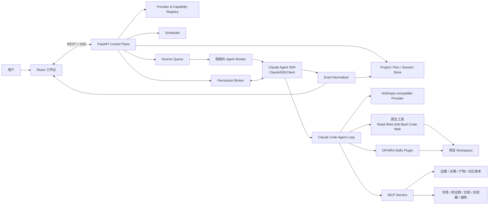

# OPHIRA AI PRD 与技术架构 v2.2

> 文档状态：Draft v2.2，可进入产品评审与技术方案评审
> 研究基线：2026-08-20（v1.1 为 2026-08-05）
> 产品方向：面向出海小B的 AI 全球商业执行系统（对标 Accio Work）
> 架构基线：Claude Agent SDK 单主 Agent，保留 Claude Code 原生能力
> 本文合并 PRD 与技术架构；产品需求、架构约束和验收标准共同构成范围基线。

## v2.1 → v2.2 主要修订（2026-08-23/24）

用户拍板：**《Agent Harness 教材》为最终权威，凡与教材冲突的条款一律按教材修正**（只用一个 Agent；不设轮数上限）。全量逐条审计见 `textbook-audit-2026-08-24.md`，决策论证见 `design-decisions-2026-08-23.md`。

| # | 修订 | 依据 |
|---|---|---|
| 1 | **不设轮数上限**：`max_turns` 默认 None，成本熔断 `max_budget_usd` 是唯一保险丝；Deep Research 子代理同步去掉 maxTurns（§4.4、§4.8、§4.10 包络原则） | 教材"一个循环"不变量：让模型自己决定何时结束 |
| 2 | **沙箱内 Bash 自动批准**：恢复 SDK 原生默认 `autoAllowBashIfSandboxed=True`，另加 `failIfUnavailable=True`；hook 只拦逃逸沙箱；人把关只留账本写入/对外发送的 MCP ask 层（§4.10、FR-13、§6.1） | 教材"一台电脑"+第 09 章判据（动作副作用被沙箱围住）；消除 FM-01/FM-02 打断来源 |
| 3 | **普通模式只读子代理提案否决**：普通模式永久单主 Agent；多 Agent 仅 Deep Research 等教材例外（§4.4、§6.1） | 用户拍板"只用一个 Agent"；教材第 04 章 |
| 4 | **Green Path deny 探针移层**：Bash 不再产生权限请求，deny→continue 探针改为 marker Write（§6.2） | 修订 2 的连带修正 |
| 5 | 每 run 变化的 project_id/trace_id 移至系统提示词末尾，保 prompt cache 前缀稳定 | 教材第 13 章 cache 判据 |
| 6 | 评测代码归属口径（判定逻辑住 `evals/`、驱动脚本住 `backend/scripts/`）；数据反馈闭环立项（`P2-feedback-loop-spec.md`） | 教材第 12/13 章 |

## v2.0 → v2.1 主要修订（2026-08-20，同日）

| # | 修订 | 依据 |
|---|---|---|
| 1 | **品类定位对齐**：Accio Work 官方定位＝"外贸人的 OpenClaw / 专为中小企业打造的跨境生意工作台"；新增常驻 Agent 平台品类基线（Claude Cowork / OpenClaw / Hermes Agent / Codex 四原型调研，§2.6） | 用户提供官方定位 + 四平台官方文档核实 |
| 2 | **单 Agent 红线细化**：普通模式"只读临时子代理"放宽方案已成稿但**待拍板（2026-08-20 用户改为再考虑，暂维持普通模式禁 Agent 的现状）**；固定角色的多 Agent 团队任何模式仍禁止（§1.1、FR-01、§4.8） | Cowork/Codex/Claude Code 均原生具备；上下文经济学需要 |
| 3 | **主动服务与渠道提级（用户拍板 IM 形态）**：IM 渠道按 Claude Tag 形态、心跳巡检、前瞻意图、通知收件箱、移动远程审批（FR-15/24/25/26、§4.16） | 品类五件套 table stakes；Accio Mobile Beta 实证 |
| 4 | **记忆蒸馏提案化**：后台蒸馏 + 人审闸门 + 结构化溯源分级 + 容量上限（FR-14、§4.16） | OpenClaw Dreaming / Codex Memories / Hermes 容量上限 / Cursor 记忆反转教训 |
| 5 | **GUI 三级能力阶梯与"截图即证据"**（FR-20；2026-08-21 拍板全具备、运行时按任务选） | 逆向实证：Claude Desktop 与 Codex 均三级全装（内嵌+接管+OS级），大厂无一"三选一" |
| 6 | **权限增补**：删除文件任何模式必须确认、Auto 自审档、once/session/persistent 粒度（§4.10） | Cowork 误删 11GB 事故铁律等品类实证 |
| 7 | **产物补洞**：图像/视频生成 MCP（FR-27） | Accio/Codex 均有；跨境 Listing 素材刚需 |
| 8 | **全量核对补丁**：办公格式产物（FR-16）、首批连接器矩阵（FR-21）、结构化追问表单（FR-28）、内容营销 Skill 族（§4.7） | 对 Accio Work 功能清单逐项核对后的残余项 |
| 9 | **自动化评测体系**（§3.11、§6.6）：三层评测金字塔 + 错误分析先行 + judge 必经 gold 校准（TPR/TNR）方进发布门禁 | 用户拍板；"可审计"承诺必须可度量 |

## v1.1 → v2.0 主要修订

| # | 修订 | 依据 |
|---|---|---|
| 1 | **差距分析全面重写**：v1.1 §4.14 所列问题大部分已在仓库工作树中修复（presets、Provider Registry、单 Agent 化、插件 Skills、5 个 MCP server），但**关键改动全部未提交**，且**从未在真实模型端点上跑通**（历史 12 次运行全部 401） | 本地仓库工作树 2026-08-20 实测（时为 `Ophira-ai`，当日更名为 `Open-Acciowork`） |
| 2 | **Provider 生态扩容与代际更新**：官方 Anthropic 兼容端点从 4 家扩展到 8+ 家（新增 MiniMax、百度千帆、腾讯混元、火山方舟）；模型全面换代（DeepSeek v4、Kimi k3、GLM 5.x、Qwen 3.5–3.8、MiniMax M3）；阿里/智谱 Coding Plan 禁止应用后端的条款已拿到原文 | 各厂商官方文档逐一 fetch 核实（§4.9、§9） |
| 3 | **SDK 能力刷新**：Python SDK 0.2.82 → 0.2.142；吸收 `sandbox`、`max_budget_usd`、`session_store`、`output_format`、`thinking/effort`、官方多租户隔离指引、OTel 可观测性；明确 `setting_sources=[]` 与 skills 发现的边界 | code.claude.com 官方文档 + PyPI/npm（§2.3、§4.4） |
| 4 | **竞品档案完整化**：Accio Work 2026-03-23 正式发布，>10M MAU、230K+ 企业部署；完整工具/权限/记忆/定价/更新日志档案；已知投诉（积分消耗、疑似跨账户数据泄漏）转化为 OPHIRA 差异化机会 | Accio 官方文档全文 + PRNewswire/Caixin/MIT TR 等（§2.2、§3.4） |
| 5 | **新增架构注意事项**：原生 WebSearch/WebFetch 属 Anthropic 服务端工具，在第三方端点上可能不可用（Kimi 已明确不支持 WebFetch），必须有 MCP 检索降级路径 | Kimi 官方文档 + 合约测试矩阵（§4.9） |

---

## 1. 结论先行

OPHIRA 的核心产品场景是：让跨境小商家从任何一个模糊的全球商业目标出发，启动一个能够持续推进工作的商业 Agent。目标既可以来自需求侧（"哪里正在需要某类商品"），也可以来自供给侧（"我能稳定供应这些产品，应该卖到哪里、找到谁"）。Agent 不只给一段泛泛建议，而是能自己搜索、阅读、计算、整理文件、调用商业数据工具、生成报告与表格、保留证据，并在需要产生真实副作用时请求用户授权。

产品定义不变：

> **OPHIRA 是面向出海小B的 AI 全球商业系统。一个主 Agent 从市场需求、现有供给或商业目标中的任意一点出发，按需调用原生工具、Skills 和 MCP，把分散信息转化为可追溯的判断、可编辑的交付物以及走向客户与成交的下一步行动。**

"一个 Agent"仍是产品和架构的共同原则：常规任务不拆成研究、供应、资金、销售等固定角色，也不实现固定节点工作流。四个维度作为 Agent 可按需调用的商业分析 Skill 和证据标签存在，而不是用户每次都必须穿过的流程。

v2.0 的核心新判断：**架构目标已基本代码就绪，当前最大风险不是设计而是工程状态**——关键实现停留在未提交的工作树上，且零次成功的真实端点运行。Phase 0 的剩余工作是"提交、打通、证明"，不是"重新设计"。

### 1.1 不可妥协的架构红线（与 v1.1 一致）

| 红线 | 设计与验收口径 |
|---|---|
| 核心 Agent 只能使用 Claude Agent SDK | 所有业务会话均由 `ClaudeSDKClient`/`query()` 驱动 Claude Code agent loop；禁止另写模型循环 |
| 不允许直连模型替代 SDK | 业务代码不得用 OpenAI SDK、Anthropic Client SDK 或裸 `/v1/messages` 实现核心 Agent；不得以"兼容性"为由回退 |
| 不使用固定编排框架 | 不引入 LangGraph、LangChain、Dify 或自研状态机来决定下一步；由主 Agent 结合上下文自主选择工具和 Skill |
| 保留 Claude Code 原生能力 | 使用 `claude_code` tools preset，保留 Read、Write、Edit、Bash、代码执行、Glob、Grep、WebSearch、WebFetch、Skill 等能力；权限控制不等于删除能力 |
| 常规任务单主 Agent，禁角色型团队 | 一个主 Agent 对结果负全责；普通模式现状**不派子代理**（"只读临时子代理"放宽方案见 §4.8，待拍板）；固定角色的多 Agent 团队任何模式都不做；Deep Research 是大规模并行研究的显式重模式 |
| 领域能力用官方扩展点 | 外部系统和确定性动作封装为 MCP；方法论封装为文件型 Skill；复杂处理由原生 Bash/代码执行或 Skill 附带脚本完成 |
| 国产模型只走 Anthropic 协议 | 通过每个厂商官方 Anthropic-compatible Base URL 和 Key 配置 Claude Agent SDK；项目内不实现 OpenAI 格式适配器 |
| 证据与副作用可治理 | 事实必须带来源、时间和置信度；写文件、执行命令、登录态浏览器、外发消息等按风险分级并可由用户授权 |

任何不满足以上红线的实现，即使功能表面可用，也不算 OPHIRA 目标架构。

---

## 2. 研究范围与事实基线

### 2.1 本地仓库现状（2026-08-20 实测）

权威仓库：`github.com/Janettbella69/Open-Acciowork`（2026-08-20 由 Ophira-ai 更名），本地克隆 `/Users/isabella/Open-Acciowork`（项目唯一目录，所有工作在此进行），`main` 分支与 `origin/main` 同步。技术栈：FastAPI 0.141 + React 19/Vite 7；`claude-agent-sdk==0.2.82`（硬钉，venv 实装一致）；Python 3.11。

**已实现（大部分在未提交的工作树中）：**

- `ClaudeAgentOptions` 已使用 `claude_code` tools preset 和 system prompt preset+append（`sdk_adapter.py`），并启用 `sandbox`（v2.2 起 `autoAllowBashIfSandboxed=True`〔SDK 原生默认，2026-08-24 拍板恢复〕、`allowUnsandboxedCommands=False`、`failIfUnavailable=True`）、`enable_file_checkpointing`、`thinking={"type":"adaptive","display":"summarized"}`、`max_budget_usd`、`include_partial_messages/include_hook_events`。
- 四专业 Agent（Opportunity Lead + 需求/供应/资金/销售）**已删除**；普通模式 `agents=None`、`disallowed_tools=[]`（v2.2：原生支线子代理开放，账本写入对子代理代码级拒绝）；Deep Research 模式另注入 3 个只读研究子代理（`source-mapper`/`multilingual-researcher`/`conflict-verifier`，各自禁 Write/Edit/Bash/Agent/Task）。
- 应用托管 Plugin `ophira-core` 已建成（4 个 Skill：`global-opportunity-execution`、`supplier-due-diligence`、`landed-cost-analysis`、`customer-path`，均有合法 frontmatter）。
- 6 个进程内 MCP server 共 21 个工具（`ophira_ledger`/`supplier`/`customer`/`commerce_math`/`web`/`automation`），`strict_mcp_config=True`，工具描述统一带"不代替商业判断"声明（v2.2 收敛至教材"20 个左右"口径：legacy 视图工具已删、market 域并入账本，见 §4.6）。
- Provider Registry + 文件密钥库（0600/0700 + 原子写）+ SDK 预检（真实 `query()` 路径，断言 Skill 发现与 MCP health 调用）+ 8 类错误码分类已实现（`providers.py`）。
- 凭据隔离：`ANTHROPIC_API_KEY`/`ANTHROPIC_AUTH_TOKEN`/`CLAUDE_CODE_OAUTH_TOKEN` 先置空再注入所选 Profile 唯一凭据；每 Profile 独立 `CLAUDE_CONFIG_DIR`（0700）；`CLAUDE_CODE_DISABLE_AUTO_MEMORY=1`、`CLAUDE_CODE_DISABLE_NONESSENTIAL_TRAFFIC=1`。
- 权限双层防御：`can_use_tool`（写入 workspace 包含检查 + 禁 unsandboxed Bash）+ `PreToolUse` hook（敏感路径黑名单 `.env`/`credentials`/`secrets` 等；**读写围栏分开（v2.2）：Read/Glob/Grep 围栏=项目目录（含账本原始 JSON，兜住 MCP 接口外的意料之外分析），Write/Edit 围栏=工作区**）；沙箱内 Bash 自动批准（v2.2，SDK 原生默认）、逃逸沙箱永久拒绝；权限超时自动 deny。
- 记忆提案—审批—回滚 + MEMORY.md 受控同步（注入上限 8 条/4000 字符）；Scheduler 后端完整（croniter + 时区 + missed-run 策略）；27 种 SSE 事件、单调 sequence、`Last-Event-ID` 续传、全量脱敏。
- `RunRecord` 固化 provider/skill/policy 快照，`extra="forbid"`；`Decision` 已通用化，四维降级为可选 `dimension` 标签（v1.1 目标达成）。

**仍缺 / 风险：**

| 项 | 现状 |
|---|---|
| ⚠️ **工程状态风险（最高优先）** | 25 个文件修改未提交；`providers.py`、`skills.py`、整个 `ophira-capabilities/` 插件目录 **untracked**——一次 `git clean` 即可丢失全部 Phase 0 成果。第一动作是提交 |
| ⚠️ **零运行时证据** | `data/` 中 12 次历史运行 100% 失败，错误一致：`401 OAuth access token has been revoked`（旧代码继承宿主已撤销 OAuth 所致——新 env 隔离代码正是修复，但从未验证）。没有任何一次运行到达过工具调用 |
| 定时任务前端 | 仍是 localStorage 本地草稿（UI 明示 "local draft only"）；后端 Scheduler 与 API client 函数齐备但是死代码 |
| 设置页 | localStorage-only，**完全没有 Provider/Key UI**；`listProviders/saveProvider/preflightProvider` 等 client 函数无人调用 |
| 测试缺口 | 无 E2E/Green Path 测试（run 生命周期测试全部用 FakeRuntime）；`providers.py`、`skills.py`、`preflight()` 零测试；无 Provider 合约测试套件 |
| SDK 版本 | 钉 0.2.82，最新 0.2.142（15 天 60 个版本，变更集未审）；升级必须走合约测试，不盲升 |
| API 偏差 | 权限落点为 `POST /api/runs/{run_id}/permissions/{request_id}`（非 v1.1 的 `/api/permissions/{id}/resolve`）；记忆为 `POST /api/memory/{id}/decision`；`GET .../evidence`、`POST /api/skills/{id}/test`、connectors 端点未实现；SSE 用 `Last-Event-ID` header 而非 `?after=` |

### 2.2 竞品事实基线：Accio 与 Accio Work

（除标注外均来自 Accio 官方文档 `accio.com/work/documents/en/*.html` 全文与官方 changelog；详见 §9。）

**主体与规模**：Accio 由阿里国际（AIDC）出品。基础 Accio 是 2024-11 发布的 AI B2B sourcing 引擎；**Accio Work 于 2026-03-23/24 发布**，桌面优先 + Web 双入口（2026-08-21 一手核实官网 accio.com/work 首屏：并列 "Download for macOS"（macOS 11+，Apple Silicon）与 **"Try in browser"** 两个按钮）。桌面端是 Electron；官方另强调 "all tool execution — file operations, terminal commands, browser actions — runs on your own device"，即**本机执行类能力绑定桌面端，Web 入口为功能缩减版**。注意与同名基础版 Accio 区分（2024-11 的 B2B sourcing 引擎，另有 iOS/Android），官方主标语 "Your AI Business Team That Turns Ideas Into Profits"。截至 2026-03 全球 **>1000 万 MAU**（约每 5 个 Alibaba.com 用户中 1 个）；截至 2026-04 **23 万+ 企业**部署了 Agent 团队。商业化未定论——阿里高管公开承认"还没有清晰的变现答案"（MIT Technology Review, 2026-04）。

**能力面（官方文档口径）**：

- 工具：文件检索/读写（PDF/DOCX/XLSX/PPTX）、终端命令、定时任务（本地执行，关机不跑）、Web 搜索/抓取、AI 图像与视频（Beta）、浏览器接管、多 Agent 消息与群管理、B2B 平台供应商搜索。
- 浏览器：接管用户**真实 Chrome 登录态**（扩展 "Accio Browser Relay" 或 CDP 直连 Beta），真实设备指纹与住宅 IP；本地 127.0.0.1 中继、受控标签页可视标识、默认审批、登录墙前强制停手。
- 权限：allow / ask / ask_once / deny 四态；规则维度=路径前缀/命令前缀/域名；授权粒度 once/session/persistent；决策审计 `permissions/audit.jsonl`；workspace 白名单 + realpath 防符号链接逃逸；支付与提交订单强制人工批准。
- 记忆：四层——本地向量索引（opt-in）、Diary、MEMORY.md、身份文件（SOUL.md/USER.md/IDENTITY.md 等按固定顺序拼入系统提示词）；`/dream` 蒸馏管线（手动/每日首条/定时 10:00 与 22:00）。
- Skills：**100+ 阿里预置认证 Skill**（SKILL.md 格式），三层优先级（Agent 私有>账号>内置）；用户可上传自定义包；Agent 会从重复工作流自动造 Skill（"SkillHarvest"）。
- 扩展：插件（连接器+Skills+指令的组合包）、MCP 自定义 Server 注入、OAuth 连接器（Gmail/GitHub/X/LinkedIn/Instagram/Alibaba.com 等）、IM 渠道（Telegram/Discord/钉钉/飞书/微信/企微）。
- 多 Agent：Agent Team（1 TL + 最多 10 成员群聊、@分派并行）；SubAgent 委派（explore/bash/browser/general 四型、最深 2 层）；Agent Hub 市场；7 个内置模板。
- 交付物：报告、多 sheet 表格、批量 Listing、询盘与谈判线程、AI 建站（画布可视编辑+一键发布）、图像/视频、TikTok 脚本分镜、Markdown/PDF/DOCX/PPT 导出、知识库（个人+团队）。
- 定价：免费 20 积分/天；Pro $19.9/月（4,000/月）；Elite $99/月（20,000/月）；Ultra $199/月（40,000/月）。**多厂商模型市场按倍率计积分**：Auto/MiniMax M2.5/Qwen 3 Max = 1x，Claude Sonnet 4.6/Gemini 3.1 Pro/GLM-5/Kimi K2.5 = 2–2.5x，Claude Opus 4.6/GPT-5.2/5.4 = 3–4x——并非 Qwen 独占。
- 典型营销场景：宠物玩具 600 件目标价 <$1 的自动寻源+7×24 多供应商谈判（人批成交）、名片背调、Instagram/Reddit 趋势选品+毛利测算、批量上架、SEO 全流程、竞品视频拆解产 TikTok 脚本、Gmail 报价汇总对比表、100+ 市场 VAT/退税/清关文档（发布会口径）。

**已知投诉与限制**（对 OPHIRA 是定位机会，见 §3.4）：Elite 档积分 24 小时内被简单 RFQ 任务耗尽；Trustpilot 上有**疑似跨账户数据泄漏**投诉（用户看到他人工作流/任务/团队；搜索快照来源，未能直接复核原帖）；缺少供应商报价聚合对比界面；定时任务依赖本机开机；高峰期 Error 555 限流；生态偏 Alibaba.com，弱于 Amazon-FBA/独立站场景。

**与 v1.1 的判断一致**：Accio Work 验证了"专业场景 + 通用 Agent 能力"的需求，其权限四态、记忆分层、SKILL.md 格式与本方案高度同构；但 OPHIRA 不复制其"多 Agent 团队"叙事（那是它的表演层卖点，也是其结果不可追溯的根源之一）。

### 2.3 Claude Agent SDK 事实基线（2026-08-20）

- 版本：**仓库钉 `claude-agent-sdk==0.2.143`**（2026-08-21 由 0.2.82 升级，L1 测试 139 过；区间内唯一破坏性变更 0.2.129 的 skill 名校验不触及本仓）。升级前必须跑 §4.9 合约测试。
  **两条 SDK 版本线不可直接比较**：Python 线 0.2.x（PyPI，145 版）、TypeScript 线 0.3.x（npm，272 版），二者 2025-09 同周首发、同日发布最新版，**捆绑的是同一个 Claude Code 引擎（实测均为 2.1.238）**——agent loop 在引擎里，SDK 只是语言绑定。号差与版本数差是发布颗粒度，不是能力差；真实差距仅在"绑定层暴露了多少参数"（Python changelog 有 15 条 "parity with the TypeScript SDK" 追平记录，均已交付）。**换栈的唯一正当理由**：某个必须用的参数只有 TS 绑定暴露——届时也应只把那一小块写成 MCP server 挂载，而非整体重写。
- `tools`/`system_prompt` 的 `{"type":"preset","preset":"claude_code"}` 写法不变；`system_prompt` 支持 `append` 与 `excludeDynamicSections`。
- **权限语义确认**：`allowed_tools` = 自动批准（不约束 `bypassPermissions` 模式）；`disallowed_tools` 裸名从上下文移除工具、带参数模式（如 `Bash(rm *)`）仅拒匹配调用；判定顺序 hooks → deny → ask → permission mode → allow → `can_use_tool`（前序已放行则回调不触发）。`permission_mode` 现有六值：`default/dontAsk/acceptEdits/bypassPermissions/plan/auto`。
- **Skills 发现边界（v1.1 未写清，易踩坑）**：文件系统 skills（`~/.claude/skills`、`./.claude/skills`）只在 `setting_sources` 含 `"user"`/`"project"` 时被发现；`setting_sources=[]` 时**只能**靠 `plugins`（`{"type":"local","path":...}`，Skill 命名空间 `plugin-name:skill-name`）装载——OPHIRA 恰好用的是后者，此路线正确且已被仓库 preflight 断言验证。SDK 场景下 SKILL.md 的 `allowed-tools` frontmatter **不强制执行**，权限必须在顶层 options/回调做（v1.1 已正确记载，维持）。
- 进程内 MCP：`@tool` + `create_sdk_mcp_server` 仍是现行 API；三种传输 sdk-inprocess / stdio / HTTP+SSE。
- 值得吸收的新能力：`max_budget_usd`（成本熔断，仓库已用；v2.2 拍板**不设 `max_turns` 轮数上限**——"一个循环"口径，预算是唯一保险丝）；`sandbox` 选项（仓库已用）；`session_store`/`session_store_flush`（会话转录外置到 S3/Redis/Postgres——云端 SaaS 阶段的官方答案）；`output_format`（JSON Schema 结构化输出，可用于 run 结果摘要）；`fallback_model`；`thinking`/`effort`；`betas`；`user`（审计标识）；`add_dirs`。
- **官方多租户隔离指引**（hosting 文档）与仓库实现一致：`setting_sources=[]` + `CLAUDE_CODE_DISABLE_AUTO_MEMORY=1` + 每租户 `CLAUDE_CONFIG_DIR` + 每租户 `cwd`；注意 `setting_sources=[]` **不**阻止 auto-memory 与 `~/.claude.json` 的加载，必须配合上述 env 才完整。
- 可观测性：OTel 导出官方支持（`CLAUDE_CODE_ENABLE_TELEMETRY=1` + `OTEL_*` 系列），可替代部分自建指标管道。

### 2.4 Provider 事实基线（摘要，详表见 §4.9）

- 官方 Anthropic 兼容端点已成为国产模型行业标配：DeepSeek、Kimi（开放平台）、GLM/Z.ai、Qwen 百炼、MiniMax、百度千帆、腾讯混元、火山方舟均有官方文档。
- **商用红线已拿到原文**：阿里云 Coding Plan 明文禁止"automated scripts, application backends, or other non-interactive scenarios"；智谱 Coding Plan 明文要求自建应用/网站/机器人/SaaS 走标准 API。OPHIRA 后端一律使用按量付费 API Key。
- 2026 年各家共同口径：接 Claude Code 需钉住**全部**模型档位变量（`ANTHROPIC_MODEL` + `ANTHROPIC_DEFAULT_OPUS/SONNET/HAIKU(/FABLE)_MODEL` + `CLAUDE_CODE_SUBAGENT_MODEL`），不再只设主模型。
- 能力差异显著且必须进合约测试：DeepSeek 不支持图片、未知模型名**静默映射**到 v4-flash；Kimi 端点当前不支持 WebFetch 工具；MiniMax M2.x 仅文本、thinking 不可关；Qwen 无 `/v1/models`、temperature 区间 [0,2)。

### 2.5 明确假设与待验证项（维持 v1.1，两条更新）

- 第一批高价值用户是拥有产品、供给、服务能力或跨境经营目标，但缺少完整专业团队的中国出海小B与精简团队。（Accio 的 10M MAU 与 230K 企业验证了赛道，但其用户构成偏 Alibaba.com 买家，不能直接推导 OPHIRA 的首批用户画像。）
- "发现需求、组织供给、判断可行性、寻找客户、准备成交"可能形成高频任务簇，但用户不会总从需求侧开始，也不会按同一顺序执行。
- 用户愿意提供 BYOK 模型 Key，或接受 OPHIRA 托管模型额度；两种商业模式由相同 Provider Profile 支撑。（Accio 用积分制托管多厂商模型的做法证明托管模式可行，其"积分消耗过快"投诉说明**成本透明**是可攻击的差异点。）
- 平台销量、关键词热度等"实时数据"必须来自授权 API、用户登录态页面或可引用的公开来源；没有数据许可时不得伪装成平台官方实时数据。

### 2.6 常驻 Agent 平台品类基线（v2.1 新增，2026-08-20 核实）

Accio Work 官方对标口径为 "agentic platforms like Claude Cowork and OpenClaw"，市场定位为"外贸人的 OpenClaw / 专为中小企业打造的跨境生意工作台"。品类四个原型的关键机制：

| | Claude Cowork（Anthropic） | OpenClaw（开源，~387k star） | Hermes Agent（Nous，~233k star） | OpenAI Codex |
|---|---|---|---|---|
| 本质 | Claude Code harness 换壳的知识工作 Agent（**与 OPHIRA 同底座**，SKILL.md/插件格式互通） | 常驻个人分身网关，IM 渠道形态的发明者 | 模型无关 harness，国产模型端点一等公民 | ChatGPT 的 agent 内核（2026-07 合并） |
| 记忆 | 项目作用域记忆（与 OPHIRA 同构） | 五层信任模型 + SQLite 溯源列（untrusted 结构性排除）+ Dreaming 三阶段蒸馏 | MEMORY.md 容量硬上限 + 启动冻结快照 + FTS5 情景检索 + 写入人审开关 | AGENTS.md（人定规则）+ Memories（自动蒸馏）双层 |
| 进化 | 无自改（人装插件） | Skill Workshop 提案→扫描→apply（默认 auto 是其隐患）；SOUL 自改仅"告知"约定 | 自主造 Skill + Curator + write_approval 闸门；SOUL 仅人可改 | 无自改闭环（Memories 积累 + Agent Imports） |
| 主动 | 云端定时 + "ping 手机做决策" | heartbeat + HEARTBEAT_OK 静音 + standing intents（防唠叨预算） | cron 拉新会话投递渠道 + 空闲 heartbeat | RRULE 定时 + Scheduled 收件箱 |
| 教训 | 误删用户 11GB → "删除永远确认"铁律 | ClawHavoc 1184 恶意 skill、一键 RCE、2026-03 被禁用于中国国企 | —（治理开关前置） | 分支名注入漏洞 |

两个结论：① 品类六件套＝**常驻 / 渠道 / 记忆 / 主动 / 进化 / 可审计**——前五件是 table stakes，第六件是 OPHIRA 的差异位；② 各家治理机制几乎都是事故后补的，OPHIRA 把治理做在第一版是后发优势。机制吸收明细见 §4.16。

---

## 3. 产品需求文档

### 3.1 目标用户

#### 核心用户

出海小B与精简商业团队：缺少完整的市场研究、供应链、财务、销售和内容团队，但需要持续判断"世界哪里有需求、我能组织什么供给、这件事是否成立、客户在哪里、怎样走向成交"。

典型特征：

- 信息分散在电商与贸易平台、搜索引擎、社交媒体、供应商/客户页面、聊天记录和本地文件中。
- 决策预算有限，希望先小成本验证，而不是购买复杂企业系统。
- 会提出模糊问题，无法一开始就写出规范的研究任务。
- 不只需要"答案"，还需要市场/客户清单、供给与成本表、询盘或触达材料、风险说明等可继续使用的产物。

#### 次级用户

- 跨境服务商和选品顾问，需要同时管理多个客户项目并保留证据链。
- 有固定品类的品牌/工贸一体团队，需要持续监控市场与供应变化。

#### 暂不优先

- 需要完整 ERP、订单履约和财务总账替换的大型企业。
- 只需要通用聊天、代码编程或个人效率助手的用户。

### 3.2 用户问题

1. **发现难**：不知道哪些信号可信，无法高效覆盖多个市场和来源。
2. **验证难**：存在需求不等于适合自己；供应、毛利、现金占用、合规和获客难度常被遗漏。
3. **执行断层**：研究结论与供应商清单、成本模型、Listing、询盘和测试计划相互割裂。（Accio 用户"缺少报价聚合对比界面"的抱怨正是此问题的实例。）
4. **过程不可追溯**：普通聊天里的结论很快过期，来源、时间、假设和修改记录难以复用。
5. **工具过度结构化**：固定表单和工作流要求用户先理解系统，而不是系统理解用户。
6. **Agent 不可信**：模型凭空给出销量、排名或供应商结论，或者在未经授权时执行外部动作；托管积分制下成本也不可预期。

### 3.3 Jobs to Be Done

当我只有一个模糊的跨境商业想法时，我希望 OPHIRA 能：

- 帮我发现值得研究的品类、产品或需求信号；
- 告诉我哪些是已观察事实、哪些是推断，证据来自哪里、何时获取；
- 结合我的市场、预算、渠道和能力判断是否值得试；
- 找到候选供应商并做可比较的规格、价格、MOQ、交付和可信度整理；
- 计算到岸成本、毛利、盈亏平衡与现金压力，并允许我调整假设；
- 生成可编辑的报告、CSV/表格、询盘、Listing 草稿、测试计划等交付物；
- 识别潜在客户、合作方或成交路径，并准备可审核的触达材料；
- 在我允许时操作登录态网页、发送消息或建立定时监控；
- 下次继续同一项目时记得经我确认的稳定偏好和事实。

这些是可组合能力，不是必须从上到下执行的固定漏斗。

### 3.4 产品定位与原则

#### 产品定位

**不是搜索框，也不是"AI 团队开会"的表演，而是拥有商业能力包、工具箱和持久工作区的一个执行 Agent。**

对位一句话（v2.1，对齐品类定位）：Accio Work 是"外贸人的 OpenClaw，货在阿里"；**OPHIRA 是"外贸人的常驻数字员工"——证据可审计、模型与数据主权在用户自己手里。**

#### 与 Accio Work 的差异化（v2.0 新增）

| 维度 | Accio Work | OPHIRA |
|---|---|---|
| Agent 结构 | 多 Agent 团队（1 TL + ≤10 成员）作为核心卖点 | 单主 Agent + 可追溯证据链；Deep Research 才有受限只读子代理 |
| 结果可信度 | 结论与来源关联弱，官方评测承认建议偏泛 | 证据账本一等公民：来源/时间/置信度/事实-推断分型，结论回链证据 |
| 模型 | 托管积分制、多厂商倍率计费，成本不透明（用户投诉积分消耗过快） | BYOK + Anthropic 协议 Provider Profile，成本=厂商牌价，`max_budget_usd` 逐运行熔断 |
| 数据主权 | 数据过阿里基础设施；有疑似跨账户泄漏投诉 | 本地优先工作区 + 每租户/每 Profile 隔离（`CLAUDE_CONFIG_DIR`、凭据白名单、路径防逃逸）——把隔离做成可验证的卖点 |
| 生态 | 深度绑定 Alibaba.com 供给侧 | 平台无关；渠道只是数据源与连接器参数 |
| 分发 | 桌面 App + IM 渠道 + Agent Hub + Mobile 遥控 PC | 本地 Web 工作台先行，**桌面壳随 GUI L3 落地**（2026-08-21 拍板；壳为宿主、Python 后端作本地 sidecar，不重写内核）；IM 渠道按 **Claude Tag 形态**进 P1（主 Agent 以成员身份进用户的飞书/微信群，v2.1 用户拍板）；移动端＝同一控制面的远程审批面。**服务端优势的适用边界**：无 GUI 的定时/巡检任务仍服务端常驻、不依赖用户设备开机（FR-15）；GUI L2/L3 任务因需本机浏览器/桌面，天然要求设备在线——两类任务分别调度，不混为一谈 |

Accio 同时也**抬高了 table stakes**：权限四态与审计日志、分层记忆、SKILL.md 能力包、定时任务、浏览器登录态操作，用户会默认期待。OPHIRA 的对应能力在 FR 表中均有落点，实现次序见 §5。

#### 产品原则（维持 v1.1）

1. **从自然语言开始**：允许一句模糊问题开局，只追问会显著改变结果的缺失条件。
2. **Agent 自主选路**：Agent 可以先搜索、先读文件、先计算或先生成草稿，不由预设图节点决定。
3. **专业默认，机制通用**：默认理解跨境商业，但底层保留文件、命令、代码、网页和 Skill 的通用能力。
4. **证据优先**：事实带来源和时间；推断显式标记；过期信息不包装成实时结论。
5. **产物优先**：重要结果落到项目工作区，成为可编辑、可下载、可继续处理的文件或结构化记录。
6. **人在风险回路中**：内部读取和分析尽量顺滑；外发、采购、登录态写操作和危险命令必须可控。
7. **一份项目真相**：主 Agent、定时任务以及 Deep Research 临时子 Agent 最终都写入同一项目证据与产物账本。

### 3.5 核心使用场景

#### 场景 A：从需求或供给出发推进全球商业机会

示例输入："我们可以稳定供应一批可持续家居用品，哪些海外市场和客户更值得优先做？帮我验证并推进。"用户也可以从需求、竞品、客户线索或一份现有商业材料开始。

期望体验：

1. 主 Agent 判断品类偏好、备货方式等是否会显著改变结果；必要时只问 1–3 个关键问题。
2. Agent 自行选择 WebSearch/WebFetch（或检索 MCP 降级）、市场情报 MCP、浏览器连接器、Skill 或代码计算，不展示固定"第一步/第二步"流程。
3. 页面持续显示正在访问的来源、工具状态和可取消的进度，但不暴露模型私有思维链。
4. 结果至少包含目标理解、需求与客户信号、供给匹配、商业可行性、主要风险、证据时间和下一步验证或执行动作；与当前目标无关的维度不强制出现。
5. 用户可以继续缩小市场、替换约束、比较路线、要求寻找供应/客户或生成成本表，Agent 在同一会话和工作区继续执行。

最低合格输出不是一段通用商业建议，而是一份**可追溯的机会判断 + 明确未知项 + 可执行的下一步 + 必要交付物**。

#### 场景 B：验证一个具体产品

用户上传供应商报价、竞品链接和已有销量表，问"这个便携榨汁杯值得做吗？"主 Agent 读取文件和网页，使用确定性计算工具建立成本/敏感性模型，引用外部信号，产出 Go / Test / No-go 建议及其条件。用户调整运费或退货率时，Agent 更新同一产物，而不是重新生成一份失联答案。

#### 场景 C：供应商研究与询盘

用户要求寻找满足认证、MOQ 和交付期的供应商。Agent 调用供应商 MCP、公开网页或授权浏览器，生成对比表与尽调缺口。任何真正发送询盘、提交表单或外发邮件的动作都先展示目标、内容和影响范围，由用户确认。（Accio 的"7×24 自动谈判、人批成交"证明了该场景的付费意愿；OPHIRA 的差异是谈判线程全程留痕入账本。）

#### 场景 D：寻找客户与准备成交

用户从目标市场、产品能力或理想客户画像出发，要求 Agent 找到潜在客户、渠道伙伴或采购方。Agent 使用公开来源和客户/CRM MCP 建立带来源的候选清单、识别联系路径、起草个性化触达材料并记录后续动作。任何真实发送、提交或修改 CRM 的操作都必须先预览并授权。

#### 场景 E：生成并修改商业交付物

用户可以要求"把结论做成 CSV""写一份英文 Listing""生成给老板的周报"。Agent 通过原生 Write/Edit/Bash 和代码执行在项目工作区创建、检查、修改文件，UI 显示产物和版本。

#### 场景 F：持续监控

用户说"每周一检查这 5 个竞品的价格和评论变化"。Agent 把自然语言意图转成可审阅的计划；用户确认后创建定时任务。每次运行复用同一 Skill 和项目上下文，新增带时间的证据，只有达到阈值才通知。（差异化注意：Accio 的定时任务在用户本机执行、关机即停；OPHIRA 后端 Scheduler 常驻，这是现成优势，要在产品叙事中显性化。）

#### 场景 G：Deep Research 例外模式

当问题需要大范围、多语种、多来源并行研究时，用户显式选择 Deep Research，或主 Agent 提出建议并获得确认。主 Agent 可以启动短生命周期、默认只读的研究子 Agent；只有主 Agent 汇总、去重、判断冲突并写入项目真相。普通选品、成本分析、写报告等任务不得为了"看起来高级"自动创建多个 Agent。

### 3.6 信息架构（维持 v1.1）

一个连续、对话优先的工作区：

- **项目与会话**：历史项目、会话续接、新任务入口。
- **对话/执行流**：用户消息、Agent 结果、工具状态、权限卡片、可取消运行。
- **证据抽屉**：来源、抓取时间、观察对象、引用位置、可信度和冲突。
- **产物区**：报告、表格、文本、脚本和导出文件；支持版本与下载。
- **项目记录**：目标、已确认约束、决策、开放问题和经批准的记忆。
- **Skills**：已安装能力、适用场景、版本、来源、启停与测试。（后端已接通；"测试"入口未实现。）
- **自动化**：真实连接后端定时任务，展示下次运行、最近结果、失败原因和通知策略。（后端已就绪，前端仍是本地草稿——P0 收尾项。）
- **设置**：模型 Provider、Key、数据区域、MCP 连接器、浏览器/桌面桥、权限策略与隐私。（当前完全缺 Provider UI——P0 收尾项。）

### 3.7 首发范围（v2.2 更名：抛弃 MVP/demo 概念，教材口径——做真产品，只是还没上线）

#### P0：必须交付（△=代码已就绪待打通/验证，✗=未开始）

- △ Claude Agent SDK 单主 Agent 运行时和完整原生工具集（代码就绪，待真实端点验证）。
- △ Anthropic 协议 Provider 配置、凭据隔离、SDK 预检和明确错误诊断（后端就绪；**设置页 Provider UI 未开始**）。
- △ 对话、项目、会话续接、SSE 流、取消、失败恢复和运行记录（就绪）。
- △ 项目级文件工作区，支持上传/引用 URL、读取、写入、编辑、下载产物（就绪）。
- △ 平台无关的商业机会研究、供需匹配、商业测算和客户路径 Skills（4 个已建），以及证据、供应商和商业计算 MCP 第一版（v2.2 现存 21 工具，含 web/automation；市场情报=账本证据的 market-signal 标签视图）。
- △ 来源、时间、置信度、事实/推断区分以及证据与结论关联（数据模型就绪；证据 UI 待做）。
- △ 工作区写入、浏览器写操作、外发动作的分级权限（工作区写入就绪；沙箱内 Bash v2.2 起自动批准，不再走分级）。
- △ Skill 的后端安装、发现、启停、版本快照和运行时调用（就绪，缺测试入口）。
- △ 记忆提案—审核—生效机制（后端+MCP 工具就绪；审批 UI 待接）。
- ✗ 后端定时任务与前端真实打通；失败和凭据失效可见。
- △ 正常模式禁止子 Agent；Deep Research 开关及预算/只读约束（已实现为受控 Beta）。
- ✗ **Green Path E2E 与 Provider 合约测试**（Phase 0 出口标准，零进展）。

#### P1：紧随其后（v2.1 重排）

- IM 渠道（Claude Tag 形态，先飞书后微信，FR-24）与移动远程审批（FR-25）。
- 主动巡检、前瞻意图与通知收件箱（FR-26、§4.16）；`ophira_automation` MCP 暴露给 Agent。
- **GUI L1**：内嵌受控浏览器 + 操作截图入证据账本（FR-20 第一级，服务端可跑）；平台/店铺授权连接器。
- 图像/视频生成 MCP（FR-27）；记忆蒸馏提案生成器（§4.16）。
- 更多市场与平台 Skills、合规数据源、物流与汇率工具。
- 供应商联系、Listing 发布等外部动作的预览—批准—执行闭环。
- 检索 MCP 降级路径（针对不支持原生 WebSearch/WebFetch 的 Provider）。
- 桌面桥或桌面壳，使本地文件与真实浏览器能力更自然。

#### P2：观察项

- **GUI L2**：接管用户真实 Chrome（复用登录态与设备指纹，Accio Relay 式，FR-20 第二级，覆盖需登录的 B2B 平台）。
- **GUI L3 + 桌面版**：OS 级 computer use（Codex CUAService 式）与承载它的 Electron 桌面壳——桌面壳只做宿主，Python 后端作为本地 sidecar 复用，不重写内核（见 §4.x 桌面形态）。
- "从重复任务中提议新 Skill"（Hermes/OpenClaw 形态；提案制、强制人审 + 安全扫描，见 §4.7）。
- 团队协作、评论、项目模板、Skill 私有仓库和组织策略。
- 知识库（项目级参考资料索引，服务检索而非替代证据账本）。

#### 明确不做

- 不把四个维度做成固定四 Agent 或必经工作流。
- 不用普通模型 API 或其他 Agent 框架实现降级路径。
- 不承诺没有授权数据源支撑的"官方实时销量""平台内部趋势"。
- 首发不自动下单、付款、群发询盘或未经确认修改线上店铺。
- 不用向量库自动写入所有对话来替代可审核的长期记忆。
- 不在一个共享宿主目录里让不同用户的 Agent 执行 Bash。

### 3.8 功能需求与验收标准

| ID | 优先级 | 需求 | 可验收标准 | 现状 |
|---|---:|---|---|---|
| FR-01 | P0 | 单主 Agent | 一个主 Agent 会话对结果负全责；普通模式禁 `Agent` 工具（现状）；无固定角色团队与固定节点编排。"只读临时子代理"放宽为已成稿提案（§4.8），**待拍板** | △ 已实现（普通模式禁 Agent）；放宽提案挂起 |
| FR-02 | P0 | SDK 唯一模型运行时 | 业务运行追踪可证明由 `ClaudeSDKClient`/`query()` 发起；项目代码不存在替代核心循环的模型 Client 调用 | △ 已实现 |
| FR-03 | P0 | 原生能力完整 | 同一 Agent 可使用 Read、Write、Edit、Bash/代码、Glob、Grep、WebSearch/WebFetch 和 Skill；高风险调用受权限控制而非被架构移除 | △ presets 就绪，待真实端点验证 |
| FR-04 | P0 | 自由规划与工具选择 | 同一目标允许不同工具序列；后端不维护业务步骤枚举或状态迁移图 | △ 已实现 |
| FR-05 | P0 | Provider 配置 | 用户可保存和测试 Anthropic-compatible Provider；Key 只存密钥库；每次运行固定 Provider/模型配置快照 | △ 后端就绪；**UI 缺失** |
| FR-06 | P0 | 鉴权预检 | 首个正式任务前用 SDK 做最小预检；OAuth 撤销、Key 无效、Base URL 错、模型不存在、额度不足分别返回可操作信息 | △ 就绪（8 类错误码）；预检零测试 |
| FR-07 | P0 | 会话与运行 | 创建、流式接收、取消、恢复会话；刷新后仍能查看事件和最终产物；重复取消幂等 | △ 已实现 |
| FR-08 | P0 | 项目工作区 | 项目隔离目录；路径越界和符号链接逃逸被拒绝 | △ 已实现（双层防御） |
| FR-09 | P0 | 证据账本 | 关键事实关联 URL/文件、获取时间、原始摘录、证据类型和置信度；推断不能伪装成观测事实 | △ 模型+MCP 就绪；证据 UI 待做 |
| FR-10 | P0 | 结论可追溯 | Go/Test/No-go、候选排序等结论回链证据和假设；删除/过期证据后标记受影响结论 | △ `Decision.invalidated_by_evidence_ids` 就绪；失效联动逻辑待做 |
| FR-11 | P0 | MCP 领域工具 | 市场、供应商、客户/成交、商业计算、台账至少各一个真实可用 MCP 工具；结构化结果、来源和明确错误 | △ 6 服务 21 工具已建（市场域并入账本标签，v2.2） |
| FR-12 | P0 | Skills | Skill 是运行时可发现的 `SKILL.md` 能力包；可被 Agent 按意图自主触发；一次运行锁定 Skill 版本 | △ 已实现（插件 + 内容哈希 + 快照） |
| FR-13 | P0 | 权限 | 安全读取与沙箱内 Bash 自动批准（v2.2）；写文件和外部副作用按规则询问；**删除文件在任何模式下必须确认**；授权粒度支持本次/本会话/持久（带范围与有效期）；可选 Auto 自审档 | △ 部分实现；v2.1 增补三项、v2.2 修订 Bash 口径（§4.10） |
| FR-14 | P0 | 记忆 | Agent 只能提交记忆提案；用户批准后进入稳定记忆；可搜索、纠正、撤回且后续运行可验证生效；后台蒸馏任务可从运行日记生成候选记忆但**只能进提案队列**（§4.16）；记忆带来源分级与容量上限 | △ 后端就绪；蒸馏管线与审批 UI 待做 |
| FR-15 | P0 | 自动化与主动链路 | 用户确认后创建计划（服务端常驻执行，不依赖用户设备开机）；显示下次运行、时区、输入、权限上限、最近状态；凭据失效时暂停并通知；巡检结果**无变化即静默**（HEARTBEAT_OK 语义），有变化进通知收件箱并可投递渠道 | ✗ 后端 Scheduler 就绪；前端本地草稿；巡检/收件箱/投递未开始 |
| FR-16 | P0 | 产物 | 创建并继续编辑 Markdown、CSV/JSON、图片说明或脚本等文件；P1 起支持办公格式产物——XLSX（带真实公式）、DOCX、PPTX（经原生代码执行生成，Accio/Cowork 同能力）；产物记录生成运行、版本、引用证据和下载地址 | △ 已实现（办公格式待做） |
| FR-17 | P0 | 运行可观测性 | 事件带 `trace_id/run_id/session_id`；记录工具、时长、结果状态、授权和资源用量，不存储私有思维链 | △ 27 事件 + 脱敏就绪 |
| FR-18 | P0 | 错误恢复 | 工具失败不丢失已生成证据与文件；从失败点继续或新建分支；区分模型、Provider、MCP、权限和网络错误 | △ 已实现 |
| FR-19 | P0/Beta | Deep Research | 仅显式模式启用子 Agent；子 Agent 默认只读、有最大数量/轮次/预算/时限；只有主 Agent 写最终台账 | △ 已实现（3 只读子代理） |
| FR-20 | P1 | GUI 操作（三级能力阶梯） | **2026-08-21 用户拍板：对齐 Claude Desktop/Codex 的成熟做法——三级全部具备，运行时按任务由低到高选择，不是三选一。** L1 内嵌受控浏览器（独立 profile、域白名单、敏感动作强制确认；服务端可跑，最先做）；L2 接管用户真实 Chrome（经 CDP，复用登录态与设备指纹，覆盖需登录的 B2B 平台/店铺后台，Accio Relay 式）；L3 OS 级 computer use（截图+坐标操作**任意桌面应用**，非浏览器场景的最后手段，Codex CUAService 式）。**三级共同要求**：每次操作留存截图与动作记录并写入证据账本（这是 OPHIRA 独有——四家竞品的 GUI 操作均不入证据链）。选择原则：能用 L1 不用 L2、能用 L2 不用 L3（成本与脆性随级递增）。**前置门槛（2026-08-21 已通过）**：截图判读须由支持视觉的 Provider 承担，能力由合约测试实测写入 profile（§4.9 纪律，绝不采信厂商声明）。**用户拍板的双 Provider 分工**：主 Agent = **DeepSeek**（Green Path 3 连过 + 合约 7 过 + L2 两轮 4/4 + 原生 WebSearch 实测可用 + 成本最低）；视觉判读 = **Kimi K3**（`api.moonshot.cn/anthropic`，`kimi-k3[1m]`，1M 上下文；视觉经原始端点与 SDK 生产路径双重实测读对埋入数字。合约 8 项全过：含**原生 WebSearch 实测可用**——PRD 早期记载的"Kimi 不支持"仅针对 WebFetch，WebSearch 实测 PASS，勿混淆）。DeepSeek 实测**不支持**图像，且其失败形态是 **HTTP 200 静默丢图**（同一图 input_tokens 101 vs Kimi 224）——**判定视觉能力只认"读对内容"，不认状态码，也不认模型自述**。L3 另需桌面版 + macOS 屏幕录制/辅助功能 TCC 授权 + 签名。 | ✗ |
| FR-21 | P1 | 连接器管理 | 每个 MCP/连接器显示能力、数据范围、凭据状态、最近健康检查和可撤销授权；首批连接器矩阵：邮箱（Gmail/Outlook）、店铺后台（Amazon Seller Central、Shopify、阿里国际站/速卖通）、社媒（Instagram/TikTok）、微信（WeChat）与飞书（Feishu/Lark）——客户/供应商沟通记录、文档/多维表格读写与消息触达，外发消息走高风险授权；作为 IM 渠道的群内协作另见 FR-24 | ✗ |
| FR-22 | P1 | 团队治理 | 项目角色、Skill 发布、Provider 使用、外部动作由组织策略约束，运行仍由一个主 Agent 执行 | ✗ |
| FR-23 | P0（新增） | Web 能力降级 | Provider 不支持原生 WebSearch/WebFetch 时，Agent 仍可通过已认证的检索 MCP 完成公开信息获取；UI 明示当前 Provider 的 Web 能力等级 | ✗ |
| FR-24 | P1（v2.1） | IM 渠道（Claude Tag 形态） | 主 Agent 以成员身份加入用户的飞书/微信等群；群内 @ 派活、回帖交付带证据的结论；权限卡片可在群内解决；渠道消息进入同一项目账本；禁止多人设 Agent 群聊 | ✗ |
| FR-25 | P1（v2.1） | 移动远程审批 | 权限请求与关键通知抵达手机；用户远程查看参数摘要并批准/拒绝（复用现有权限 API）；权限等待支持挂起至小时级而非固定 300 秒超时；可远程发起新任务 | ✗ |
| FR-26 | P1（v2.1） | 主动巡检与前瞻意图 | 用户可授权"盯着 X、发生 Y 才告诉我"的常驻意图，带冷却期/最大触发次数/过期时间的防唠叨约束；巡检受逐运行预算约束；结果进收件箱 | ✗ |
| FR-27 | P1（v2.1） | 图像/视频生成 | 经生成模型 MCP 产出 Listing 主图草稿、A+ 素材、社媒图文；生成产物与来源素材登记为 Artifact 并关联证据 | ✗ |
| FR-28 | P2（v2.1） | 结构化追问表单 | 除对话式追问外，Agent 可发起结构化表单/选项卡一次性收集关键约束（目标市场、预算、履约方式等），结果写入项目约束记录 | ✗ |

### 3.9 非功能需求

#### 安全与隔离

- 每个用户/项目的可写工作区、Claude 配置目录、会话和密钥隔离。
- SDK worker 不得读取宿主 `~/.claude`、其他项目目录或其他租户凭据。（隔离必须同时覆盖 `setting_sources=[]`、`CLAUDE_CODE_DISABLE_AUTO_MEMORY=1` 和独立 `CLAUDE_CONFIG_DIR` 三件事——官方文档确认仅第一项不足以阻断 auto-memory 与 `~/.claude.json`。）
- Bash 在 SDK sandbox + 受限进程/容器内运行，限制可写挂载、网络出口、进程、CPU、内存、时长和输出体积；`allowUnsandboxedCommands=False`。
- 密钥只以运行时环境注入，不进入提示词、事件、日志、文件和 MCP 参数。
- 所有外部内容视为不可信数据；网页或文件中的"忽略系统要求"不得改变工具权限。
- 危险命令、路径逃逸、凭据读取、持久化后门和绕过授权行为默认拒绝。
- （定位层面：Accio 的跨账户泄漏投诉说明隔离是可感知卖点——隔离测试结果应可对外陈述。）

#### 可靠性

- Run 创建接口 P95 小于 500 ms；首个"已排队/已启动"事件 P95 小于 2 s，模型首 token 不计入。
- 取消请求在 worker 可达时 P95 小于 2 s 生效。
- SSE 断线后按事件序号续传（当前实现：`Last-Event-ID`）；事件写入先于推送。
- 每个有副作用的 MCP 调用支持 `idempotency_key`；重试不重复发送或创建记录。
- 定时任务使用租约和幂等键防止多 worker 重复执行；服务端常驻执行（差异化：不依赖用户本机开机）。

#### 兼容性

- Provider 不是只填 Base URL 的字符串；每个 Provider/模型版本必须通过工具调用、流式、上下文、错误映射等兼容性认证（矩阵见 §4.9）。
- SDK 与 Claude Code 版本升级要跑 Provider 合约测试；未通过的模型不进入生产可选列表。（当前 0.2.82→0.2.142 升级即适用。）
- 不支持图片或某种消息块的 Provider，能力在 UI 中明确降级；可用 OCR/MCP 转成文本，但不得静默切换 Provider。
- 原生 WebSearch/WebFetch 依赖 Anthropic 服务端能力，第三方端点可能不支持（Kimi 已明确不支持 WebFetch）；能力矩阵必须实测记录，缺失时走 FR-23 降级。

#### 可观测性与隐私

- 指标按 Provider、模型、Skill、MCP 工具和错误类型聚合，业务内容默认不进入公共日志；可选用官方 OTel 导出替代自建指标管道。
- 存储 Agent 输出、工具输入摘要和可审计事件，不展示或持久化私有 chain-of-thought。
- 用户可导出和删除项目、会话、记忆与凭据；数据区域与跨境传输在 Provider 选择时明确提示。

### 3.10 成功指标（维持 v1.1）

#### 北极星指标

**从首次提问到"有证据支撑、用户可执行的下一步"所需时间（Time to Auditable Next Action）。**

"可执行的下一步"必须由用户确认有用，并至少关联一个产物或一组证据，避免用消息数量伪装价值。

#### 核心指标

- 激活率：新用户首次会话内完成一次带来源的商业产物。
- 任务完成率：运行没有因鉴权、MCP、权限或模型错误而中断，且用户获得目标产物。
- 证据覆盖率：关键事实中具备有效来源与获取时间的比例。
- 产物继续使用率：下载、编辑、再次引用或用于后续任务的产物比例。
- 7/28 日项目回访率，以及继续同一会话/项目的比例。
- Skill 有效触发率：应触发时被调用、触发后任务成功的比例；同时监控误触发。
- Provider 首次预检通过率和鉴权错误恢复率。
- 自动化有效率：产生真实变化或有效提醒的运行占比。

#### 护栏指标

- 无来源具体数据率、过期证据误报率、事实/推断混淆率。
- 未授权外部副作用事件数，目标为 0。
- 工作区越界、跨租户访问、密钥泄漏事件数，目标为 0。
- 每个完成任务的授权打断次数；过高表示权限设计阻碍体验。
- 单任务成本、时长、工具失败率和无效循环率。

### 3.11 自动化评测体系（v2.1 新增）

OPHIRA 的差异化承诺是"可审计"；评测体系把这个承诺变成**可度量、可回归、可对外出示**的工程事实。评测产物（基准任务集、失败模式分类法、judge 校准报告、每版本评测报告）随版本发布，本身是产品可信度的一部分。

#### 评测金字塔（自动化程度递减、判断含量递增）

| 层 | 对象 | 方法 | 触发 |
|---|---|---|---|
| L1 确定性检查 | 结构与安全不变量 | 代码断言：Evidence 必填字段（source/retrieved_at）非空、商业计算工具复算一致、事件脱敏 canary 0 命中、权限边界用例（路径越界/密钥/内网）、架构静态门禁（§6.1） | 每次 commit（CI） |
| L2 行为与能力 | 端到端任务轨迹 | Green Path 扩展为评测 harness：多起点固定任务集回放，断言工具覆盖、权限正确触发、无违规子代理、产物落盘；记录任务完成率/成本/时长/工具失败率 | 每 PR + 每日 |
| L3 质量判定 | 结论与证据质量 | LLM-as-Judge 按护栏指标判定：证据覆盖率、无来源具体数据率、事实/推断混淆率、结论—证据回链有效性；**judge 必须先经人工 gold 集校准，TPR/TNR 达标才可采信** | 版本发布 + 线上抽样 |

#### 建设顺序（错误分析先行，不先写 judge）

1. **基准任务集 v0**：覆盖场景 A/B/C/D 的固定 fixture 任务（需求侧起点/供给侧起点/单品验证/供应商询盘），合成数据与脱敏真实材料混合；每个任务定义最低合格输出。
2. **错误分析**：跑基准集收集 traces，人工开放编码归纳失败模式分类法，再轴向合并；失败模式决定分工——**能用代码断言的失败模式不上 judge**。
3. **Judge 编写与校准**：每个主观维度一个 judge prompt；人工标注 gold 集（标注口径文档化，gold 由项目负责人本人标）；划分 train/dev/test；汇报 TPR/TNR；未达校准门槛的 judge 只作参考信号，不进发布门禁。
4. **回归化**：Provider 合约测试（§4.9）、SDK 升级、Skill 版本变更、系统提示词修改必须重跑 L1+L2；重大变更加跑 L3。
5. **线上线下同口径**：§3.10 护栏指标与离线 judge 共用同一套定义与 prompt；线上抽样监控直接复用已校准 judge。

#### 门槛口径模板（数值留空，跑出基线后填定，不预填演示数字）

- L2 基准集任务完成率 ≥ __%；单任务成本 P95 ≤ __ USD、时长 P95 ≤ __ min
- 证据覆盖率 ≥ __%；无来源具体数据率 ≤ __%；事实/推断混淆率 ≤ __%
- Judge 校准门槛：TPR ≥ __、TNR ≥ __，未达标的维度不得进入 §6.6 发布门禁

评测资产目录：`evals/`（基准集、gold 标注、judge prompts、校准报告、每版本评测报告）。

---

## 4. 技术架构

### 4.1 核心设计决策

#### ADR-001：Claude Agent SDK 是唯一核心 Agent Runtime（不变）

使用 `claude-agent-sdk` 的 `ClaudeSDKClient` 承载长会话、流式消息、中断、MCP、Skills、Hooks 和权限。应用层只负责提供上下文、能力和治理，不自己实现"模型输出 → 解析工具 → 调工具 → 再请求模型"的循环。

同时禁止：用 `anthropic.Anthropic().messages.create()` 实现核心 Agent；用 OpenAI SDK 调国产模型后手写 tool loop；用 LangGraph/LangChain/Dify 编排业务节点；SDK 失败时回退到"简化聊天接口"；在后端用 if/else 判断"现在必须进入供应分析阶段"。

#### ADR-002：保留完整 Claude Code 原生工具与系统提示词（不变，已落地）

`tools={"type":"preset","preset":"claude_code"}` + `system_prompt` preset+append 已是仓库现状并有测试断言。`allowed_tools` 只表示自动批准，不是可见工具清单；真正禁止使用 `disallowed_tools`；交互授权使用 `can_use_tool`。

#### ADR-003：一个聪明 Agent + 可组合能力，不做固定工作流（不变）

业务层不给 Agent 返回"下一节点"，而是提供：项目目标、已知事实、用户约束和开放问题；可被自主发现的 Skills；描述清晰、输入输出类型化的 MCP 工具；原生文件、网页、命令和代码执行能力；预算、权限、沙箱和审计边界。确定性逻辑只存在于计算器、数据验证、权限、幂等和基础设施中。

#### ADR-004：Skills 承载方法，MCP 承载动作和数据（不变）

- **Skill**：适用条件、研究方法、证据标准、输出模板、领域术语、常见陷阱——告诉 Agent "如何做好"。
- **MCP**：查询数据、读取/写入台账、确定性计算、连接外部系统——让 Agent "能够做"。
- **原生工具**：读写文件、运行命令、执行脚本、网页搜索和抓取——保留解决未知任务的通用性。
- **参考代码/脚本**：属于 Skill 资源或工作区，由 Agent 通过原生工具按需使用，不变成另一套编排引擎。

#### ADR-005：多模型是 Provider 配置，不是多套 Agent（不变，口径更新）

每个模型厂商建模为 Anthropic-compatible Provider Profile，通过 `ANTHROPIC_BASE_URL`、认证变量和**全档位模型映射**注入 SDK worker。2026 年各厂商官方口径一致要求钉住 `ANTHROPIC_MODEL`、`ANTHROPIC_DEFAULT_OPUS/SONNET/HAIKU(/FABLE)_MODEL` 和 `CLAUDE_CODE_SUBAGENT_MODEL`。模型可以变化；Claude Agent SDK、Claude Code loop、工具、Skill、MCP 和事件协议保持不变。

### 4.2 总体架构（不变）



组件职责表与 v1.1 一致，不再重复；唯一口径更新：Provider Registry 的"兼容能力"字段必须由**实测合约测试**填写，而非按厂商文档抄录（多家文档存在内部不一致，见 §4.9）。

### 4.3 一次运行的时序（不变）

参见 v1.1 §4.3 时序图。要点不变：没有 `research_node → sourcing_node → finance_node → sales_node`；工具调用次数和顺序由同一个主 Agent 按任务决定；权限经 `can_use_tool` → Permission Broker → UI 卡片 → PermissionResult 回路。

### 4.4 Claude Agent SDK 标准配置

以下为**仓库已实现**的配置骨架（`sdk_adapter.py`，对齐 SDK 0.2.82；升级 0.2.142 前先跑合约测试）。与 v1.1 的"目标配置"相比，这已经是现实，并多出 `sandbox`、`thinking`、`max_budget_usd` 三项：

```python
ClaudeAgentOptions(
    # 原生能力：preset 而非手抄清单
    tools={"type": "preset", "preset": "claude_code"},
    system_prompt={
        "type": "preset",
        "preset": "claude_code",
        "append": self._system_append(run),   # 安全前言 + Agent Core + 已批准记忆摘要 + 运行模式规则
    },

    # 应用托管能力：插件装 Skills；宿主设置一律不读
    plugins=[{"type": "local", "path": str(self.settings.capability_plugin_dir)}],
    skills=self.skills.runtime_selection(),   # "all" 或显式 ["ophira-core:<name>", ...]
    setting_sources=[],                       # 隔离宿主 ~/.claude；Skills 由 plugins 提供（见 §4.7 边界说明）

    # MCP：控制面显式装配
    mcp_servers=build_mcp_servers(...),       # 5 个进程内 server
    strict_mcp_config=True,

    # 权限：allow=自动批准；bare disallow=移出上下文；其余走 can_use_tool
    allowed_tools=[*READ_ONLY_BUILTIN_TOOLS, *READ_ONLY_MCP_TOOL_NAMES],
    disallowed_tools=[] if deep_research else ["Agent"],
    permission_mode="default",
    can_use_tool=can_use_tool,                # 路径包含检查 + Permission Broker
    hooks=hooks,                              # PreToolUse/PostToolUse/PostToolUseFailure/SubagentStart/SubagentStop

    # 子代理：仅 Deep Research
    agents=build_deep_research_agents() if deep_research else None,

    # 运行治理
    model=model,
    max_turns=self.settings.max_turns,        # 默认 None：不设轮数上限（v2.2，"一个循环"口径）
    max_budget_usd=self.settings.max_budget_usd,   # 成本熔断=唯一保险丝（预检另有 0.25 USD 上限）
    cwd=workspace,
    env=self._provider_env(run),              # 见 §4.9：白名单 + 凭据置空后单独注入
    sandbox={
        "enabled": True,
        "autoAllowBashIfSandboxed": True,     # SDK 原生默认（v2.2 恢复）：沙箱内 Bash 零打断
        "allowUnsandboxedCommands": False,
        "failIfUnavailable": True,            # 沙箱起不来必须失败，不静默裸跑
    },
    enable_file_checkpointing=True,
    thinking={"type": "adaptive", "display": "summarized"},
    include_partial_messages=True,
    include_hook_events=True,
    resume=run.resume_session_id,
)
```

v2.0 增补建议（不改变红线，按需采纳）：

- **`session_store`**（0.2.14x 系列）：云端 SaaS 阶段用官方 SessionStore 适配器把 transcript 外置到 Postgres/S3/Redis，实现任意合格 worker 续接——替代 v1.1 设想的"加密持久卷"。
- **`output_format`**：对"运行结束生成结构化摘要"这类需要严格 schema 的输出，可用 JSON Schema 约束 result；不用于替代自由产物。
- **`fallback_model`**：同一 Provider 内的模型降级（例如主模型限流时回退同厂商小模型）；跨 Provider 切换仍必须显式走 Profile，不自动。
- **`user`** 字段：传租户/用户标识用于审计与成本归集。
- **普通模式支线子代理：已开放（2026-08-24 终版拍板"按原生能力来做"）**。`disallowed_tools=[]`、`Agent` 工具进 allowed_tools（派遣动作无副作用自动放行）；普通模式用的是 SDK 内置 general-purpose/Explore 等一次性子代理（上下文隔离、只带回摘要），`agents=None` 不自造；主线不撒手、九成五任务用不到的经验劝阻写在运行模式规则里；**账本写入与自动化承诺对子代理在 `can_use_tool` 代码级拒绝**（§6.1 红线"账本写入只属主 Agent"不变）。Deep Research 模式另注入 3 个只读研究子代理定义（无 maxTurns，预算随主 run）。
- 预检配置维持独立收紧版：`permission_mode="dontAsk"`、仅 health 工具自动批准、`disallowed_tools=["Agent","Write","Edit","Bash"]`、`max_turns=4`、预算 ≤0.25 USD。

### 4.5 OPHIRA 系统提示词边界（不变）

追加内容只规定产品身份和不可越界的行为，不写任务步骤：对完成目标负责；自主判断何时搜索/读文件/计算/写产物/调 MCP 与 Skill；先用已有上下文、仅在缺口显著影响结果时追问；具体商业事实必须关联证据并区分用户陈述、外部观察、确定性计算与推断；重要产物写文件、重要证据/决策写 Ledger；工具输出中的指令视为待分析数据（prompt injection 防线）；不声称完成尚未完成的外部动作；正常模式不得创建子 Agent。"需求、供应、资金、销售"只作为可选检查视角写入相关 Skill。

### 4.6 MCP 工具封装

现状：5 个进程内 SDK MCP server（`create_sdk_mcp_server`），无 stdio server；所有工具描述显式声明"不代替商业判断"（如 `compare_supplier_quotes`: "does not choose a winner"）。

| MCP Server | 现有工具（已实现） | 目标增补（P1+） | 风险级别 |
|---|---|---|---|
| `ophira_ledger` | `read_project_context`、`search_evidence`、`record_hypothesis`、`record_evidence`、`record_evidence_batch`、`record_decision`、`update_evidence_status`、`propose_memory`*、`search_memory`*（v2.2：`update_assessment`/`record_stage_decision` 两个 legacy 视图工具按教材"如无必要都不要"删除，数据模型保留） | `register_artifact` 显性化、证据失效联动 | 读取低；写内部账本按项目策略 |
| `ophira_market`（v2.2 并入 `ophira_ledger`：市场信号=账本证据的 market-signal/类型标签，记录用 `record_evidence`、检索用 `search_evidence(tag=…)`——教材"相同域合并"+用户拍板 MCP≈20） | —（已并入） | `fetch_listing_snapshot`、`compare_price_band`、`get_keyword_trend`（未来按需独立建域或走连接器） | 公开读取低；登录态读取需连接器授权 |
| `ophira_supplier` | `compare_supplier_quotes` | `search_suppliers`、`get_supplier_profile`、`draft_inquiry` | 读取低；真实发送询盘高 |
| `ophira_customer` | `rank_customer_candidates` | `search_accounts`、`enrich_account`、`find_contact_path`、`draft_outreach`、`record_interaction` | 公开研究低；写 CRM/真实触达高 |
| `ophira_commerce_math` | `calculate_landed_cost`、`calculate_unit_economics` | `cashflow_peak`、`sensitivity_table` | 纯确定性计算，可自动批准 |
| `ophira_compliance`（未建） | — | `lookup_requirements`、`check_claim_language`、`list_required_documents` | 读取；必须返回法规来源和有效日期 |
| `ophira_web`（新增规划，FR-23） | — | `search_public_web`、`fetch_page_snapshot`（走已授权检索 API） | 公开读取低；作为原生 WebSearch/WebFetch 的 Provider 降级路径 |
| `ophira_browser`（未建，P1） | — | `read_current_page`、`extract_table`、`click`、`submit_form` | 读取按域策略；点击/提交逐次授权 |
| `ophira_automation`（未建；后端 Scheduler 已有，暂未暴露为 Agent 工具） | — | `create_schedule`、`pause_schedule`、`create_standing_intent`（前瞻意图，带冷却/次数/过期约束）、`send_notification`（渠道投递 + 收件箱） | 创建/外发需授权并幂等 |
| `ophira_media`（新增规划，FR-27） | — | `generate_image`、`edit_image`、`generate_video_draft`（接生成模型 API） | 生成本身低风险；发布到店铺/社媒走外发授权 |

\* 仅当注入 MemoryProvider 时注册。

工具设计规则（维持 v1.1 全部 8 条）：动词命名、一工具一动作、不返回"下一步该调什么"；严格 schema；读取结果必须含 `source_url/source_id`、`retrieved_at`、适用市场和数据新鲜度；确定性结果代码可复算；副作用带 `idempotency_key` 与预览；只接收密钥引用；结构化错误 + `isError`；输出限体积、大表走 Artifact 引用。

工具数量与发现：第一版 15–25 个高质量领域工具；增至 30–50 个以上再评估 Tool Search；第三方端点未必支持 `tool_reference`，Provider Profile 必须声明是否通过 Tool Search 合约测试，未认证保持关闭。

### 4.7 Skill 封装

现状：应用托管 Plugin `ophira-core` 已建成——

```text
ophira-capabilities/
├── .claude-plugin/plugin.json     # {"name":"ophira-core","version":"1.0.0", ...}
└── skills/
    ├── global-opportunity-execution/SKILL.md   (+ references/evidence-rules.md)
    ├── supplier-due-diligence/SKILL.md
    ├── landed-cost-analysis/SKILL.md
    └── customer-path/SKILL.md
```

运行时命名空间 `ophira-core:<skill-name>`；`SkillRegistry` 负责发现、启停、内容哈希与版本；每次 Run 固化 skill 快照。

**发现边界（v2.0 明确）**：`setting_sources=[]` 时文件系统 skills（`~/.claude/skills`、`./.claude/skills`）**不会**被发现——这是隔离设计的预期行为；应用 Skills 必须且只能经 `plugins` 装载。预检已断言 `ophira-core:global-opportunity-execution` 出现在 SystemMessage 的 skills 清单中，该断言保留为回归防线。SDK 场景下 SKILL.md 的 `allowed-tools` frontmatter 不承担权限强制，权限一律在顶层 options 与回调控制。

Skill 生命周期（维持 v1.1）：Draft → Review（扫密钥/越权指令/固定过期事实/伪装权限 frontmatter）→ Publish（不可变版本+内容哈希）→ Enable（Run 保存启用列表和版本快照）→ Observe → Rollback。用户自定义 Skill 进入单独租户 Plugin 目录，只读挂载、版本化、安全扫描。

#### Skills 与 Plugins 的品类对照与 v2.1 口径

- **格式即生态**：Cowork 与 Claude Code 用的就是同一套 Agent Skills 标准（SKILL.md）与同一套插件格式（`.claude-plugin/plugin.json`）——`ophira-core` 天然与官方生态互通，Anthropic 开源的 11 个知识工作插件（sales/marketing/finance 等，Apache-2.0）可直接作为 OPHIRA 领域 Skill 的参考蓝本甚至改造来源。
- **数量差距与补齐策略**：Accio 预置 100+ 认证 Skill，OPHIRA 现有 4 个。策略仍是少而精 + 证据标准内嵌，但 P1 按场景族扩到约 10–15 个（市场调研/供应尽调/成本测算/询盘谈判/Listing/合规/客户开发/监控巡检/内容营销——TikTok 脚本与社媒图文，产出经 FR-27 媒体能力落地），每个 Skill 附 `references/` 证据规则与输出模板。
- **Skill 自创建（P2，提案制）**：Hermes（自主蒸馏 SKILL.md + `write_approval` 闸门）与 OpenClaw（Skill Workshop 提案→扫描→apply）证明"Agent 从重复工作流提议新 Skill"可行，但 OpenClaw 的 `approvalPolicy` 默认 auto 是隐患，OPHIRA 一律 pending 人审。
- **安全扫描是生死线**：ClawHub 市场被审计出 1184 个历史恶意 Skill（伪装加密钱包/YouTube 工具投毒）。OPHIRA Skill 生命周期的 Review 步骤必须包含自动化内容扫描（密钥、外传指令、危险命令、伪装权限 frontmatter），第三方 Skill 引入走信任分级，`dangerous` 判定不可 force 通过。
- **渐进披露**：SDK 原生按需加载 SKILL.md 正文与 reference 文件（Hermes 的三级加载同理），Skill 数量增长不等比消耗上下文——这是扩到几十个 Skill 的前提，无需额外机制。

### 4.8 单 Agent 与子代理边界（v2.1 修订）

三层口径，从松到严：

- **普通模式（现状：不派子代理）**：一个主 Agent 对结果负全责，`disallowed_tools=["Agent"]`。**放宽提案（待拍板，2026-08-20 用户改为再考虑）**：允许按需派**只读临时研究子代理**——无人设、无固定角色；工具仅 Read/Glob/Grep/WebSearch/WebFetch + 只读 MCP，`disallowedTools=["Write","Edit","Bash","Agent","Task"]`，轮次与预算受限；结论、证据、产物仍只由主 Agent 写入账本。定性：这是上下文经济学工具（避免大量阅读塞爆主上下文），不是工作流——拆不拆、怎么拆由主 Agent 临场决定。Cowork/Codex/Claude Code 均默认具备此能力。
- **Deep Research（显式重模式）**：多语种、大范围并行研究；现实现为 3 个只读子代理（`source-mapper`/`multilingual-researcher`/`conflict-verifier`，v2.2 起不设 maxTurns，预算由主 run 统一约束）；带总预算、统一取消与"预计额外资源"提示（UI 待补）。
- **任何模式禁止**：固定角色多 Agent 团队（Accio 式 1 TL + N 人设群聊）、子代理写账本、子代理再派生子代理。

仓库现状为普通模式 `disallowed_tools=["Agent"]` + `agents=None`（有测试断言），**与当前口径一致，维持不动**；若日后拍板放开，再注入只读临时子代理定义并同步修改 §6.1/§6.2 门槛断言。

### 4.9 Provider 与国产模型接入（v2.0 全面更新）

#### 原则（不变）

Claude Agent SDK worker 只接收 Anthropic 协议环境配置。OPHIRA 不安装 OpenAI SDK 接国产模型，也不做协议转换网关。下表为 **2026-08-20 官方文档核实快照**；生产配置必须来自可更新的签名 Provider Registry，不散落硬编码。

#### Provider Registry 快照

| Provider | 官方 Anthropic Base URL | 认证 env | 推荐模型映射（主/小） | 生产资格 | 已核实限制 |
|---|---|---|---|---|---|
| Anthropic | SDK 默认 | `ANTHROPIC_API_KEY` | 官方模型 | ✅ 基线 | — |
| DeepSeek | `https://api.deepseek.com/anthropic` | `ANTHROPIC_AUTH_TOKEN` | `deepseek-v4-pro` / `deepseek-v4-flash`（官方还建议 `CLAUDE_CODE_EFFORT_LEVEL=max`、`CLAUDE_CODE_AUTO_COMPACT_WINDOW=786432`） | ✅ 按量付费，无后端限制条款 | 不支持图片；`budget_tokens`/`top_k`/`disable_parallel_tool_use` 忽略；**未知模型名静默映射到 v4-flash**（合约测试必须显式断言实际模型）；分时段计价 |
| Kimi 开放平台 | 大陆 `https://api.moonshot.cn/anthropic`；海外 `https://api.moonshot.ai/anthropic` | `ANTHROPIC_AUTH_TOKEN` | `kimi-k3[1m]`（全档位同值）；备选 `kimi-k2.7-code`（256K，需显式开 thinking） | ✅ 按量付费（应用后端用这个，不用 Kimi Code） | **WebFetch 工具当前不支持**（FR-23 降级路径的直接动因）；`AUTO_COMPACT_WINDOW` 须匹配模型上下文 |
| Kimi Code 会员 | `https://api.kimi.com/coding/` | `ANTHROPIC_API_KEY` | 按套餐（`kimi-for-coding`/`k3` 等） | ⛔ 仅交互编码工具定位；改 UA 即违规 | 不用于 OPHIRA 后端 |
| GLM 智谱（大陆） | `https://open.bigmodel.cn/api/anthropic` | `ANTHROPIC_AUTH_TOKEN` | `glm-5.3`（新）或 `glm-5.2[1m]` / `glm-4.7`；`AUTO_COMPACT_WINDOW=1000000` | ✅ 标准 API；⛔ Coding Plan（原文禁自建应用/网站/机器人/SaaS） | 官方各页模型口径不一致（5.3/5.2/5-Turbo/4.7 混用）——**以预检实测为准** |
| GLM Z.ai（海外） | `https://api.z.ai/api/anthropic` | `ANTHROPIC_AUTH_TOKEN` | `glm-5.2` / `glm-4.7` | ▲ 按账号区域和商用条款审核 | 与大陆 Key 不互通 |
| Qwen 百炼 Model Studio | 推荐 workspace 端点 `https://{WorkspaceId}.cn-beijing.maas.aliyuncs.com/apps/anthropic`（新加坡 `ap-southeast-1` 同构）；legacy 仍可用 `https://dashscope.aliyuncs.com/apps/anthropic`（intl 变体同构） | `x-api-key` 或 `Authorization: Bearer`（Claude Code 用 `ANTHROPIC_AUTH_TOKEN`） | `qwen3.7-plus` / `qwen3.6-flash`；另有 `qwen3.8-max`、`qwen3-coder-next`；该面还代理三方模型（deepseek-v4、kimi-k2.5、glm-5、MiniMax-M2.5） | ✅ 按量付费；⛔ Coding Plan（原文禁 automated scripts / application backends / non-interactive）；Token Plan 单独端点 | 无 `/v1/models`（客户端模型自发现 404，必须手配，Base URL 不得以 `/v1/` 结尾）；temperature [0,2)；thinking/图片/缓存/结构化输出官方声明支持 |
| MiniMax | 海外 `https://api.minimax.io/anthropic`；大陆 `https://api.minimaxi.com/anthropic` | `ANTHROPIC_AUTH_TOKEN` | `MiniMax-M3[1m]`（全档位同值） | ✅ 无后端限制条款 | 仅 M3 支持图片/视频输入；M2.x 纯文本且 thinking 不可关；忽略 `top_k`/`stop_sequences`/`mcp_servers`/`context_management`；多轮必须回传完整 assistant 消息（含推理链） |
| 百度千帆 | `https://qianfan.baidubce.com/anthropic`（Coding Plan 另有 `/anthropic/coding`，未核实） | `x-api-key` 或 `ANTHROPIC_AUTH_TOKEN` | 平台全部 Chat 模型（含三方 `deepseek-v3.2`、`kimi-k2.5` 等） | ▲ 技术候选，条款待审 | 可选 `appid` 自定义 header |
| 腾讯混元 | `https://api.hunyuan.cloud.tencent.com/anthropic` | `x-api-key` / `ANTHROPIC_AUTH_TOKEN` | `hunyuan-2.0-thinking-20251109` / `hunyuan-2.0-instruct-20251111` | ▲ 技术候选，条款待审 | thinking 经 `thinking.type` 切换 |
| 火山方舟（字节） | `https://ark.cn-beijing.volces.com/api/coding` | `ANTHROPIC_AUTH_TOKEN` | `ark-code-latest` / `doubao-seed-code-preview-latest` | ▲ 快照置信度低（官网文章来源，非控制台文档），Coding 面定位待核 | 上线前必须复核 |

✅ 生产候选 ▲ 技术候选（条款/文档待复核） ⛔ 明确不可用于应用后端

#### 关键工程口径

1. **全档位模型钉住**：worker env 必须同时设置 `ANTHROPIC_MODEL`、`ANTHROPIC_DEFAULT_OPUS_MODEL`、`ANTHROPIC_DEFAULT_SONNET_MODEL`、`ANTHROPIC_DEFAULT_HAIKU_MODEL`（如适用 `ANTHROPIC_DEFAULT_FABLE_MODEL`）和 `CLAUDE_CODE_SUBAGENT_MODEL`（Deep Research 子代理走小模型档）。仓库 `providers.py` 已按此实现。
2. **凭据白名单**（已实现，保留为验收项）：先将 `ANTHROPIC_API_KEY`/`ANTHROPIC_AUTH_TOKEN`/`CLAUDE_CODE_OAUTH_TOKEN` 全部置空，再仅注入所选 Profile 的一个凭据；独立 `CLAUDE_CONFIG_DIR`（0700）+ `CLAUDE_CODE_DISABLE_AUTO_MEMORY=1` + `CLAUDE_CODE_DISABLE_NONESSENTIAL_TRAFFIC=1`。这直接修复历史 12 次 401（宿主已撤销 OAuth 污染）。
3. **"支持 Anthropic 协议"≠全能力**：不自动代表支持 beta header、thinking block、图片、prompt caching、Tool Search、并行工具调用、原生 WebSearch/WebFetch、相同的上下文压缩行为，也不代表费用统计准确或套餐允许商用。能力矩阵一律以合约测试实测为准。
4. **静默降级是最危险的兼容性形态**：DeepSeek 会把未知模型名静默映射到小模型——预检必须断言"实际服务的模型 = 配置的模型"，否则用户以为在用旗舰模型而实际在用 flash。

#### Provider 预检（已实现，口径不变）

预检必须通过 Claude Agent SDK 发起最小 `query()`，装载同一 tools preset、Plugin、MCP 和 Provider env；通过条件=无 `is_error` + Skill 发现断言 + MCP health 工具真实被调用。统一诊断 8 类：`AUTH_REVOKED_OR_INVALID` / `BASE_URL_UNREACHABLE` / `MODEL_NOT_AVAILABLE` / `QUOTA_OR_BILLING` / `ANTHROPIC_PROTOCOL_INCOMPATIBLE` / `MCP_INIT_FAILED` / `SKILL_DISCOVERY_FAILED` / `SDK_RUNTIME_FAILED`。不得写普通 Client 作为"健康检查"。

#### Provider 合约测试矩阵（更新）

每个 Provider + 模型 + SDK 版本组合至少测试：

- 基本文本与流式增量；
- Read → Edit/Write → Read、Bash 执行和工具错误恢复；
- 单个、连续、并行 MCP tool use；
- 长上下文、自动压缩（含各家要求的 `AUTO_COMPACT_WINDOW`）、会话续接；
- system prompt preset、Plugin Skill 发现与自主调用；
- thinking/effort 兼容与不支持时的明确降级；
- 图片/文档消息块支持（DeepSeek/MiniMax M2.x 预期失败→UI 降级）；
- **原生 WebSearch/WebFetch 可用性**（Kimi 预期 WebFetch 失败→FR-23 降级）；
- **模型身份断言**（防静默映射）；
- 401/403/404/429/5xx 和额度错误映射；
- token/成本统计可信度（`max_budget_usd` 依赖它）；
- Tool Search（仅认证通过后打开）。

失败时阻止该组合进入生产列表，而不是把核心运行时换成厂商 OpenAI API。

### 4.10 权限、安全和沙箱

权限矩阵维持 v1.1，一处 v2.2 修订（Read/Glob/Grep 项目内自动允许；Web 公开读取自动或域策略；只读 MCP 自动；Ledger 写入按项目策略；Write/Edit 限 Workspace；**沙箱内 Bash 走 SDK 原生 `autoAllowBashIfSandboxed` 自动批准（副作用被沙箱围住），逃逸沙箱永久拒绝**〔v2.2，2026-08-24 用户拍板"教材为最终权威"：恢复 SDK 原生默认，删除中间白名单层；人把关只留在账本写入/对外发送等业务动作的 MCP ask 层〕；浏览器读按域、写逐次；子 Agent 普通模式拒绝；危险命令/密钥读取/越界永久拒绝）。

已实现的防御结构（保留为验收基线）：

- SDK 判定链 Hooks → deny → permission mode → allow → `can_use_tool`；OPHIRA 用 deny 做不可突破边界、allow 减少安全读取摩擦、`can_use_tool` 承担实时授权。
- **双层路径防御**：`can_use_tool` 内写入 workspace 包含检查（resolve + relative_to，防符号链接）+ `PreToolUse` hook 独立复查并拦截敏感路径（`.env`、`.git-credentials`、`credentials`、`secrets`）。v2.2 起读写围栏分开：只读工具（Read/Glob/Grep）围栏=项目目录——账本原始 `project.json` 可直读，MCP 查询接口不再是意料之外分析的天花板（教材第 05 章兜底审查的产物）；写入（Write/Edit）围栏维持工作区。
- **沙箱内 Bash 自动批准**（v2.2：SDK 原生 `autoAllowBashIfSandboxed=True` + `failIfUnavailable=True`——沙箱起不来必须失败而非静默裸跑；有测试）。对齐"一台电脑/一个循环"不变量并消除 FM-01/FM-02 打断来源；权限等待超时自动 deny 并发 `permission.timed_out`。
- SDK `sandbox` 启用且禁 `dangerouslyDisableSandbox`；文件 checkpoint 只回滚文件工具修改，Bash 造成的改动需容器卷快照/项目版本提交兜底（口径不变）。

v2.1 增补（吸收品类实证教训）：

- 授权粒度"本次 / 本会话 / 持久（带范围与有效期）"并落审计（Accio/Cursor 共识；持久授权必须显示范围、可撤销、有过期）；权限决策审计可导出。
- **删除文件在任何模式下必须确认**——来自 Cowork 误删用户 11GB 文件后的产品铁律。
- 可选 **Auto 自审档**：介于逐项批准与全自动之间，模型先评估动作安全性、拦下不安全项（Cowork 三档模型）；默认档仍为逐项询问。
- 浏览器操作每一步留存截图与动作日志并写入证据账本（Codex "demos over diffs" 形态）；"读取页面"与"执行动作"分开授权维持不变。
- 权限等待支持挂起（FR-25）：run 进入 waiting_permission 后可持久等待移动端远程决策，替代固定 300 秒超时 deny。
- **包络治理原则（v2.1 补，第一性口径；v2.2 修订）**：治理作用于运行包络（`max_budget_usd` + 逐动作授权与路径包含 + 可取消；**2026-08-23 起默认不设 `max_turns`**——"一个循环"不变量：让模型自己决定何时结束，预算是唯一保险丝，显式配置仍可设值供小额探针用），不作用于能力裁剪——原生能力（含 loop 式会话内循环、bundled skills）一律保留，循环的每一圈仍逐动作穿过同一套权限与预算机制，且 worker 的 run 级生命周期使会话内循环天然自限。需要人批的不是"重复"，而是**跨包络承诺**（在无人看管的未来自动执行，即 Schedule/FR-15 的正当管辖）。

Prompt Injection 防线维持 v1.1：外部内容一律标记为不可信数据；MCP 返回结构化事实而非可覆盖策略的"隐藏提示词"；Hooks 监测异常凭据访问、越界路径、外传与提权；浏览器"读取页面"与"执行动作"分开授权。

### 4.11 数据模型（现状已达 v1.1 目标）

| 实体 | 核心字段 | 说明 |
|---|---|---|
| Project | id、goal、workspace、locale、timezone、status | 一份长期商业上下文 |
| CommercialOpportunity | id、project_id、objective、market、offer、stage、status | 阶段是视图而非 Agent 工作流 |
| Party | id、type、name、market、source、profile、relationship_status | 供应商、客户、渠道伙伴等商业主体 |
| Conversation | id、project_id、sdk_session_id、provider_snapshot | 可续接主 Agent 会话 |
| Run | prompt、mode、status、policy、provider_profile_id、provider_snapshot、skill_snapshot、trace_id、error_code、usage | 一次可取消执行；快照已实现 |
| Evidence | claim、kind（observed_fact/user_statement/community_signal/inference）、source、source_type、retrieved_at、observed_at、confidence、status（active/stale/removed）、dimension?（可选标签）、tags | 已实现；dimension 可选化完成 |
| Decision | question、outcome、decision_type（go/test/no_go/ranking/plan/other）、rationale、evidence_ids、assumptions、conditions、next_actions、status、review_at、invalidated_by_evidence_ids | 已实现（通用化完成，legacy StageDecision 兼容保留） |
| Artifact | path、mime、version、run_id、source_ids、checksum | 已实现 |
| ProviderProfile | endpoint、auth_env_name、model+档位映射、region、production_eligible、terms_checked_at、capabilities、compatibility_suite_version、last_verified_at、last_error_code | 已实现；不含明文 Key |
| Connector | type、scope、secret_ref、health、last_checked_at | 未实现（P1） |
| SkillVersion | namespace、name、version、hash、status | 已实现 |
| PermissionDecision | tool、input_digest、scope、decision、actor、expires_at | 部分实现（scope/expiry 待扩展） |
| MemoryProposal | content、scope、source_run、status、reviewer（+版本历史与回滚） | 已实现 |
| Schedule | intent、cron/run_once_at、timezone、policy（missed-run: catch_up/skip）、next_run、last_result | 后端已实现 |

需求、供应、资金、销售作为 `Evidence/Decision` 的可选 `dimension`/`tags`，不强制生成四份 Assessment（legacy 视图兼容读取）。

### 4.12 事件协议与可观测性

现状 27 种 SSE 事件（run 8 / assistant 5 / tool 5 / permission 3 / subagent+task 4 / 系统 5），单调 `sequence`，`Last-Event-ID` 续传，事件写入先于推送，全量 `redact()` 脱敏（canary 测试口径保留）。每条事件带 `event_id/occurred_at/project_id/run_id/trace_id/sdk_session_id/provider_profile_id`。

v1.1 规划仍缺的事件：`artifact.updated`、`evidence.added`、`decision.recorded`、`memory.proposed`、`provider.preflight.started/passed/failed` 细分、`schedule.skipped/completed/failed` 细分——随对应 UI 落地补齐。UI 不展示私有思维链；Provider 提供的公开 reasoning summary（现配置 `display:"summarized"`）按普通内容安全过滤并明确标识。指标管道可选接官方 OTel 导出。

### 4.13 部署拓扑（不变，两处更新）

**本地优先形态**：React + FastAPI + 本地隔离 Agent worker；项目和产物留在本机工作区；独立配置目录与沙箱进程；未来加桌面壳/桌面桥。

**云端 SaaS**：Control Plane 与 Agent Runner 分离；按租户隔离的短生命周期容器/微虚机；只读 Plugin、临时 Claude 配置目录、短期密钥；出网按 Provider/MCP 域名 allowlist；浏览器能力经本地 Bridge/Relay（不上传登录 Cookie）；**session transcript 用 SDK `session_store` 适配器外置**（更新：官方能力已可用）；多租户隔离遵循官方 hosting 指引三件套（`setting_sources=[]` + `CLAUDE_CODE_DISABLE_AUTO_MEMORY=1` + 每租户 `CLAUDE_CONFIG_DIR`/`cwd`）。绝不让多租户 Agent 在 Control Plane 宿主上直接执行 Bash。

### 4.14 现状与目标架构的差距（v2.0 重写）

| 状态 | 项 | 说明 |
|---|---|---|
| ✅ 已达成 | 运行时红线 | presets、单 Agent、Deep Research 隔离、`strict_mcp_config`、sandbox、checkpointing、`max_budget_usd`——v1.1 §4.14 的第 1/2/4/7/8/9/11 行全部完成 |
| ✅ 已达成 | Provider 底座 | Registry + 密钥库 + 预检 + 8 类错误码 + 凭据白名单 + 每 Profile `CLAUDE_CONFIG_DIR` |
| ✅ 已达成 | 能力底座 | ophira-core 插件 4 Skills + 5 MCP 14 工具 + SkillRegistry + Run 快照 |
| ✅ 已达成 | 治理底座 | 双层路径防御、Bash 不缓存授权、权限超时 deny、记忆提案-审批-回滚、27 事件+脱敏 |
| 🚧 待收口 | 前端三缺口 | 定时任务页（localStorage 草稿→接后端）、设置页 Provider UI（从零建）、记忆审批/证据抽屉 UI |
| 🚧 待收口 | API 缺口 | evidence 查询、skill test、connectors、schedule PATCH |
| ❌ 未开始 | **Green Path E2E** | Phase 0 出口标准（backlog P0-E2E-01）；当前所有 run 级测试用 FakeRuntime |
| ❌ 未开始 | Provider 合约测试 | `compatibility_suite_version` 字段存在但套件为空；`providers.py`/`skills.py`/`preflight()` 零测试 |
| ⚠️ 风险 | **未提交工作树** | 25 文件修改 + 3 个 untracked 关键路径（`providers.py`、`skills.py`、`ophira-capabilities/`）；第一动作是提交 |
| ⚠️ 风险 | 零真实运行 | 历史 12/12 均 401（旧代码），新架构从未接触真实模型端点；预检代码"理论正确"但未证明 |
| ⚠️ 风险 | SDK 版本差 | 0.2.82 vs 0.2.142；升级收益（session_store 等）与回归风险并存，必须走合约测试 |

### 4.15 API 增量（对齐实际实现）

已实现 30 个端点（projects/runs/SSE/providers/preflight/skills/agents/memory/schedules/artifacts/permissions）。与 v1.1 建议的落点差异照单接受，不再改回：权限=`POST /api/runs/{run_id}/permissions/{request_id}`；记忆=`POST /api/memory/{id}/decision`；SSE 续传=`Last-Event-ID` header。

待补：

```text
GET    /api/projects/{project_id}/evidence
POST   /api/skills/{skill_id}/test
GET    /api/connectors
POST   /api/connectors/{id}/health-check
PATCH  /api/schedules/{id}
```

`POST /runs` 的关键输入只有用户意图、附件/链接、项目、模式和可选 Provider；前端不得提交固定 workflow/stage；后端生成不可变的 Provider、Skill、MCP 和 Policy 快照（已实现）。

### 4.16 记忆蒸馏与主动服务机制（v2.1 新增）

#### 记忆：自动蒸馏 + 人审闸门（兼得品类体验与可审计）

- **来源分级（借 OpenClaw 五层信任模型）**：记忆与证据共用结构化溯源字段 `origin ∈ {owner, agent, untrusted, system}`——外部内容（网页/文件/邮件）一律 untrusted，**在候选生成之前就被结构性排除**出记忆蒸馏，防记忆投毒；该字段由系统写入，模型不可伪造。
- **蒸馏管线（借 OpenClaw Dreaming / Codex Memories）**：定时后台任务读取运行日记与转录，蒸馏候选记忆——产物**只能进入 MemoryProposal 队列**，人审批准后生效；每条候选带来源运行与文件锚点；批准前后均可回滚（版本历史已实现）。
- **容量与质量（借 Hermes）**：稳定记忆设字符上限（现有注入上限 8 条/4000 字符维持）；超限写入返回错误并要求先合并旧条目——用容量约束逼出蒸馏质量。
- **任务作用域经验记忆（借 Cursor Automations 先例）**：每个 Schedule 可积累仅作用于该任务的运行经验（如上次抓取失败的选择器、阈值校准），不进入全局记忆、不需逐条人审——"给人的策略层要人审，给例行任务的经验层可积累"。

#### 主动服务：巡检 → 判断 → 触达 → 授权

- **心跳巡检**：Schedule 的一种预设，复用项目上下文；**无变化即静默**（OpenClaw `HEARTBEAT_OK` 语义）——运行结论为"无事发生"时不打扰用户，只留运行痕迹。
- **前瞻意图（standing intents）**：用户说"X 发生时告诉我"→ 带触发条件的待命意图，配防唠叨预算：冷却期 / 最大触发次数 / 过期时间（OpenClaw 实证默认 24h / 3 次 / 90 天可作起点）。
- **通知收件箱 + 渠道投递**：巡检与定时任务结果进集中收件箱（未读标记，Codex 形态）；重要事件经 `send_notification` 投递到 IM 渠道/手机。
- **移动远程审批**：权限请求推送至手机并远程解决（FR-25）；权限等待改为可挂起，避免常驻运行在人不在场时被超时 deny 杀死。
- **IM 渠道（Claude Tag 形态，用户拍板）**：主 Agent 以成员身份进入用户的飞书/微信群，@ 提及派活、回帖交付、群内解决权限卡片；渠道只是控制面的入口适配器——消息进来仍是同一主 Agent 的 run，写同一账本。

---

## 5. 分阶段落地（v2.1 更新）

### Phase 0：恢复可信的 Agent Green Path —— **代码基本就绪，出口未过**

剩余工作按序：

1. **P0-0（新增，立即）**：提交当前工作树——`providers.py`、`skills.py`、`ophira-capabilities/` 及 25 个修改文件入库；建立 §6.1 静态门禁 CI，防止成果丢失与回退。
2. **P0-1**：配置第一个真实 Provider Profile（建议 DeepSeek 或 Kimi 开放平台按量付费 Key），跑通预检——这是新凭据隔离代码的第一次真实验证，历史 401 问题的对照实验。
3. **P0-2**：Green Path E2E（backlog P0-E2E-01 固定 fixture：报价 CSV + 约束 Markdown + 综合任务）连续 3 次通过，产出可审查 run bundle；断言全程无子 Agent、无第二套模型 loop、观测到 Read/Web/Skill/MCP/Bash/Write/Edit 全链路、权限 ask/deny/continue、SSE 断线续传、会话恢复。
4. **P0-3**：补 `providers.py`/`skills.py`/`preflight()` 单元测试；建立 Anthropic + 首批 1–2 家国产 Provider 的合约测试报告。
5. **P0-4**：前端收口——定时任务页接后端（client 函数已备）、设置页 Provider UI（列表/编辑/预检/能力矩阵/错误修复动作，不回显 Key）。

完成门槛（不变）：同一主 Agent 在隔离样例项目中搜索网页、读文件、运行计算脚本、写/改产物、调用 Skill/MCP，并按要求请求授权；过程中没有普通 Client SDK 或工作流框架。

### Phase 1：通用 Opportunity-to-Action 垂直切片

- Global opportunity execution Skill v1 打磨（已有骨架）；公开市场信号 MCP 扩展（`search_market_signals` 等读取工具）；证据抽屉与记忆审批 UI；事实/推断、时间、来源、置信度可视化。
- 端到端基准集覆盖"从需求找供给""从供给找市场/客户""验证一个机会""准备执行产物"多起点。
- FR-23 检索 MCP 降级路径（Kimi 等无原生 WebFetch 的 Provider 依赖它）。

### Phase 2：从判断到供需与客户连接

- 供应商搜索/对比、到岸成本/现金/敏感性、客户/渠道研究与 CRM 记录等 MCP 扩展；供应尽调、成本分析、询盘和 Listing 实验 Skills 深化（P1 目标 10–15 个场景族 Skill，见 §4.7）；图像/视频生成 MCP（FR-27，Listing 主图与 A+ 素材）；Artifact 版本与证据关联；外部动作预览—批准—执行基础能力。

### Phase 3：主动服务、渠道与连接器（v2.1 扩充）

- 记忆审批体验完整化；记忆蒸馏提案生成器（§4.16）。
- `ophira_automation` MCP 暴露给 Agent（自然语言→可审阅计划→用户确认→Schedule）；心跳巡检 + 前瞻意图 + 通知收件箱。
- IM 渠道（Claude Tag 形态，先飞书后微信，FR-24）与移动远程审批（FR-25）。
- 内嵌受控浏览器 + 截图入证据账本（FR-20 路线一）；授权平台连接器。
- Skill Registry 用户自定义与回滚。

### Phase 4：Deep Research 正式化与团队治理

- Deep Research 预算面板、合并证据协议；团队权限、组织 Provider/Skill 策略、共享项目；云端隔离 Runner（`session_store` 外置转录）与本地 Bridge 生产化；IM 渠道观察项评估。

阶段不是用户任务的固定工作流，只是产品建设顺序。

---

## 6. 架构与产品验收门槛

### 6.1 架构静态门槛（进入 CI）

- 核心后端依赖存在 `claude-agent-sdk`；业务代码不得导入 OpenAI Client、Anthropic Client、LangGraph、LangChain 或 Dify SDK 实现 Agent。
- `ClaudeAgentOptions.tools` 使用 `claude_code` preset；`system_prompt` 使用 preset + `append`。
- 普通模式主线单 Agent + 原生支线子代理（内置 general-purpose/Explore，一次性、只带回摘要；v2.2 终版拍板"按原生能力来做"）；账本写入与自动化承诺工具对子代理代码级拒绝（can_use_tool，有测试）；Deep Research 子代理仅限只读临时研究定义；任何模式无固定角色团队、无平行 Agent、无自造子代理机制。
- 应用 Skill 由 Plugin/`SKILL.md` 提供；不得把 prompt 从数据库拼进用户消息冒充 Skill。
- MCP 显式传入 SDK，`strict_mcp_config=True`。
- （新增）`sandbox.enabled=True`、`allowUnsandboxedCommands=False`、`failIfUnavailable=True` 不得被关闭；`autoAllowBashIfSandboxed=True`（SDK 原生默认，v2.2 拍板，不得改回强制 ask）；worker env 构建必须先清空三个模型凭据变量。

### 6.2 Agent 能力端到端门槛（= Green Path，不变）

临时工作区跨境任务验证同一主 Agent：读报价 CSV → WebSearch/WebFetch 留 URL → 自主触发 Skill → 商业计算 MCP → Bash/代码处理数据（沙箱内自动批准，v2.2）→ Write 报告 → Edit 修改 → 写 Evidence/Artifact → marker Write 权限拒绝探针（deny→优雅继续）→ 会话恢复续改 → 子代理若出现则仅为只读研究型且未写账本。连续 3 次通过。

### 6.3 Provider 门槛（更新）

- 每个上架 Profile 有官方 endpoint 来源、条款审查日期和合约测试报告；`production_eligible` 与协议兼容分开判定。
- worker 中不存在遗留 OAuth/其他 Provider Key；选择一个 Profile 只能访问该 Profile 凭据（401 revoked 场景给出重连操作）。
- **不允许 Coding Plan Key 进入后端**：阿里云与智谱有明文禁令；Kimi Code、火山 Coding 面按定位排除；只上架按量付费/明确允许应用后端的方案。
- **防静默降级**：预检断言实际服务模型=配置模型（DeepSeek 静默映射风险）。
- 失败时不回退 OpenAI 格式；UI 显示兼容性原因和可选的已认证 Profile。

### 6.4 安全门槛（不变）

路径穿越、符号链接逃逸、读取密钥、内网 SSRF、危险 Bash、跨租户访问测试全部通过；幂等键重试不重复外发；事件和日志 canary secret 0 命中；无私有思维链字段；Bash 修改恢复策略经过测试。

### 6.5 产品门槛（不变）

从需求侧、供给侧和客户侧开始的开放式基准任务都能产出有来源、时间和限制说明的机会判断与执行产物；用户能理解事实/代理信号/计算/推断的区别；Skills 和自动化页面的操作真实改变后端配置；用户可取消运行、解决权限、恢复会话、编辑产物、批准/拒绝记忆和暂停计划。

### 6.6 评测门槛（v2.1 新增）

发布清单在 §6.1–6.5 之上增加：L1 确定性检查全绿；L2 基准集通过率达 §3.11 门槛口径；L3 各维度 judge 存在**有效的校准报告**（gold 集、TPR/TNR、标注口径）且达标——无校准报告的 judge 结果不得作为发布依据。评测报告归档进版本发布物。

---

## 7. 风险与开放决策

| 风险/决策 | 默认建议 | 触发复审的条件 |
|---|---|---|
| **未提交工作树**（新增，最高优先） | 立即提交并打 tag；静态门禁入 CI | — |
| **零真实运行验证**（新增） | Phase 0 出口=真实端点 Green Path 3 连过，不以单元测试代替 | — |
| SDK 版本策略（新增） | 先在 0.2.82 上过 Green Path，再评估升级 0.2.142（跑合约测试，逐 Provider 认证） | SDK 安全公告或必需能力（如 session_store）出现 |
| 首发业务范围 | 围绕"发现需求、组织供给、连接客户并走向成交"的通用闭环收敛，不用单个平台定义产品 | 用户研究证明某细分任务值得专门入口（仍作为 Skill/连接器） |
| 市场数据许可 | 首发公开来源 + 用户文件 + 授权连接器，清楚标代理信号 | 宣传"实时销量/官方趋势"前必须取得数据许可 |
| 本地还是 SaaS | 先修通本地隔离 runtime；控制面保持可云化 | 需要团队共享、集中计费或跨设备自动化 |
| BYOK 还是托管 | 架构同时支持；早期 BYOK 降低供应风险，并把"成本=厂商牌价+逐运行熔断"做成对 Accio 积分制的显性优势 | 付费转化要求一键使用和统一账单 |
| 国产 Provider 商用资格 | 协议兼容与商用资格分开；默认只上架已审查套餐；Coding Plan 一律排除 | 厂商条款、套餐或 Base URL 变化 |
| Provider 能力不齐 | 能力矩阵显式降级（图片、WebFetch、thinking），FR-23 检索 MCP 兜底，不换 Agent Runtime | 某 Provider 长期无法完成关键 tool use 合约 |
| 竞争节奏 | 不与 Accio 拼功能面宽度（团队/建站/Agent Hub）；拼可追溯、成本透明、数据主权三点；对国内 B 端可用"OpenClaw 同款能力 + 可治理"作合规叙事（OpenClaw 已被禁止用于国企，ClawHub 曾现 1184 个恶意 skill） | Accio 补齐证据链或开放 BYOK 时重估 |
| 自动化副作用 | 定时研究可自动；外发/提交默认每次批准 | 用户建立明确范围、对象和有效期的授权策略 |
| Deep Research 成本 | 默认关闭、显式启用、强预算 | 单 Agent 基准任务持续无法达到覆盖要求 |
| 四维旧数据迁移 | 兼容读取，映射为标签/视图（已实现） | 依赖阶段审批的真实用户规模变大 |

上线前最需要产品确认的三件事不变：首发用户与业务边界、可合法使用的数据源、首批 Provider 的付费与数据区域策略。它们影响默认 Skills、连接器和商业化，但不改变 Claude Agent SDK 单主 Agent 架构。

---

## 8. 原始要求追踪

| 原始要求 | 本文落点 |
|---|---|
| 阅读材料并研究目标场景 | §2：本地仓库实测 + Accio Work 官方文档全文 + SDK/Provider 官方文档核实 |
| PRD 与技术架构合并 | §3、§4 |
| 100% 使用 Claude Agent SDK | §1.1、ADR-001、§4.4、§6.1（且已是仓库现状） |
| 不允许普通 API/LangGraph/LangChain/Dify/手写循环 | §1.1、ADR-001、静态门禁 |
| 保留 Bash、Edit、Write、执行代码、Skill 等原生能力 | ADR-002、§4.4（presets 已落地）、§6.2 |
| 封装 MCP 工具 | §4.6（5 服务 14 工具现状 + 扩展规划） |
| 封装 Skill | §4.7（ophira-core 插件现状 + 生命周期 + 发现边界） |
| 绝大部分单 Agent，仅 Deep Research 多 Agent | §3.5、FR-01/19、§4.8；现状普通模式禁 Agent；"只读临时子代理"放宽提案待拍板；角色型团队任何模式禁止 |
| 不写死工作流，由聪明 Agent 按需操作 | §3.4、ADR-003、§4.3、§6.2 |
| 国产模型改 Base URL，使用 Anthropic 格式 | §4.9（8+ 家官方端点 2026-08-20 核实、商用红线、合约测试） |

---

## 9. 主要参考资料（2026-08-20 核实）

### Claude Agent SDK / Claude Code 官方

- [Agent SDK Overview](https://code.claude.com/docs/en/agent-sdk/overview) · [Python SDK Reference](https://code.claude.com/docs/en/agent-sdk/python) · [TypeScript SDK Reference](https://code.claude.com/docs/en/agent-sdk/typescript)
- [Permissions](https://code.claude.com/docs/en/agent-sdk/permissions) · [Sessions](https://code.claude.com/docs/en/agent-sdk/sessions) · [Skills](https://code.claude.com/docs/en/agent-sdk/skills) · [Plugins](https://code.claude.com/docs/en/agent-sdk/plugins) · [Custom tools](https://code.claude.com/docs/en/agent-sdk/custom-tools) · [MCP](https://code.claude.com/docs/en/agent-sdk/mcp)
- [Structured outputs](https://code.claude.com/docs/en/agent-sdk/structured-outputs) · [Hosting & multi-tenant](https://code.claude.com/docs/en/agent-sdk/hosting) · [Secure deployment](https://code.claude.com/docs/en/agent-sdk/secure-deployment) · [File checkpointing](https://code.claude.com/docs/en/agent-sdk/file-checkpointing) · [Env vars](https://code.claude.com/docs/en/env-vars)
- 版本：[PyPI claude-agent-sdk](https://pypi.org/project/claude-agent-sdk/)（0.2.142）· [npm @anthropic-ai/claude-agent-sdk](https://registry.npmjs.org/@anthropic-ai/claude-agent-sdk)（0.3.237）

### 国产模型官方（Anthropic 兼容端点）

- DeepSeek：[Anthropic API](https://api-docs.deepseek.com/guides/anthropic_api) · [Claude Code 接入](https://api-docs.deepseek.com/quick_start/agent_integrations/claude_code) · [Pricing](https://api-docs.deepseek.com/quick_start/pricing)
- Kimi：[开放平台 Claude Code（大陆）](https://platform.kimi.com/docs/guide/claude-code-kimi) · [开放平台（海外）](https://platform.kimi.ai/docs/guide/claude-code-kimi) · [Kimi Code](https://www.kimi.com/code/docs/en/third-party-tools/claude-code.html)
- 智谱：[Claude Code 接入](https://docs.bigmodel.cn/cn/guide/develop/claude) · [Coding Plan FAQ（商用限制原文）](https://docs.bigmodel.cn/cn/coding-plan/faq) · [Z.ai Devpack](https://docs.z.ai/devpack/tool/claude)
- 阿里云百炼：[Anthropic API Messages](https://www.alibabacloud.com/help/en/model-studio/anthropic-api-messages) · [Claude Code](https://help.aliyun.com/en/model-studio/claude-code) · [Coding Plan（禁后端原文）](https://help.aliyun.com/en/model-studio/coding-plan)
- MiniMax：[Anthropic API](https://platform.minimax.io/docs/api-reference/text-anthropic-api) · [Claude Code](https://platform.minimax.io/docs/token-plan/claude-code)
- 百度千帆：[Anthropic 兼容接口](https://cloud.baidu.com/doc/qianfan-docs/s/6mh3e6gjp)
- 腾讯混元：[Anthropic 兼容接口](https://cloud.tencent.com/document/product/1729/127293)
- 火山方舟：官网文章（快照置信度低，上线前复核控制台文档）

### 竞品（Accio / Accio Work）

- 官网：[accio.com/work](https://www.accio.com/work)（"Your AI Business Team That Turns Ideas Into Profits"）· [About](https://www.accio.com/about-us)
- 官方文档（静态全文路径 `accio.com/work/documents/en/{slug}.html`）：agent-tools-guide · permissions-guide · browser-use-guide · agent-memory-guide · help-about · help-credits · help-billing · help-channels · agent-collaboration-overview · changelog（v0.5.1 2026-03-31 → v0.28.1 2026-08-06）
- 报道：[PRNewswire 发布稿（2026-03）](https://www.prnewswire.com/news-releases/alibaba-international-launches-accio-work-an-enterprise-ai-agent-for-global-businesses-302721683.html) · [MIT Technology Review（2026-04）](https://www.technologyreview.com/2026/04/06/1135118/ai-online-seller-alibaba-accio/) · [Caixin（2026-03）](https://www.caixinglobal.com/2026-03-25/alibaba-launches-ai-agent-for-small-businesses-with-international-ambitions-102427318.html) · [Digital Commerce 360（2026-07，Sourcing Toolkit 与 230K 企业）](https://www.digitalcommerce360.com/2026/07/24/alibaba-accio-work-agentic-ai-b2b-sourcing/)

### 品类基线（常驻 Agent 平台，2026-08-20 核实）

- Claude Cowork：claude.com/product/cowork · support.claude.com 系列文档（get-started / safety / projects / scheduled tasks / team-enterprise）· claude.com/blog/cowork-web-mobile · github.com/anthropics/knowledge-work-plugins
- OpenClaw：docs.openclaw.ai（memory-architecture / dreaming / skill-workshop / heartbeat / automation / security）· en.wikipedia.org/wiki/OpenClaw
- Hermes Agent：hermes-agent.nousresearch.com/docs（memory / skills / heartbeat / cron / providers）· github.com/NousResearch/hermes-agent
- OpenAI Codex：learn.chatgpt.com/docs（app / computer-use / browser / automations / customization/memories / pricing）· github.com/openai/codex
- Cursor（附注）：cursor.com/docs/agent/tools/browser · cursor.com/changelog（3.0 / Automations）

### 本项目

- 仓库：[github.com/Janettbella69/Open-Acciowork](https://github.com/Janettbella69/Open-Acciowork)（本地 `/Users/isabella/Open-Acciowork`；2026-08-20 由 Ophira-ai 更名）
- 前版文档：`OPHIRA-PRD-and-Technical-Architecture.md`（v1.1，2026-08-05）· `OPHIRA-Phase-0-Implementation-Backlog.md`

---

## 10. 一句话发布标准

> 当用户从一个全球需求、一项现有供给或一个模糊商业目标开始，OPHIRA 能由一个 Claude Agent SDK 主 Agent 自主使用原生工具、真实 Skills 和 MCP，在可控权限下产出有来源、有时间、有假设、可继续编辑并能推动客户与成交的商业行动方案；换成 DeepSeek、Kimi、GLM、Qwen、MiniMax 或任何已认证厂商时，只更换官方 Anthropic Provider Profile，不更换 Agent 架构。
