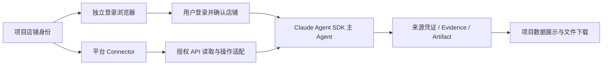

# 店铺配置、独立登录浏览器与 Agent 数据采集

交付范围：店铺身份配置 → 浏览器会话 → 主 Agent 任务 → 来源账本与文件 → 前端展示。
适用于运行后端的 macOS / Linux 桌面。店铺身份由操作者确认；本功能不验证平台实际登录账号。



平台 Connector 承担应用身份、OAuth / API Key / Token 及平台 API 适配；店铺记录保存
平台、外部店铺标识、可选 Connector 关联和浏览器范围。上图中的 API 能力按平台逐项交付，
具体状态见 [平台 Connector 清单](marketplace-connectors.md)：

- 店铺身份配置支持 SHEIN、Temu、TikTok Shop、AliExpress、Shopee、Shopify 及其他平台。
  Shopify 已可在前端选择、创建、显示与编辑，并可选关联同平台 Connector。
- TikTok Shop 已有手动卖家 Token 或卖家授权码/自动刷新、授权店铺与商品分页读取、
  项目授权和主 Agent 来源凭证能力；真实卖家同意与平台商业写入仍待交付。
- Shopify 已有同一 Dev Dashboard 组织内自有店铺的 client credentials grant、店铺/
  商品/近期订单只读接口、项目授权、主 Agent 来源凭证及店铺体检 Skill。这些是已有的
  Connector 能力，本轮补齐的身份选择与配置界面不增加 API 权限或新的平台适配。
  组织外商家授权码与可刷新令牌也已本地实现。真实店铺联调和商业写入仍未验收，
  详见平台清单。
- SHEIN、Temu、AliExpress、Shopee 已有官方文档入口，运行时 API adapter 仍未交付。
  保存这些平台的店铺身份不能证明已接通其 API 或兼容其真实登录流程。

浏览器与 API 分别授权。关联 Connector 不会自动创建 API 店铺授权，也不会把 API
授权转换成浏览器会话授权。浏览器产物记录内部 shop_id、外部 seller_shop_id、platform
和 connector_id，便于追溯；当前数据面板列出浏览器采集，尚未自动合并 API 商品记录。

## 使用

先安装后端已有的可选浏览器依赖和 Chromium；生产窗口保持 Chromium 自身沙箱开启：

```sh
.venv/bin/python -m pip install -e 'backend[browser]'
.venv/bin/python -m playwright install chromium
```

1. 在已保存项目的工作区打开 **Project shops / 项目店铺**，填写显示名称、平台、外部店铺
   标识、卖家后台 HTTPS 地址及需要的登录/CDN 域名。入口不接受凭据、查询参数或片段。
2. 可选关联同平台 Connector，保存后选择 **Open shop login browser / 打开店铺登录浏览器**。
   窗口出现在运行后端的电脑上。远程网页不会把窗口传输到访问者电脑。
3. 用户亲自完成登录、验证码和店铺切换，核对当前窗口属于该店铺；回到工作区勾选确认，
   授权 1、7 或 30 天。检测到可见密码/OTP 输入框或登录路径时拒绝授权和 Agent 采集。
4. **Prepare shop task / 准备店铺任务** 只填入任务草稿。用户提交后，由已有主 Agent 执行。
   读取页面可使用已授权会话；点击、填写、提交和下载报表仍逐次经过原生 SDK 审批。
5. **View collected shop data / 查看已采集店铺数据** 显示最近 50 次采集，提供来源地址、
   采集时间、截图、页面文本和原始报表下载。页面文本也进入项目现有知识检索。

关闭窗口会结束当前会话；重新打开可保留登录状态，但必须重新确认 Agent 授权。编辑身份
前须关闭窗口；更换平台、外部店铺标识、Connector 或入口主机将启用新的浏览器配置目录。
撤销阻止后续 Agent 使用，同时保留用户登录窗口和已采集项目数据。权限冲突后先刷新状态。

### 独立导出与删除登录数据

项目 owner/admin 在关闭店铺窗口后，可选择 **Export saved browser data… / 导出已保存的浏览器数据…**，再次确认后下载未加密 ZIP。文件含该店铺全部历史 `profile-*` 代次中的 Cookie、Local Storage 等 Chromium 文件；不含临时 `session.json` RPC 密钥和 Chromium `Singleton*` 锁。导出逐文件禁止跟随链接并校验读取前后状态，上限为 20,000 个文件、单文件 256 MiB、源文件合计 512 MiB；超限或结构异常会明确失败。浏览器下载副本由用户另行保管或删除。

**Delete saved browser data… / 删除已保存的浏览器数据…** 也需要二次确认、当前店铺 revision 和已关闭的窗口。服务端先撤销会话授权、推进 profile 代次并保存单调删除边界，再删除所有历史 profile 和 `session.json`；中途失败时旧代次不会重新用于新窗口，刷新后可继续清理。店铺身份、已登记的采集证据和项目产物保留。冷备会拒绝旧代次残留；恢复若提供最新停机目录，会比较删除边界并拒绝删除前旧快照。此门禁不清理已有备份、浏览器下载或平台远端登录令牌。两项操作都只对当前项目管理员开放，POST 响应禁止缓存。真实卖家登录后的跨机器恢复尚未认证。

### Shopify 店铺身份

在 **Shop platform / 店铺平台** 选择 **Shopify**，填写店铺识别名称或 ID，以及该店铺的
后台 HTTPS 地址，例如 `https://admin.shopify.com/store/<store>`。按需要添加登录和
资源域名。**Platform Connector / 平台 Connector** 仅列出 Shopify 类型的连接器，也可
选择不关联；切换平台会清空原来的 Connector 选择。

新建保存后店铺仍处于浏览器关闭、Agent 未授权状态。后续需用户主动打开窗口、亲自登录并
确认身份，才可授予浏览器读取权限。若要使用 Shopify API，仍须在已有 Connector 页面
配置应用凭据并单独授予项目店铺访问权限。即使两个店铺共用 `admin.shopify.com`，更换
店铺标识也会换用独立登录配置并撤销旧会话授权；编辑显示名称不会更换登录配置。

## 执行与来源

沿用现有 `ophira_browser` MCP 的两个工具，无新增模型循环或独立业务 Agent：

- `snapshot_page`：`list_shops: true` 分页发现当前项目店铺；`shop_id` 读取当前会话；
  可选 `url` 在该店铺允许的域名中导航。主 Agent 获得 observation_id 和 element_N 引用。
- `act_on_page`：传入 shop_id、最近的 observation_id、作为 selector 的 element_N，
  以及 click/type/submit/download 动作。拒绝猜测 CSS 选择器、过期页面和已变更元素。
  研究子代理不能直接使用这些会写入项目来源的店铺工具。

每店铺最多一个持久 Chromium 进程。私有 Unix socket、随机会话密钥和 OS 文件锁实现
所有权与串行操作；SDK 工具参数不能设置 socket、CDP 地址、Cookie、profile、Run 或 SDK 身份。
后台在队列消费时、操作执行期间、网络检查和保存结果前复验项目成员、运行状态、SDK 会话、
店铺 revision、当前会话及授权到期/撤销。客户端断开或授权变更会取消进行中的操作；
已发出的远端副作用无法回滚。用户在窗口内手动操作仍由用户负责。

截图、页面文本与报表通过同一个真实 Run 归档到 `workspace/shop-captures/`。来源凭证绑定
Run/SDK session、店铺、URL、时间和文件 SHA-256；报表经过字节大小及校验和验证才登记。
报告保留原始文件字节，显示经过清理的下载文件名；不会自动把报告内容转换为销售额等指标。
来源 URL 移除查询与片段；页面文本、文件名和工具输出遵循现有外部不可信数据处理规则。

## 边界与运维

- 每项目最多 100 个店铺；每次最多一个报表，支持 csv/tsv/xlsx/xls/pdf/json/zip，单文件
  20 MiB；报告原件不自动执行或解压。浏览器截图保留当前视口，文本和元素列表有明确上限。
- 每次动作最多 40 秒，下载等待最多 20 秒；临时文件受大小限制，失败时清理，旧临时文件
  在后续操作时清理。未通过 download 操作发起的下载会取消。
- 域名范围与当前组织策略取交集，并复用 DNS 固定连接和私网地址拒绝。弹窗和 Service Worker
  被禁用。依赖这些能力的卖家后台可能需要后续适配；不能因平台出现在身份列表中就宣称
  其真实登录流程已兼容，Shopify 也尚未完成真实登录验收。
- `data/shop-browsers/` 保存私有配置、登录文件和会话元数据，位于项目工作区之外；主 Agent
  与预检的 SDK 沙箱配置显式禁止读写此目录。普通 Read/Grep 继续受现有项目路径门禁约束。
  这是本地宿主边界，尚未完成生产多租户物理隔离和真实 SDK 沙箱攻击认证。
- 浏览器进程持有应用维护租约；即使 API 进程停止，活动窗口仍阻止冷备份。先关闭所有
  店铺窗口再备份。冷备份包含登录文件，须按敏感应用数据保管；跨机器登录恢复未经认证。
- UI 不接收密码或 Cookie。无人提供真实卖家账号时，不能确认当前平台授权、验证码、
  风控兼容性或真实报表格式。后台必须运行在用户能操作其显示器的环境。

## API

所有接口属于 `/api/projects/{project_id}/shops`，响应禁止缓存；可信网关模式沿用项目
身份检查，配置、窗口控制、确认和撤销要求 owner/admin，读取列表/数据要求项目读权限。

| 方法与路径 | 功能 |
| --- | --- |
| GET / POST 基础路径 | 列表 / 创建身份 |
| PUT `/{shop_id}` | 编辑，携带 expected_revision |
| POST `/{shop_id}/open`、`/close`、`/revoke` | 窗口控制或撤销，携带 expected_revision |
| POST `/{shop_id}/login/export`、`/login/delete` | 管理员独立导出或删除本地浏览器登录数据，携带 expected_revision 与对应 confirmation |
| POST `/{shop_id}/grant` | 当前 revision、session_id、confirmed_identity=true 和有效秒数 |
| GET `/{shop_id}/data` | 最近 50 个采集记录及已登记 Artifact 下载链接 |

## 验证

常规后端测试不启动浏览器。以下独立测试使用真实 Chromium、DOM、下载事件、持久 profile
和私有 socket，网络内容全部为合成卖家页面；既不连接平台，也不调用真实模型：

```sh
OPHIRA_SHOP_BROWSER_E2E=1 PYTHONPATH=backend/src .venv/bin/pytest backend/tests/test_shop_browser.py -q
```

覆盖会话隔离/重开、登录墙、报告字节与来源回放、项目隔离、真实元素失效、socket 密钥、
原生 MCP 与 PostToolUse 内容一致性、主 Agent 限制及逐次动作审批。权限取消、成员撤销、
配置 CAS 和生产 HTTP 路由由 `test_shop_browser_access.py` 覆盖；UI 行为由
`ProjectShopsPanel.test.tsx` 覆盖。独立登录数据导出/删除由
`test_shop_browser_login_data.py` 验证管理员权限、二次确认、跨代次清理、失败重试、
残留会话及链接拒绝；可选真实 Chromium 测试验证 profile 导出、删除和重新打开。
真实平台、真实模型和人机登录验收仍待完成。

本轮 Shopify 身份配置验证：

- 前端店铺面板 10 项测试通过，其中新增 5 项覆盖有/无 Connector 的 Shopify 创建、
  平台筛选与切换清空关联、英文和中文界面编辑时保留平台及修订号。
- 后端店铺访问 17 项测试通过，其中 4 项 Shopify 用例覆盖 HTTP 创建、编辑、持久化
  回读、拒绝关联其他平台 Connector，以及共用后台主机时更换店铺标识使旧授权失效。
- 真实浏览器配合临时数据目录中的后端完成身份配置界面验收，范围仅为平台选择、保存、
  编辑与回读。这不等于 Shopify 登录窗口、应用授权、真实 API 或模型任务的端到端验收。
  本轮没有使用真实卖家凭据，也没有因此授予 API 或浏览器 Agent 访问权限。

实现参考：[Playwright 持久浏览器](https://playwright.dev/python/docs/api/class-browsertype#browser-type-launch-persistent-context)、
[下载处理](https://playwright.dev/python/docs/downloads)、
[Claude Code 沙箱文件范围](https://code.claude.com/docs/en/sandboxing#configure-sandboxing)。
