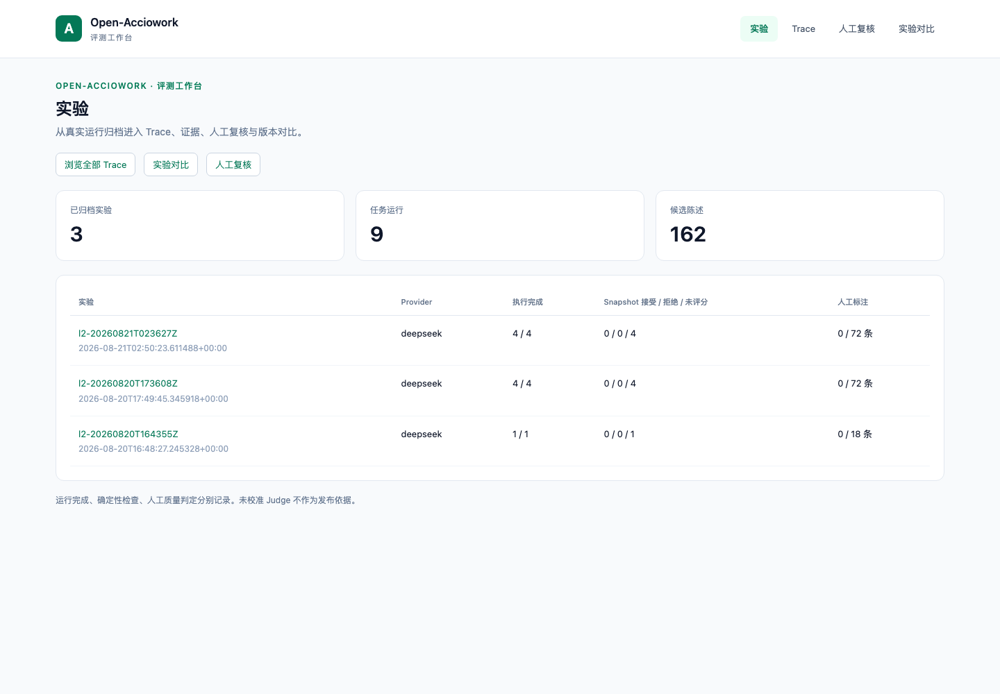

# Open-Acciowork 独立评测工作台

本工作台由 Open-Acciowork 在 `evals/workbench/` 内独立维护，提供历史实验、Trace、
逐陈述人工复核和实验对比。它拥有自己的前后端、依赖、进程和 SQLite 数据库。
[Agent-eval-kit](https://github.com/Janettbella69/Agent-eval-kit) 仅作为历史架构与交互参考，
运行本工作台无需检出、安装或启动该仓库。

工作台仅导入显式选择的报告、运行日志和 Gold 档案副本，不导入产品 Python 包。
新实验执行、Judge 运行和校准尚未接入；浏览历史数据不会调用模型。

## 安装与启动

需要 Python 3.11+、Node.js 20.x 的 20.19+ 或 Node.js 22.12+。在 Open-Acciowork 仓库根目录执行：

```bash
cd evals/workbench
python3.11 -m venv .venv
.venv/bin/python -m pip install -r requirements.txt
PYTHONPATH=backend .venv/bin/python -m acciowork_eval serve
```

后端绑定 `127.0.0.1:8101`。在另一个终端，从仓库根目录启动前端：

```bash
cd evals/workbench/frontend
npm ci
npm run dev
```

打开 **http://127.0.0.1:5201/experiments**。独立导航包括 `/experiments`、`/traces`、
`/review` 和 `/compare`；`/` 进入实验列表。旧 `/acciowork/...` 地址在本应用内重定向，
保留所选实验、查询参数和锚点。

前端开发和构建预览均将 `/api/acciowork` 代理到本工作台后端：

```bash
# 在 frontend/，后端仍需运行
npm run build
npm run preview
```

预览同样使用 `127.0.0.1:5201`，与开发服务择一启动。静态 `dist/` 本身不提供 API；
使用其他本地 Web 服务器时，需要配置 `/api/acciowork` 转发和前端路由回退。
服务仅接受本机请求。

## 数据库与配置

| 配置 | 默认值与用途 |
|---|---|
| 数据库 | `evals/workbench/data/archive.sqlite3`，由代码位置确定，改变启动目录不会改变默认位置 |
| `ACCIOWORK_EVAL_DB` | 覆盖工作台数据库路径；相对路径按调用命令的目录解析 |
| `--db PATH` | CLI 显式数据库，优先于环境变量；必须放在 `serve`、`import` 或 `import-labels` 前 |
| `serve --port` | 后端端口，默认 `8101` |
| `ACCIOWORK_EVAL_API_TARGET` | 启动 Vite 开发或预览服务时覆盖代理目标，默认 `http://127.0.0.1:8101` |

`DB_PATH`、`OPHIRA_DATA_DIR` 不参与本工作台的数据库选择。它不共享产品数据目录、
Agent-eval-kit 的 `eval.db`、虚拟环境或 `node_modules`。

例如，在 `evals/workbench/` 中使用另一个归档库：

```bash
PYTHONPATH=backend .venv/bin/python -m acciowork_eval --db data/review-copy.sqlite3 serve
```

如需从其他目录启动，使用本工作台 Python 和 `backend/` 的绝对路径；无需改变数据库配置。
`data/`、`.venv/`、`frontend/node_modules/` 和构建输出均不提交 Git。

## 显式导入历史归档

以下命令从 `evals/workbench/` 执行，仅将选定输入复制到工作台数据库：

```bash
PYTHONPATH=backend .venv/bin/python -m acciowork_eval import \
  --report ../reports/l2-20260820T164355Z/overall.json \
  --report ../reports/l2-20260820T173608Z/overall.json \
  --report ../reports/l2-20260821T023627Z/overall.json \
  --runs-dir ../../backend/data/runs \
  --samples ../gold/samples/batch-20260821T025243Z.json
```

报告中的任务目录提供结果与可用的 Snapshot；`--runs-dir` 显式提供报告未携带的运行日志。
`--samples` 关联已有候选陈述与其抽样档案。候选陈述不等于人工标签，导入不生成判定。
相同输入重复导入保持幂等。数据库保存来源信息、SHA-256 和原始文件字节；导入后浏览、
下载、复核无需访问输入目录。缺失、损坏、截断日志和异常事件序号会显示在归档来源中。

已有人工标签可显式导入同一个数据库，路径替换为实际 JSONL：

```bash
PYTHONPATH=backend .venv/bin/python -m acciowork_eval import-labels \
  --file /absolute/path/to/existing-human-labels.jsonl
```

先导入对应候选批次。标签必须保留候选的 `item_id`、`run_id`、`judge`、`item`、`source`、
`split` 身份及判定理由、时间；与已保存标签冲突时拒绝覆盖。人工复核页面可按 Judge
导出原 Gold JSONL 字段，供本仓现有校准工具使用。保存与导出不会覆盖 `evals/gold/`。

## 判定语义与历史限制

- 分别显示执行状态、Snapshot 确定性检查和人工质量判定。历史字段缺失保持未知。
- `evidence-coverage` 的 true 表示已覆盖，`unsourced-claims` 的 true 表示有来源或合规，
  `fact-inference-confusion` 的 true 表示存在混淆。界面保留这三种判定方向。
- Gold 由项目负责人本人填写；开放编码与复核笔记单独保存。修改使用 revision 检查，
  并发覆盖会返回冲突，需刷新后重新检查。
- 对比按 Case 展示两侧 Trace、版本条件与 Case 增删。缺少输入、Fixture、评分器、
  profile、schema、模型或 Skill 版本证据时，不宣称严格可比或质量改善。

本次迁入的 9 次历史运行没有当前格式的冻结 `snapshot.json` / `snapshot-eval.json`，
因此显示“未评分”。证据与产物来自当时保存的 Gold 抽样档案，界面保留来源说明，
不读取当前业务账本补造历史评分。

## 迁移记录

误放在 Agent-eval-kit 的本项目代码已迁回本目录，原仓库的相关集成已撤回。
运行数据使用 SQLite 一致性备份迁移；9 张表的结构、行数和内容摘要逐一核对一致：

| 数据 | 迁移时数量 |
|---|---:|
| 历史实验 | 3 |
| 任务运行 | 9 |
| 原始事件 | 133,342 |
| 原始文件副本 | 31 |
| 候选陈述 / 运行关联 | 162 / 162 |
| 人工标签 / Trace 复核 / 复核历史 | 0 / 0 / 0 |

迁移审计 `data/migration-20260910T050917Z.json` 与恢复副本 `data/backups/` 留在本机忽略目录。
这些历史数量不代表模型质量达标；迁移未替负责人填写任何真实标签。
修复范围见[实施记录](../../docs/eval-platform-integration.md)。

## 验证

在 `evals/workbench/` 安装独立开发依赖并运行：

```bash
.venv/bin/python -m pip install -r requirements-dev.txt
.venv/bin/python -m pytest
.venv/bin/python -m ruff check backend tests
.venv/bin/python -m ruff format --check backend tests
```

在 `frontend/` 运行：

```bash
npm test
npm run lint
npm run build
```

后端测试使用临时合成数据库，覆盖归档复制、Gold 语义、并发复核、迁移后脱离源目录读取、
不同 cwd 与数据库配置隔离。前端测试覆盖独立导航、旧链接重定向和 API 请求契约。

本次修复验证：34 项工作台后端测试、9 项前端测试、59 项原有评测工具测试通过，
Ruff、ESLint 和生产构建通过。复核提交只发送可编辑字段，刷新后再次保存不会将
服务端的审计字段一并提交；连续保存及并发冲突均有回归检查。

隔离 Chromium 验收覆盖两个独立入口、真实归档浏览、Trace 搜索与事件定位、复核队列
筛选、实验对比和旧链接重定向。生产构建预览上的复核连续保存、刷新恢复、标签保存与
导出使用临时合成数据库验证，真实数据写入为 0；新工作台无页面异常或失败的本地请求。
这些检查不验证模型质量，未接入的实验执行和 Judge 校准仍保持上述状态。



[移动端视图](screenshots/experiments-mobile.png)
